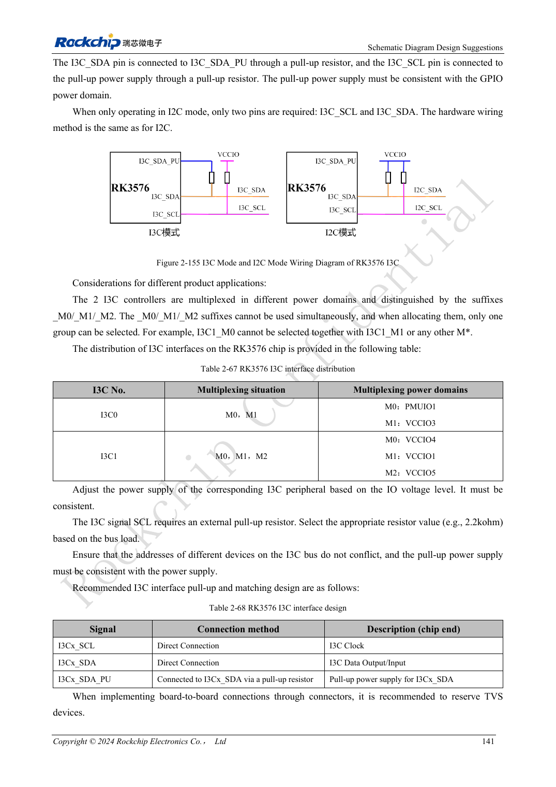
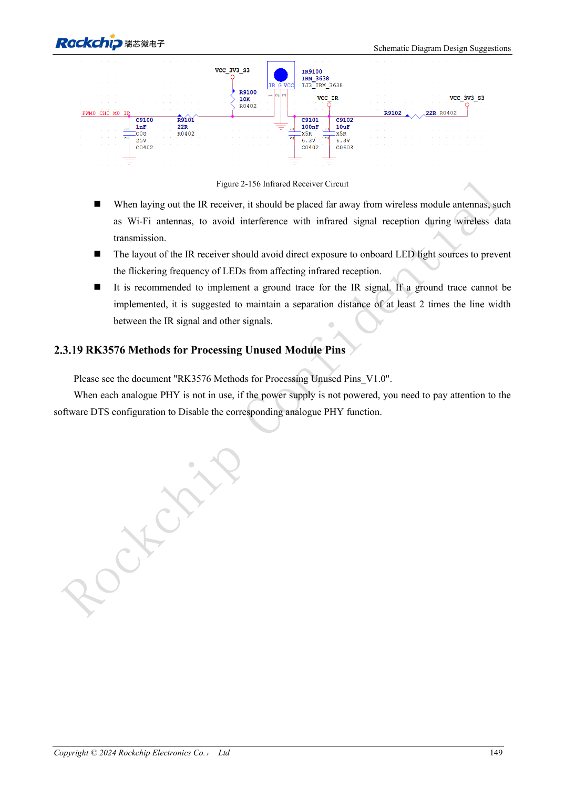

<!-- rk3576-hardware-v11-rest-20261109 -->

# RK3576 control interfaces: UART, I2C/I3C, SPI, CAN and PWM

Based on the Chinese and English RK3576 Hardware Design Guide V1.1 (2024-05-28), for SoC-board design. CM5 carriers must follow the module interface; Sige5 can establish a software/peripheral baseline. This guide does not prescribe one SDK/BSP or kernel for every product; verify each board. Values are source references, not ArmSoM measurements.

**RK3576_Hardware_Design_Guide_V1.1_20240528_EN.pdf** · §2.3.13–2.3.18

## Check mux and physical layers before counting ports

The guide lists 12 UARTs, five general SPI controllers, two CAN FD and two I3C controllers. UART0_M0 is the default debug port; UART0 has no flow control, and other RTS/CTS availability depends on mux. UART is not an RS232/RS485 electrical interface, and CAN TX/RX is not CAN_H/CAN_L. Use appropriate external transceivers and voltage levels.

## I3C and I2C use different pull-up arrangements

Mixed I3C uses SCL, SDA and SDA_PU, with SDA pulled to SDA_PU rather than blindly to a fixed rail. I2C-only operation uses ordinary two-wire pull-ups. The reference 2.2kΩ I2C value still requires rise-time checks against bus capacitance. I2C1 serves the PMIC and should not be reassigned casually. SPI clock, data and selects must use a consistent mux group.

## Control outputs must work through boot and sleep

CAN TX uses a reference external 4.7kΩ pull-up. There are 16 PWM channels, but infrared wake with LOGIC power off is limited to PWM0_CH0/1. Check default outputs, back-power into unpowered peripherals and wake recovery. Industrial validation includes field cables, transceiver termination and protection; controller operation alone is not system immunity validation.

## Design parameters and review table

| Item | Source reference |
| --- | --- |
| UART / SPI | 12 / 5 |
| I3C | 2; 12.5Mbit/s |
| I2C reference | 400kbit/s; 2.2kΩ |
| CAN TX pull-up | 4.7kΩ |
| PWM | 2 + 6 + 8 channels |

## Source figures

The reference pages below contain the relevant circuit or timing figures; click for full resolution. Designators and component values belong to the reference design, not an ArmSoM product schematic.

English original · PDF 160 · 2-155

English original · PDF 168 · 2-156

## ArmSoM development path

CM5 reduces repeated compute-core design on custom carriers; Sige5 provides a starting point for software and peripheral evaluation. Verify exposed interfaces, connector pins, voltages and image support in board documentation rather than inferring them from SoC features.

- [ArmSoM CM5](https://www.armsom.org/cm5) · [CM5 Docs](https://docs.armsom.org/armsom-cm5)
- [ArmSoM Sige5](https://www.armsom.org/sige5) · [Sige5 Docs](https://docs.armsom.org/armsom-sige5)

## Continue reading

- [RK3576 hardware design: 30 topics](/articles/rk3576-hardware-design-series/)
- [RK3576 GPIO and SARADC: voltage domains, back-power and key sensing](/articles/rk3576-gpio-saradc-hardware/)
- [RK3576 FlexBus and DSMC: FPGA, PSRAM and parallel routing](/articles/rk3576-flexbus-dsmc-hardware/)
