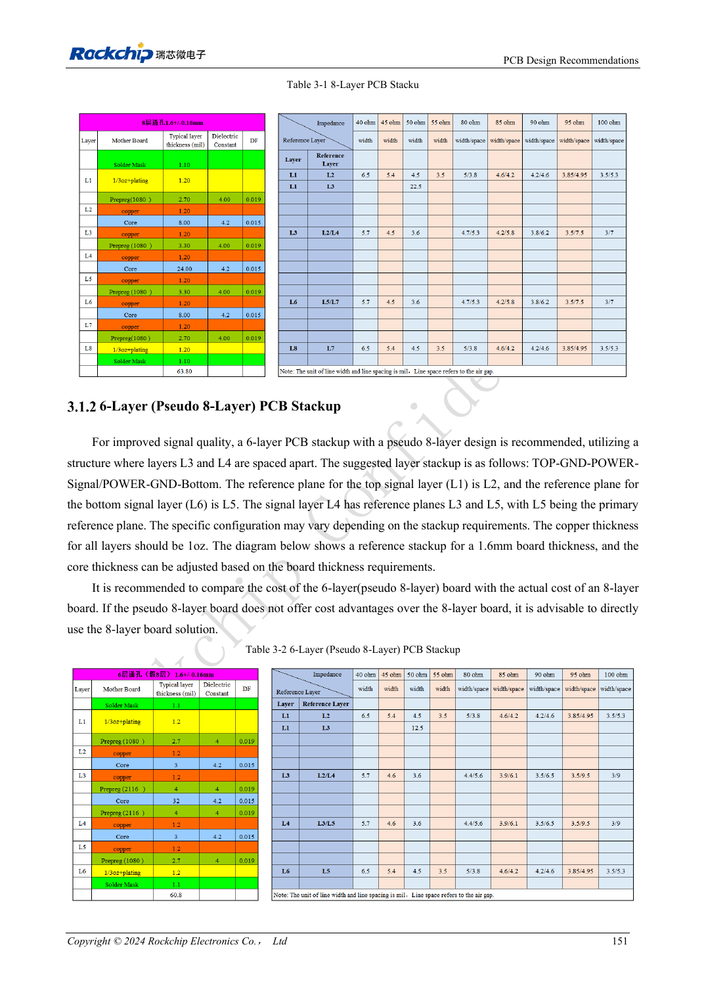
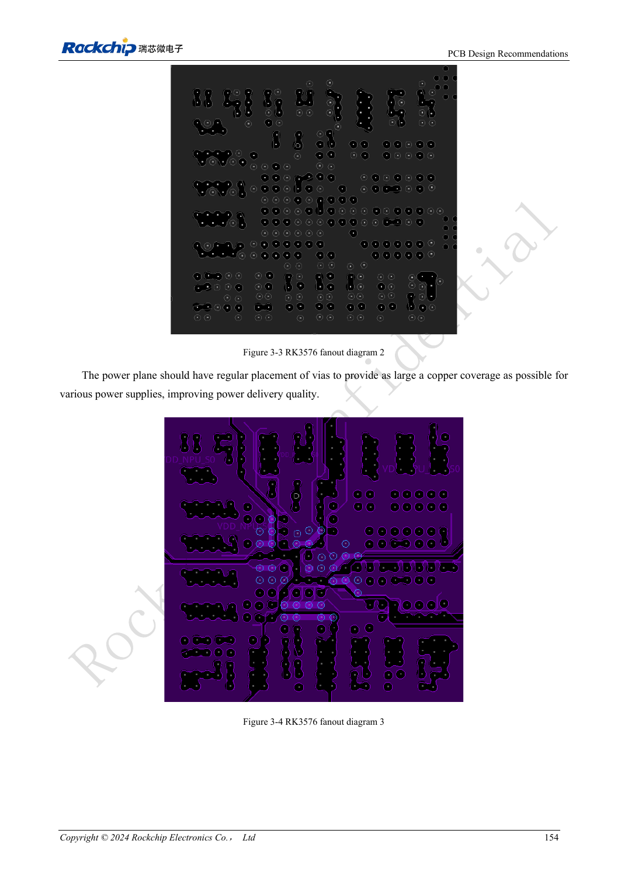

<!-- rk3576-hardware-v11-rest-20261109 -->

# RK3576 PCB stackup and fanout: six/eight layers and mixed-pitch BGA

Based on the Chinese and English RK3576 Hardware Design Guide V1.1 (2024-05-28), for SoC-board design. CM5 carriers must follow the module interface; Sige5 can establish a software/peripheral baseline. This guide does not prescribe one SDK/BSP or kernel for every product; verify each board. Values are source references, not ArmSoM measurements.

**RK3576_Hardware_Design_Guide_V1.1_20240528_EN.pdf** · §3.1–3.2

## Make the stackup satisfy every impedance

The guide provides six-layer, pseudo-eight-layer six-layer and eight-layer references, not one mandatory thickness for all products. Keep dielectric, copper and layer distribution symmetric. Prefer continuous ground adjacent to component layers and ground next to power. Different fabrication materials or thickness change widths/gaps; recalculate inner/outer single-ended and differential impedances rather than copying screenshots.

## Mixed pitch requires local escape routing

RK3576 has 698 balls with 0.55/0.60/0.65mm pitches. Outer two rows and parts of the third can escape locally at a minimum 3.5mil, then quickly transition to impedance-controlled width. Arrange inner vias regularly, leaving channels every 2–4 rows for ground and power continuity. Minimum escape width is not a recommendation for the whole high-speed route.

## Combine fabrication and electrical reviews

The eight-layer reference is TOP-GND-POWER-POWER/SIGNAL-GND-SIGNAL-GND-BOTTOM; 1.6mm and 1oz throughout describe that reference. Compare actual six-layer cost and return-path quality rather than minimizing layer count alone. Before release, confirm drills, solder-mask bridges, copper and impedance with the fabricator and inspect plane necks created by escape vias.

## Design parameters and review table

| Item | Source reference |
| --- | --- |
| BGA | 698 balls |
| Pitch | 0.55 / 0.60 / 0.65mm |
| Local escape width | ≥3.5mil |
| Reference layer count | 6 / 8 layers |
| Reference copper weight | 1oz |

## Source figures

The reference pages below contain the relevant circuit or timing figures; click for full resolution. Designators and component values belong to the reference design, not an ArmSoM product schematic.

English original · PDF 170 · Table 3-1

English original · PDF 173 · 3-3 / 3-4

## ArmSoM development path

CM5 reduces repeated compute-core design on custom carriers; Sige5 provides a starting point for software and peripheral evaluation. Verify exposed interfaces, connector pins, voltages and image support in board documentation rather than inferring them from SoC features.

- [ArmSoM CM5](https://www.armsom.org/cm5) · [CM5 Docs](https://docs.armsom.org/armsom-cm5)
- [ArmSoM Sige5](https://www.armsom.org/sige5) · [Sige5 Docs](https://docs.armsom.org/armsom-sige5)

## Continue reading

- [RK3576 hardware design: 30 topics](/articles/rk3576-hardware-design-series/)
- [RK3576 FlexBus and DSMC: FPGA, PSRAM and parallel routing](/articles/rk3576-flexbus-dsmc-hardware/)
- [RK3576 high-speed interfaces: impedance, return paths, stubs and channel review](/articles/rk3576-high-speed-interface-design/)
