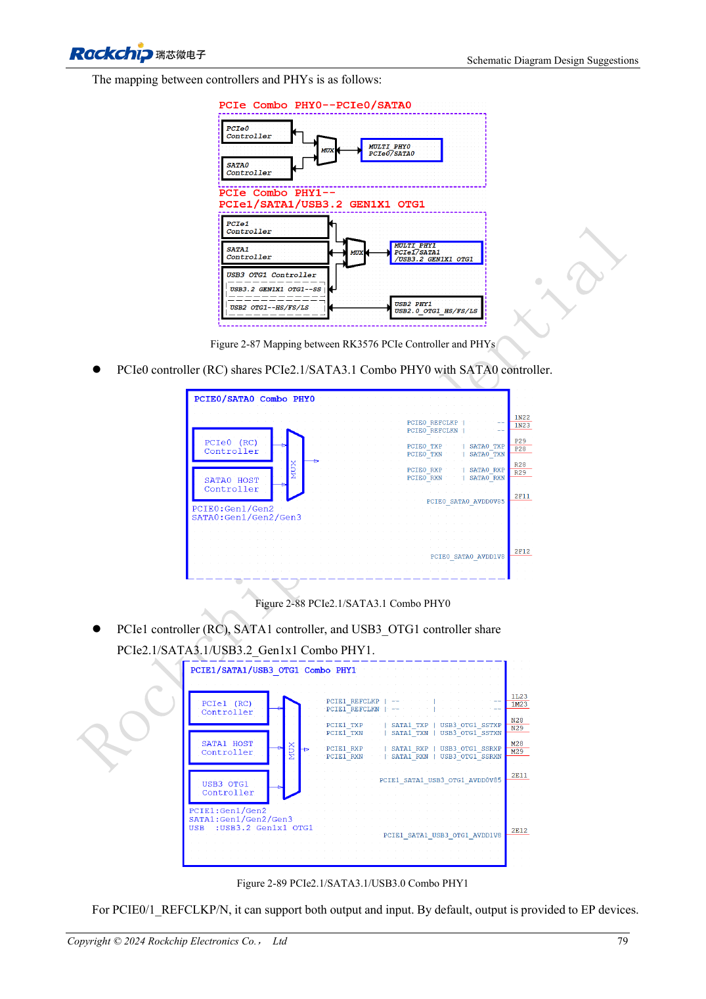
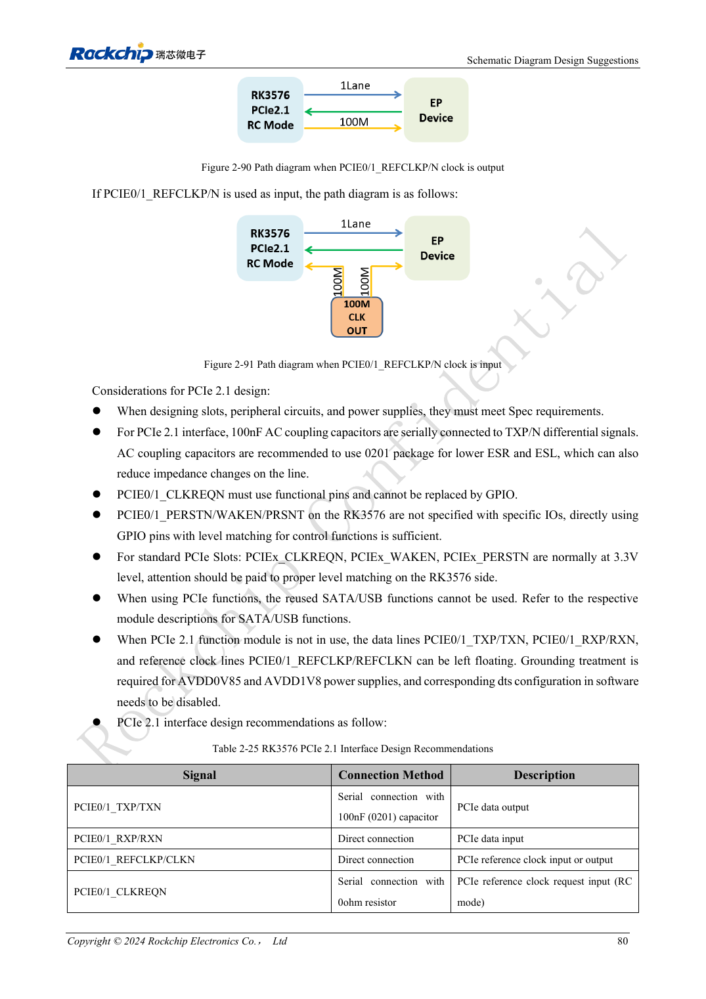

<!-- rk3576-hardware-v11-rest-20261109 -->

# RK3576 PCIe design: root-complex mode, shared PHYs and endpoint power

Based on the Chinese and English RK3576 Hardware Design Guide V1.1 (2024-05-28), for SoC-board design. CM5 carriers must follow the module interface; Sige5 can establish a software/peripheral baseline. This guide does not prescribe one SDK/BSP or kernel for every product; verify each board. Values are source references, not ArmSoM measurements.

**RK3576_Hardware_Design_Guide_V1.1_20240528_EN.pdf** · §2.3.6; PCIe PCB

## Allocate interface resources first

RK3576 provides two PCIe 2.1 x1 root complexes, without endpoint mode. PCIe0 shares Combo PHY0 with SATA0; PCIe1 shares Combo PHY1 with SATA1 and USB3 OTG1. Select the product function before assigning connectors, clocks and device tree. Shared functions cannot be added together as simultaneously available ports.

## Control pins and coupling

Use 100nF on TX, direct RX connections and reference REFCLK wiring with its direction checked. CLKREQN must use the dedicated function, not an ordinary GPIO. PERSTN, WAKEN and PRSNT may use suitable GPIOs according to the guide. Standard slot control signals are 3.3V; check the selected SoC IO domain. Apply unused-PHY power and device-tree treatment only when the entire PHY is unused.

## Enumeration is only the first check

Data pairs use 85Ω and reference clocks 100Ω; do not apply one impedance rule to both. Check endpoint supply, reset release, reference clock and low-power recovery before sustained DMA. Record negotiated width, speed and errors. A single successful enumeration does not establish long-term storage or network stability.

## Design parameters and review table

| Item | Source reference |
| --- | --- |
| Data Zdiff | 85Ω ±10% |
| REFCLK Zdiff | 100Ω ±10% |
| Data intra-pair | <6mil |
| REFCLK intra-pair | <12mil |
| Trace length | <6inch |
| TX AC | 100nF ±20% |

## Source figures

The reference pages below contain the relevant circuit or timing figures; click for full resolution. Designators and component values belong to the reference design, not an ArmSoM product schematic.

English original · PDF 98 · 2-87

English original · PDF 99 · 2-90

## ArmSoM development path

CM5 reduces repeated compute-core design on custom carriers; Sige5 provides a starting point for software and peripheral evaluation. Verify exposed interfaces, connector pins, voltages and image support in board documentation rather than inferring them from SoC features.

- [ArmSoM CM5](https://www.armsom.org/cm5) · [CM5 Docs](https://docs.armsom.org/armsom-cm5)
- [ArmSoM Sige5](https://www.armsom.org/sige5) · [Sige5 Docs](https://docs.armsom.org/armsom-sige5)

## Continue reading

- [RK3576 hardware design: 30 topics](/articles/rk3576-hardware-design-series/)
- [RK3576 SD cards and SDIO Wi-Fi: voltage switching, power and RF layout](/articles/rk3576-sdio-wifi-hardware/)
- [RK3576 SATA hardware: PHY sharing, coupling and drive power](/articles/rk3576-sata-hardware-design/)
