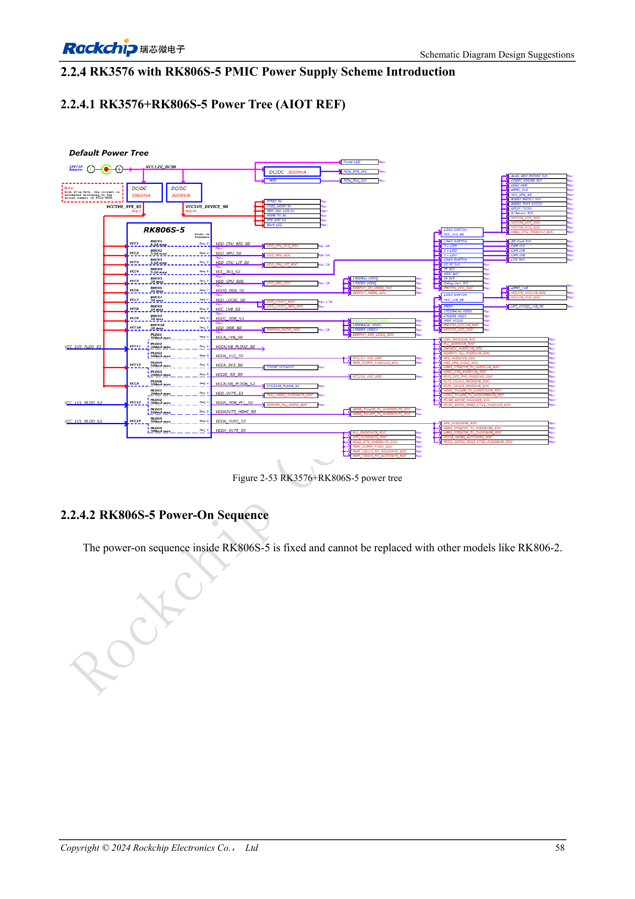

<!-- rk3576-hardware-v11-deep-20261109 -->

# RK3576 rails and decoupling: CPU, GPU, NPU and LOGIC supply planning

Review rail voltage, transient current, decoupling placement and standby state together. The following values come from the reference design or vendor examples; they are neither CM5 input specifications nor ArmSoM power measurements.

Based on the Chinese and English RK3576 Hardware Design Guide V1.1 (2024-05-28), for SoC-board design. CM5 carriers must follow the module interface; Sige5 can establish a software/peripheral baseline. This guide does not prescribe one SDK/BSP or kernel for every product; verify each board. Values are source references, not ArmSoM measurements.

**RK3576_Hardware_Design_Guide_V1.1_20240528_EN.pdf** · §2.2.1–2.2.4

## Do not disable rails merely from the application name

NPU power is required at initial startup even without an AI workload; the guide permits conditional GPU shutdown. Boot media determine required IO rails: eMMC/FSPI0 use VCCIO0, SDMMC0/FSPI1_M0 use VCCIO1, FSPI1_M1 uses VCCIO3, and UFS also requires VCCIO7, oscillator and PHY supplies. PMUIO0/1 are mandatory. Other rails can be disabled only with complete sequencing, wake and peripheral requirements satisfied.

## Capacitors must serve the load

Total big-core capacitance must exceed 130μF and little-core capacitance 88μF. GPU main decoupling exceeds 66μF, NPU 90μF and LOGIC total 88μF. Distinguish PMIC output capacitance from near-SoC decoupling; do not place the entire capacitance beside the regulator. Evaluate DC-bias derating, loops, transients and probing. LOGIC_MEM normally shares LOGIC; separate power also needs DVFS software review.

## Do not sum module peaks into board power

Vendor table 2-19 records separate extreme module workloads at 25°C on a bare board without a heatsink after 15 minutes of stable operation. Its entries are not a simultaneous whole-board workload. Add measurements of the actual concurrent workload, distinguishing peak current, sustained current and input power.

## Design parameters and review table

| Item | Value or net | Review note |
| --- | --- | --- |
| Big CPU | BUCK1; >4A; >130μF | Default reference voltage 0.85V |
| Little CPU | BUCK3; >2A; >88μF | Total decoupling |
| Graphics | BUCK5; 3A; >66μF | Main decoupling near SoC |
| NPU | BUCK2; >4A; >90μF | Do not omit startup power when AI is unused |
| Logic | BUCK7; >2A; >88μF | Keep LOGIC_MEM sharing consistent |

## Reference circuits and figures

The reference pages below contain the relevant circuit or timing figures; click for full resolution. Designators and component values belong to the reference design, not an ArmSoM product schematic.

English original · PDF 77 · 2-53

## ArmSoM products and development path

CM5 brings integrated computing to a custom carrier; Sige5 supports initial Linux and peripheral evaluation. SoC interface capability does not mean both products expose it. Check connectors, board revision and system image before purchasing or layout.

- [ArmSoM CM5](https://www.armsom.org/cm5) · [CM5 Docs](https://docs.armsom.org/armsom-cm5)
- [ArmSoM Sige5](https://www.armsom.org/sige5) · [Sige5 Docs](https://docs.armsom.org/armsom-sige5)

## Series reading order

- [RK3576 hardware design series: from minimum system to DDR and USB](/articles/rk3576-hardware-design-series/)
- [RK3576 minimum system: from schematic review to repeatable first boot](/articles/rk3576-hardware-bringup/)
- [RK3576 clock design: 24MHz crystal, 32kHz standby and peripheral clocks](/articles/rk3576-clock-circuit-design/)
- [RK3576 reset design: NPOR, RK806S-5, watchdog and thermal shutdown](/articles/rk3576-reset-watchdog-design/)
- [RK3576 boot and debug design: straps, Maskrom, UART and JTAG](/articles/rk3576-boot-debug-design/)
- [RK3576 and RK806S-5: PMIC selection, control pins and feedback](/articles/rk3576-rk806s5-pmic-design/)
- [RK3576 power sequencing and standby: reset, retained rails and wake paths](/articles/rk3576-power-sequencing-standby/)
- [RK3576 DDR circuits and power: LPDDR4, LPDDR4X and LPDDR5](/articles/rk3576-ddr-circuit-power/)
- [RK3576 DDR PCB routing: impedance, length, return paths and PDN](/articles/rk3576-ddr-pcb-routing/)
- [RK3576 USB and Type-C hardware supplement: multiplexing, recovery and protection](/articles/168-rockchip-rk3576-usb/)
