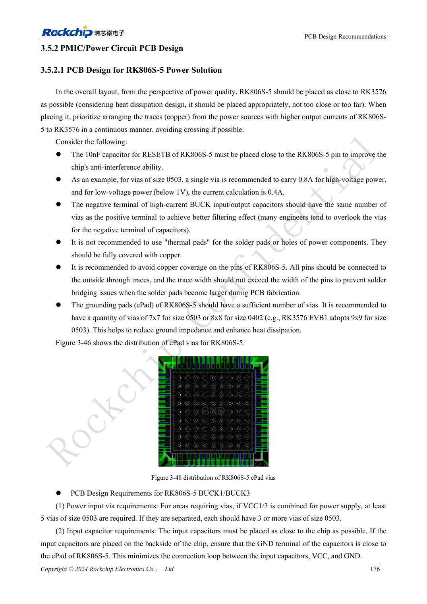
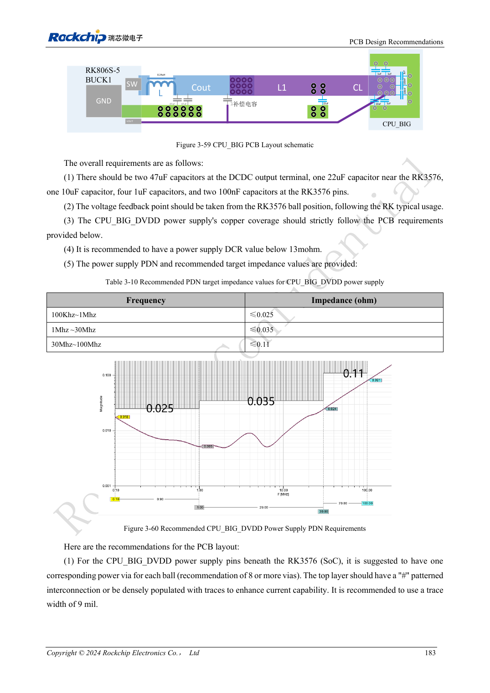

<!-- rk3576-hardware-v11-rest-20261109 -->

# RK3576 power PCB and PDN: RK806S-5, feedback and high-current loops

Based on the Chinese and English RK3576 Hardware Design Guide V1.1 (2024-05-28), for SoC-board design. CM5 carriers must follow the module interface; Sige5 can establish a software/peripheral baseline. This guide does not prescribe one SDK/BSP or kernel for every product; verify each board. Values are source references, not ArmSoM measurements.

**RK3576_Hardware_Design_Guide_V1.1_20240528_EN.pdf** · §3.5.2

## Start with input and ground loops

Place RK806S-5 so high-current BUCK paths to the SoC remain direct. Input capacitors belong close to the chip with adequate vias on both terminals; adding positive-side vias alone does not create a low-impedance loop. The ePad reference requires at least 7×7 of 0503 or 8×8 of 0402 vias, and RESETB 10nF close to the PMIC. Confirm actual hole construction and current capacity with fabrication.

## Do not mix feedback topologies

Local, conventional remote and PCB-inductance-based remote feedback require different capacitor placement and compensation. The latter moves the main capacitor toward the load; it does not authorize deleting converter capacitors without redesign. CPU_BIG retains conventional remote feedback with recommended DCR below 13mΩ; CPU_LIT below 20mΩ. Review each rail against its own template, not an NPU topology copied to every BUCK.

## Validate PDN under transient load

CPU_BIG reference impedance targets are 0.025/0.035/0.11Ω by frequency band below, not ArmSoM measurements. Inspect copper necks, via drops, capacitor return paths and load steps. Measure near the load and record probe method, bandwidth and workload; steady-state voltage at the PMIC is insufficient.

## Design parameters and review table

| Item | Source reference |
| --- | --- |
| CPU_BIG DCR | <13mΩ |
| CPU_LIT DCR | <20mΩ |
| CPU_BIG 100kHz–1MHz | ≤0.025Ω |
| CPU_BIG 1–30MHz | ≤0.035Ω |
| CPU_BIG 30–100MHz | ≤0.11Ω |

## Source figures

The reference pages below contain the relevant circuit or timing figures; click for full resolution. Designators and component values belong to the reference design, not an ArmSoM product schematic.

English original · PDF 195 · 3-48

English original · PDF 202 · 3-59

## ArmSoM development path

CM5 reduces repeated compute-core design on custom carriers; Sige5 provides a starting point for software and peripheral evaluation. Verify exposed interfaces, connector pins, voltages and image support in board documentation rather than inferring them from SoC features.

- [ArmSoM CM5](https://www.armsom.org/cm5) · [CM5 Docs](https://docs.armsom.org/armsom-cm5)
- [ArmSoM Sige5](https://www.armsom.org/sige5) · [Sige5 Docs](https://docs.armsom.org/armsom-sige5)

## Continue reading

- [RK3576 hardware design: 30 topics](/articles/rk3576-hardware-design-series/)
- [RK3576 high-speed interfaces: impedance, return paths, stubs and channel review](/articles/rk3576-high-speed-interface-design/)
- [RK3576 thermal design: thermal resistance, PCB conduction and sustained loads](/articles/rk3576-thermal-hardware-design/)
