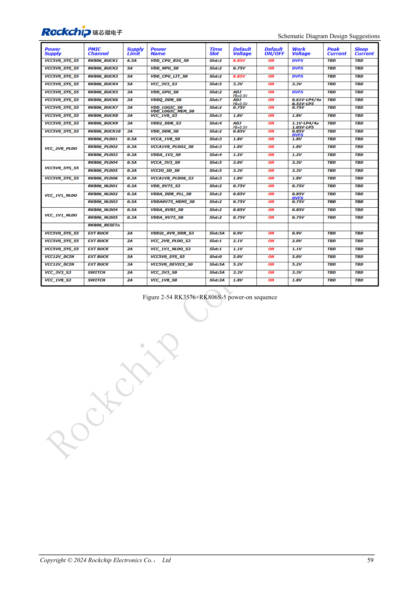
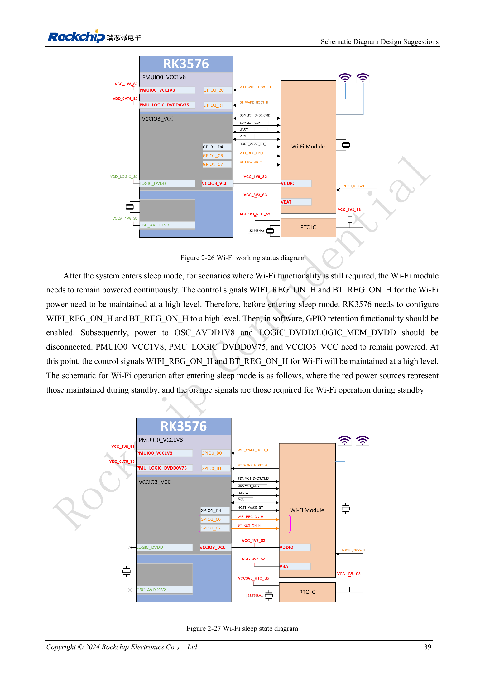

<!-- rk3576-hardware-v11-deep-20261109 -->

# RK3576 power sequencing and standby: reset, retained rails and wake paths

“Lower voltage first” cannot replace individual PHY requirements. Map each rail dependency, then review cold start, shutdown and every standby/wake configuration separately.

Based on the Chinese and English RK3576 Hardware Design Guide V1.1 (2024-05-28), for SoC-board design. CM5 carriers must follow the module interface; Sige5 can establish a software/peripheral baseline. This guide does not prescribe one SDK/BSP or kernel for every product; verify each board. Values are source references, not ArmSoM measurements.

**RK3576_Hardware_Design_Guide_V1.1_20240528_EN.pdf** · §2.2.1; §2.2.4

## Sequence exceptions and reset release

DDRPHY follows DVDD→CKE_VDDQ→VDDQ/CK_VDDQ; USB2 follows 0.75→1.8→3.3V, UFS and USB3/DP 0.85→1.8V. MIPIDCPHY has a special low-voltage→1.8→1.2V sequence, not numerical ascending order. Release RESET_L at least 1ms after the last rail stabilizes. The guide suggests a practical 5–200ms delay, subject to external device requirements.

## Retained rails depend on the wake source

Minimum standby retains DDRPHY_CKE_VDDQ, PMU_LOGIC_DVDD0V75, PMUIO0_VCC1V8 and PMUIO1_VCC, primarily using PMUIO interrupt wake. USB HID wake also requires oscillator and USB2 PHY supplies. Interrupts through VCCIO0–7 need the corresponding IO, LOGIC and LOGIC_MEM. The minimum rail list cannot be applied to every product.

## GPIO retention and shutdown tests

The Wi-Fi example first drives WIFI_REG_ON_H/BT_REG_ON_H high and enables GPIO retention before removing relevant main logic/oscillator supplies, while retaining peripheral power and IO. It does not prove an arbitrary BSP implements this. Assert RESET_L before shutdown. Keep the GPIO3.3V–PMUIO0_1.8V and USB3.3V–USB1.8V differences within the guide’s 2V limits. Check back-powering from peripherals that remain powered.

## Design parameters and review table

| Item | Value or net | Review note |
| --- | --- | --- |
| Final rail to reset | ≥1ms | Practical reference 5–200ms |
| First shutdown step | RESET_L = LOW | Then remove rails per domain rules |
| PMIC sequence | RK806S-5 | Fixed configuration; not RK806-2 |

## Reference circuits and figures

The reference pages below contain the relevant circuit or timing figures; click for full resolution. Designators and component values belong to the reference design, not an ArmSoM product schematic.

English original · PDF 78 · 2-54

English original · PDF 58 · 2-26 / 2-27

## ArmSoM products and development path

CM5 brings integrated computing to a custom carrier; Sige5 supports initial Linux and peripheral evaluation. SoC interface capability does not mean both products expose it. Check connectors, board revision and system image before purchasing or layout.

- [ArmSoM CM5](https://www.armsom.org/cm5) · [CM5 Docs](https://docs.armsom.org/armsom-cm5)
- [ArmSoM Sige5](https://www.armsom.org/sige5) · [Sige5 Docs](https://docs.armsom.org/armsom-sige5)

## Series reading order

- [RK3576 hardware design series: from minimum system to DDR and USB](/articles/rk3576-hardware-design-series/)
- [RK3576 minimum system: from schematic review to repeatable first boot](/articles/rk3576-hardware-bringup/)
- [RK3576 clock design: 24MHz crystal, 32kHz standby and peripheral clocks](/articles/rk3576-clock-circuit-design/)
- [RK3576 reset design: NPOR, RK806S-5, watchdog and thermal shutdown](/articles/rk3576-reset-watchdog-design/)
- [RK3576 boot and debug design: straps, Maskrom, UART and JTAG](/articles/rk3576-boot-debug-design/)
- [RK3576 rails and decoupling: CPU, GPU, NPU and LOGIC supply planning](/articles/rk3576-power-domain-design/)
- [RK3576 and RK806S-5: PMIC selection, control pins and feedback](/articles/rk3576-rk806s5-pmic-design/)
- [RK3576 DDR circuits and power: LPDDR4, LPDDR4X and LPDDR5](/articles/rk3576-ddr-circuit-power/)
- [RK3576 DDR PCB routing: impedance, length, return paths and PDN](/articles/rk3576-ddr-pcb-routing/)
- [RK3576 USB and Type-C hardware supplement: multiplexing, recovery and protection](/articles/168-rockchip-rk3576-usb/)
