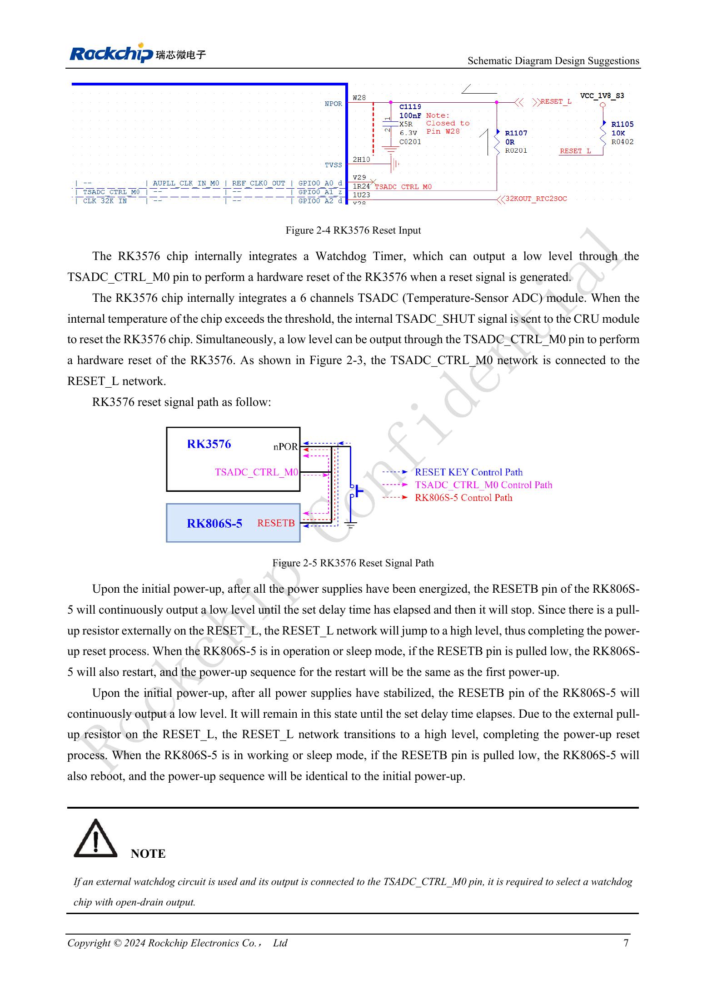

<!-- rk3576-hardware-v11-deep-20261109 -->

# RK3576 reset design: NPOR, RK806S-5, watchdog and thermal shutdown

The reset net connects the SoC, PMIC, watchdog and temperature protection. Review direction, voltage domain, low-pulse duration and total net capacitance rather than merely adding a reset button.

Based on the Chinese and English RK3576 Hardware Design Guide V1.1 (2024-05-28), for SoC-board design. CM5 carriers must follow the module interface; Sige5 can establish a software/peripheral baseline. This guide does not prescribe one SDK/BSP or kernel for every product; verify each board. Values are source references, not ArmSoM measurements.

**RK3576_Hardware_Design_Guide_V1.1_20240528_EN.pdf** · §2.1.2; §2.2.3

## NPOR timing

NPOR (Pin W28) is active low. The source specifies at least 100 cycles of 24MHz, while also stating “at least 4μs”. Since 100/24MHz≈4.167μs, retain the 100-cycle requirement; 4μs is approximate and an exact 4.000μs pulse does not provide 100 cycles. The ≥1ms interval from final rail stabilization to RESET_L release is a separate startup requirement.

## RESETB changes its role

At initial power-up RK806S-5 holds RESETB low, then releases it after the rails and delay are valid; an external pull-up raises the net. Pulling RESETB low during operation or sleep restarts the PMIC and repeats sequencing. Pull RESET_L up to PMUIO0_VCC1V8. The reference uses 100nF on the reset net, but the PMIC requires total capacitance ≤0.3μF; do not accumulate capacitors on every branch.

## Watchdog and thermal protection

TSADC1 has six channels. At a configured threshold it can signal CRU through internal TSADC_SHUT and drive TSADC_CTRL_M0 low. An external watchdog connected to that net must have an open-drain output to avoid contention. Observe reset, rail restart and UART logs together; check BSP thresholds, watchdog routing and recovery policy. No unverified universal temperature threshold is supplied.

## Design parameters and review table

| Item | Value or net | Review note |
| --- | --- | --- |
| External reset | NPOR / W28 | Active low; at least 100×24MHz periods |
| Pull-up rail | PMUIO0_VCC1V8 | Do not arbitrarily use 3.3V |
| Total net capacitance | ≤0.3μF | Include SoC, PMIC and external reset branches |

## Reference circuits and figures

The reference pages below contain the relevant circuit or timing figures; click for full resolution. Designators and component values belong to the reference design, not an ArmSoM product schematic.

English original · PDF 26 · 2-4

## ArmSoM products and development path

CM5 brings integrated computing to a custom carrier; Sige5 supports initial Linux and peripheral evaluation. SoC interface capability does not mean both products expose it. Check connectors, board revision and system image before purchasing or layout.

- [ArmSoM CM5](https://www.armsom.org/cm5) · [CM5 Docs](https://docs.armsom.org/armsom-cm5)
- [ArmSoM Sige5](https://www.armsom.org/sige5) · [Sige5 Docs](https://docs.armsom.org/armsom-sige5)

## Series reading order

- [RK3576 hardware design series: from minimum system to DDR and USB](/articles/rk3576-hardware-design-series/)
- [RK3576 minimum system: from schematic review to repeatable first boot](/articles/rk3576-hardware-bringup/)
- [RK3576 clock design: 24MHz crystal, 32kHz standby and peripheral clocks](/articles/rk3576-clock-circuit-design/)
- [RK3576 boot and debug design: straps, Maskrom, UART and JTAG](/articles/rk3576-boot-debug-design/)
- [RK3576 rails and decoupling: CPU, GPU, NPU and LOGIC supply planning](/articles/rk3576-power-domain-design/)
- [RK3576 and RK806S-5: PMIC selection, control pins and feedback](/articles/rk3576-rk806s5-pmic-design/)
- [RK3576 power sequencing and standby: reset, retained rails and wake paths](/articles/rk3576-power-sequencing-standby/)
- [RK3576 DDR circuits and power: LPDDR4, LPDDR4X and LPDDR5](/articles/rk3576-ddr-circuit-power/)
- [RK3576 DDR PCB routing: impedance, length, return paths and PDN](/articles/rk3576-ddr-pcb-routing/)
- [RK3576 USB and Type-C hardware supplement: multiplexing, recovery and protection](/articles/168-rockchip-rk3576-usb/)
