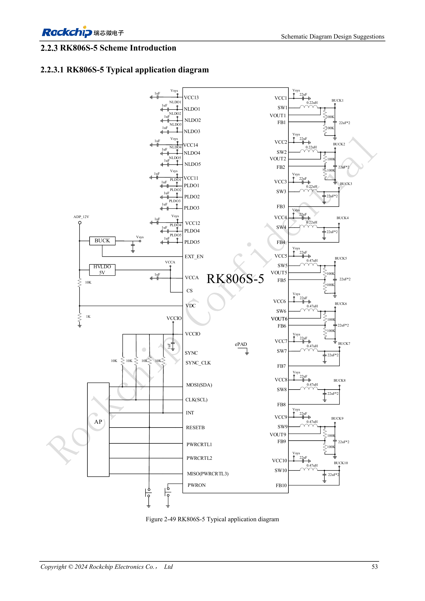
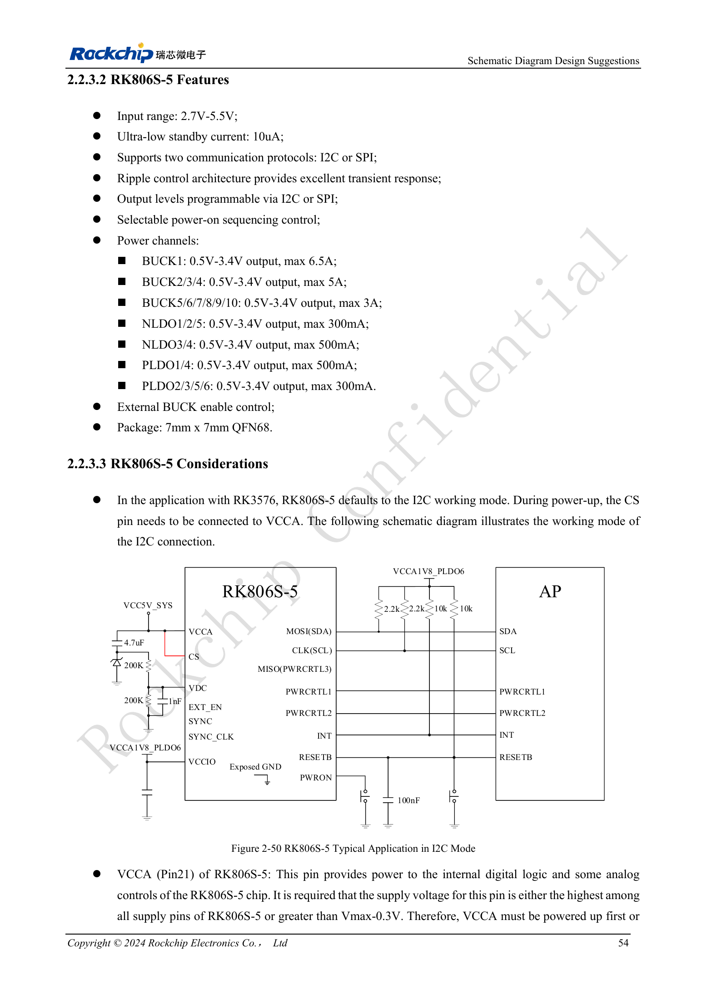

<!-- rk3576-hardware-v11-deep-20261109 -->

# RK3576 and RK806S-5: PMIC selection, control pins and feedback

The same package does not guarantee the same startup behavior. RK806S-5 has fixed sequencing for RK3576 and cannot simply be replaced by RK806-2. Confirm the exact part, OTP configuration and reference circuit before reviewing external components.

Based on the Chinese and English RK3576 Hardware Design Guide V1.1 (2024-05-28), for SoC-board design. CM5 carriers must follow the module interface; Sige5 can establish a software/peripheral baseline. This guide does not prescribe one SDK/BSP or kernel for every product; verify each board. Values are source references, not ArmSoM measurements.

**RK3576_Hardware_Design_Guide_V1.1_20240528_EN.pdf** · §2.2.3–2.2.4

## Communication and input rails

The reference uses I2C with CS connected to VCCA at startup. VCCA (Pin21) must be the highest supply, or above Vmax−0.3V, and rise before or with the other inputs. PLDO6 supplies communication IO and must match the AP domain. The PMIC input range of 2.7–5.5V does not replace startup conditions: the VDC description also requires VCCA/VCC1/VCC2 above 3.0V.

## Power control and reset belong together

VDC threshold is 0.8V; the design recommendation is above 1V and no higher than VCCA. Holding it high may prevent normal shutdown; validate the source RC auto-start circuit. PWRON has about 45kΩ internal pull-up, defaults to 20ms low for startup and 6s for forced shutdown, configurable to 6/8/10/12s. After EXT_EN rises, VCCA/VCC1/VCC2 must exceed 3V within 100ms. Keep RESETB total capacitance ≤0.3μF.

## Feedback and an unresolved source discrepancy

FB versus VOUT selection depends on the specific BUCK and OTP; do not reconnect all channels uniformly. The external-divider example is Vout=(R1/R2+1)×0.5V, with resistors from 10kΩ to 1MΩ. Figure 2-49 shows 0.22μH for BUCK1–4 while the prose says 0.24μH. Both are retained here; resolve selection using the current reference BOM, PMIC specification and vendor confirmation. COT feedback requires joint layout and ripple review.

## Design parameters and review table

| Item | Value or net | Review note |
| --- | --- | --- |
| Input/package | 2.7–5.5V; QFN68 7×7mm | Chip specification, not board input |
| BUCK ratings | 1:6.5A; 2–4:5A; 5–10:3A | Maximum rating is not sustained design load |
| Default interface | I2C / CS→VCCA | Match OTP, AP levels and startup configuration |

## Reference circuits and figures

The reference pages below contain the relevant circuit or timing figures; click for full resolution. Designators and component values belong to the reference design, not an ArmSoM product schematic.

English original · PDF 72 · 2-49

English original · PDF 73 · 2-50

## ArmSoM products and development path

CM5 brings integrated computing to a custom carrier; Sige5 supports initial Linux and peripheral evaluation. SoC interface capability does not mean both products expose it. Check connectors, board revision and system image before purchasing or layout.

- [ArmSoM CM5](https://www.armsom.org/cm5) · [CM5 Docs](https://docs.armsom.org/armsom-cm5)
- [ArmSoM Sige5](https://www.armsom.org/sige5) · [Sige5 Docs](https://docs.armsom.org/armsom-sige5)

## Series reading order

- [RK3576 hardware design series: from minimum system to DDR and USB](/articles/rk3576-hardware-design-series/)
- [RK3576 minimum system: from schematic review to repeatable first boot](/articles/rk3576-hardware-bringup/)
- [RK3576 clock design: 24MHz crystal, 32kHz standby and peripheral clocks](/articles/rk3576-clock-circuit-design/)
- [RK3576 reset design: NPOR, RK806S-5, watchdog and thermal shutdown](/articles/rk3576-reset-watchdog-design/)
- [RK3576 boot and debug design: straps, Maskrom, UART and JTAG](/articles/rk3576-boot-debug-design/)
- [RK3576 rails and decoupling: CPU, GPU, NPU and LOGIC supply planning](/articles/rk3576-power-domain-design/)
- [RK3576 power sequencing and standby: reset, retained rails and wake paths](/articles/rk3576-power-sequencing-standby/)
- [RK3576 DDR circuits and power: LPDDR4, LPDDR4X and LPDDR5](/articles/rk3576-ddr-circuit-power/)
- [RK3576 DDR PCB routing: impedance, length, return paths and PDN](/articles/rk3576-ddr-pcb-routing/)
- [RK3576 USB and Type-C hardware supplement: multiplexing, recovery and protection](/articles/168-rockchip-rk3576-usb/)
