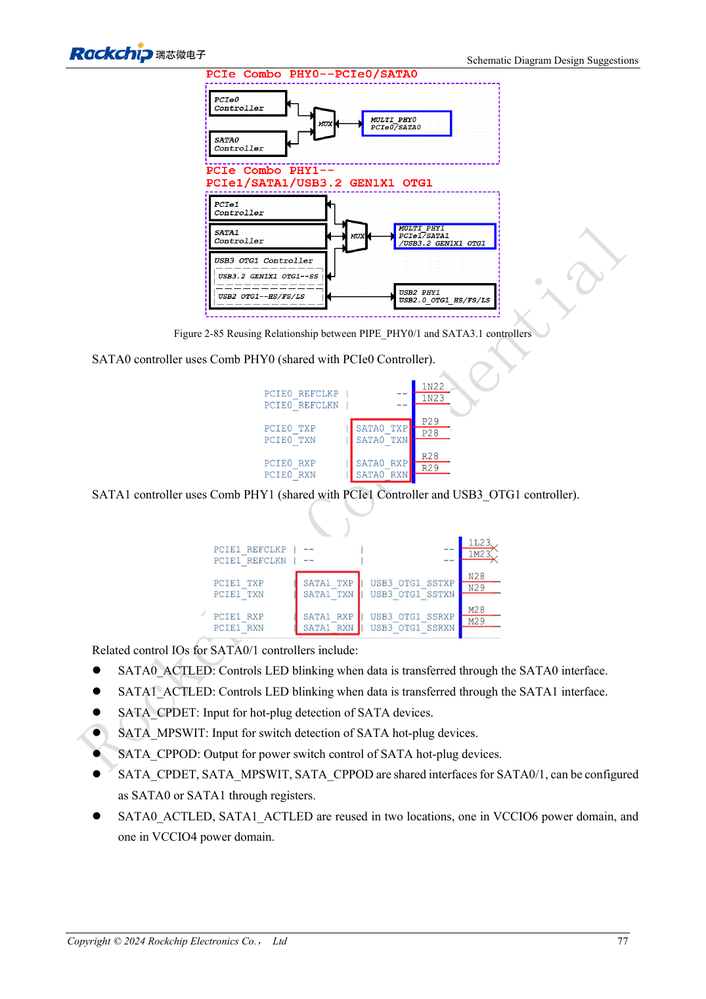
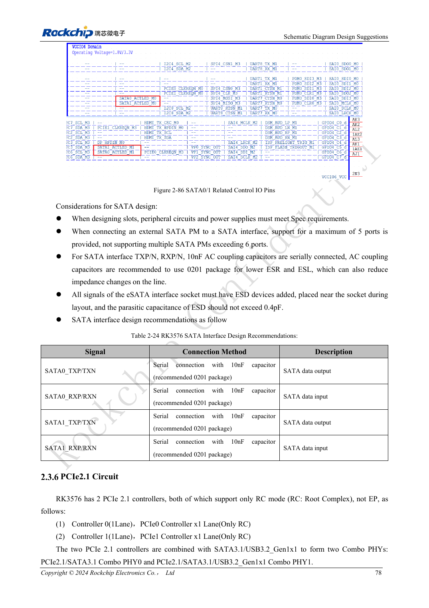

<!-- rk3576-hardware-v11-rest-20261109 -->

# RK3576 SATA hardware: PHY sharing, coupling and drive power

Based on the Chinese and English RK3576 Hardware Design Guide V1.1 (2024-05-28), for SoC-board design. CM5 carriers must follow the module interface; Sige5 can establish a software/peripheral baseline. This guide does not prescribe one SDK/BSP or kernel for every product; verify each board. Values are source references, not ArmSoM measurements.

**RK3576_Hardware_Design_Guide_V1.1_20240528_EN.pdf** · §2.3.5; SATA PCB

## A SATA controller is not a complete drive connection

Two SATA 3.1 controllers support 1.5/3/6Gbps. The guide lists port-multiplier support for up to five devices, subject to software, device and bandwidth validation. SATA0 shares PHY0 with PCIe0; SATA1 shares PHY1 with PCIe1/USB3 OTG1. Drive power, spin-up current and connectors are separate from SATA signalling.

## Do not copy PCIe RX wiring

The SATA reference uses 10nF coupling on both TX and RX, preferably 0201. eSATA protection capacitance is at most 0.4pF. CPDET/MPSWIT/CPPOD are selectable shared controls, not two independent sets for both ports. Check ACTLED IO voltage and external drive circuitry.

## Include cables and worst-case supply conditions

Prefer 100Ω differential routing. Where stackup prevents this, the guide gives a conditional floor of 90Ω±10%; evaluate the whole cable/receiver path. Preserve ground, limit vias and place protection near connectors. Test cold boot, concurrent drives, sustained writes and recovery while measuring spin-up supply droop.

## Design parameters and review table

| Item | Source reference |
| --- | --- |
| Rate | 1.5 / 3 / 6Gbps |
| TX + RX AC | 10nF |
| Intra-pair mismatch | <6mil |
| Trace length | <6inch |
| Airgap | ≥4W |
| Recommended via count | ≤2 |

## Source figures

The reference pages below contain the relevant circuit or timing figures; click for full resolution. Designators and component values belong to the reference design, not an ArmSoM product schematic.

English original · PDF 96 · 2-85

English original · PDF 97 · 2-86

## ArmSoM development path

CM5 reduces repeated compute-core design on custom carriers; Sige5 provides a starting point for software and peripheral evaluation. Verify exposed interfaces, connector pins, voltages and image support in board documentation rather than inferring them from SoC features.

- [ArmSoM CM5](https://www.armsom.org/cm5) · [CM5 Docs](https://docs.armsom.org/armsom-cm5)
- [ArmSoM Sige5](https://www.armsom.org/sige5) · [Sige5 Docs](https://docs.armsom.org/armsom-sige5)

## Continue reading

- [RK3576 hardware design: 30 topics](/articles/rk3576-hardware-design-series/)
- [RK3576 PCIe design: root-complex mode, shared PHYs and endpoint power](/articles/rk3576-pcie-hardware-design/)
- [RK3576 camera hardware: CSI grouping, DCPHY modes and power sequencing](/articles/rk3576-camera-hardware-design/)
