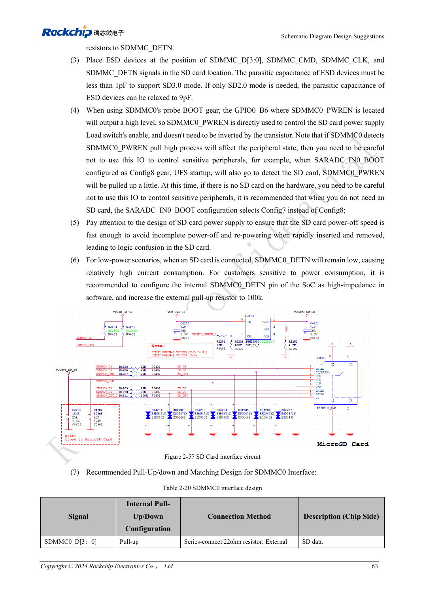
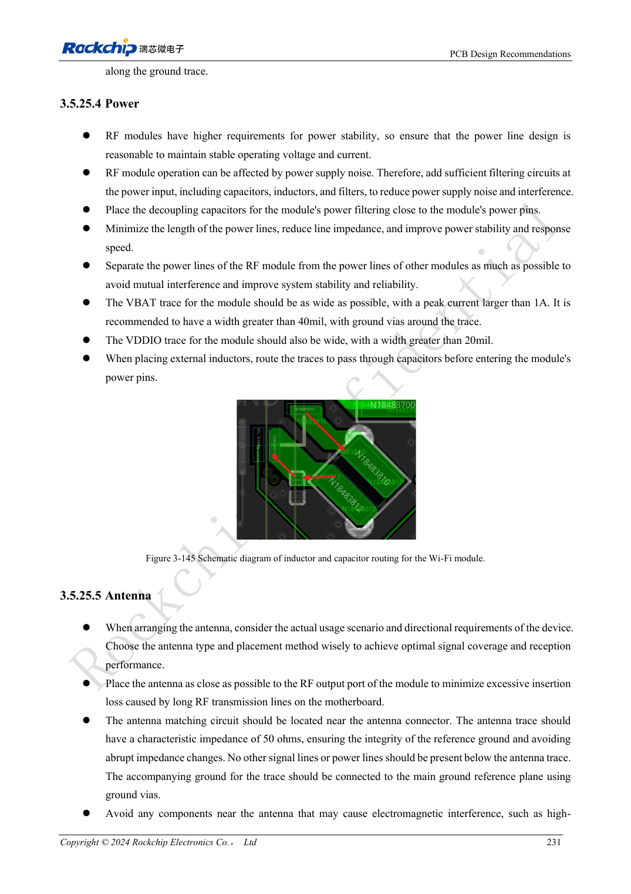

<!-- rk3576-hardware-v11-rest-20261109 -->

# RK3576 SD cards and SDIO Wi-Fi: voltage switching, power and RF layout

Based on the Chinese and English RK3576 Hardware Design Guide V1.1 (2024-05-28), for SoC-board design. CM5 carriers must follow the module interface; Sige5 can establish a software/peripheral baseline. This guide does not prescribe one SDK/BSP or kernel for every product; verify each board. Values are source references, not ArmSoM measurements.

**RK3576_Hardware_Design_Guide_V1.1_20240528_EN.pdf** · §2.3.1; SDMMC/SDIO PCB; §3.5.25

## Separate boot-capable SDMMC0 from SDMMC1

Both controllers support four-bit SDIO 3.0/MMC 4.51 and SDR104 clocks up to 200MHz. SDMMC0 uses VCCIO1 and can boot; SDMMC1 uses VCCIO3 or VCCIO4 and is not an equivalent boot port. Card supply stays at 3.3V. Negotiated SD 3.0 switching changes IO voltage, not the card supply to 1.8V.

## Power switching and insertion

The reference uses 22Ω on D/CMD/CLK and 100Ω on DETN; SD 3.0 protection capacitance must be below 1pF. Boot probing raises GPIO0_B6/PWREN, so use non-inverting load-switch control and provide discharge for reinsertion. DETN can become high impedance in low power; determine whether its external pull-up requires an always-on supply for the intended wake scheme.

## Wi-Fi also needs RF and peak-current validation

Match module VDDIO, 32.768kHz clock voltage and UART/PCM direction. Keep the module away from DDR, HDMI and power inductors. Route RF at 50Ω without branches and reserve matching components; antenna clearance follows its supplier. Size supplies for the actual module peak current, not average current. Exercise Wi-Fi alongside nearby fast peripherals and record throughput, losses, disconnections and supply droop.

## Design parameters and review table

| Item | Source reference |
| --- | --- |
| SD Z | 50Ω ±10% |
| CLK ↔ DATA | <120mil |
| Trace length | <4inch |
| RF Z | 50Ω ±10% |
| SD3 ESD | <1pF |

## Source figures

The reference pages below contain the relevant circuit or timing figures; click for full resolution. Designators and component values belong to the reference design, not an ArmSoM product schematic.

English original · PDF 82 · 2-57

English original · PDF 250 · 3-145

## ArmSoM development path

CM5 reduces repeated compute-core design on custom carriers; Sige5 provides a starting point for software and peripheral evaluation. Verify exposed interfaces, connector pins, voltages and image support in board documentation rather than inferring them from SoC features.

- [ArmSoM CM5](https://www.armsom.org/cm5) · [CM5 Docs](https://docs.armsom.org/armsom-cm5)
- [ArmSoM Sige5](https://www.armsom.org/sige5) · [Sige5 Docs](https://docs.armsom.org/armsom-sige5)

## Continue reading

- [RK3576 hardware design: 30 topics](/articles/rk3576-hardware-design-series/)
- [RK3576 FSPI boot hardware: NOR/NAND, voltage and chip-select defaults](/articles/rk3576-fspi-boot-hardware/)
- [RK3576 PCIe design: root-complex mode, shared PHYs and endpoint power](/articles/rk3576-pcie-hardware-design/)
