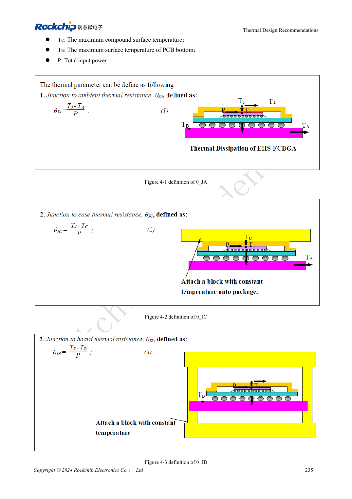

<!-- rk3576-hardware-v11-rest-20261109 -->

# RK3576 thermal design: thermal resistance, PCB conduction and sustained loads

Based on the Chinese and English RK3576 Hardware Design Guide V1.1 (2024-05-28), for SoC-board design. CM5 carriers must follow the module interface; Sige5 can establish a software/peripheral baseline. This guide does not prescribe one SDK/BSP or kernel for every product; verify each board. Values are source references, not ArmSoM measurements.

**RK3576_Hardware_Design_Guide_V1.1_20240528_EN.pdf** · Chapter 4

## Thermal resistance has defined conditions

The guide reports simulation for a JEDEC 2S2P board in natural convection without a heatsink. It does not directly represent CM5, Sige5 or a custom enclosure. θJA, θJB, θJC and ψJT describe different paths or characterization conditions and are not interchangeable. Multiplying θJC by system power does not give junction-to-ambient temperature rise.

## Optimize thermal and power layout together

The reference PMIC-to-SoC spacing is 20–50mm, balancing copper loss and thermal coupling. Power/ground copper, thermal vias and interface material all form the heat path; a metal plate alone is insufficient. Module carriers must respect module mechanics, component heights and mounting points, avoiding pressure on unsupported components.

## Record steady state and throttling

Use the final enclosure, orientation and ambient temperature for CPU, NPU, video and realistic combined workloads. Log temperature, frequency, power and throughput over time until stable. Short peaks do not establish sustained performance. Retain kernel thermal management rather than disabling protection for benchmarks. No new ArmSoM measurements are claimed here.

## Design parameters and review table

| Item | Source reference |
| --- | --- |
| θJA | 15.84°C/W |
| θJB | 6.96°C/W |
| θJC | 0.67°C/W |
| ψJT | 0.031°C/W |
| PMIC–SoC reference spacing | 20–50mm |

## Source figures

The reference pages below contain the relevant circuit or timing figures; click for full resolution. Designators and component values belong to the reference design, not an ArmSoM product schematic.

English original · PDF 254 · 4-1

## ArmSoM development path

CM5 reduces repeated compute-core design on custom carriers; Sige5 provides a starting point for software and peripheral evaluation. Verify exposed interfaces, connector pins, voltages and image support in board documentation rather than inferring them from SoC features.

- [ArmSoM CM5](https://www.armsom.org/cm5) · [CM5 Docs](https://docs.armsom.org/armsom-cm5)
- [ArmSoM Sige5](https://www.armsom.org/sige5) · [Sige5 Docs](https://docs.armsom.org/armsom-sige5)

## Continue reading

- [RK3576 hardware design: 30 topics](/articles/rk3576-hardware-design-series/)
- [RK3576 power PCB and PDN: RK806S-5, feedback and high-current loops](/articles/rk3576-power-pcb-pdn-design/)
- [RK3576 ESD and EMI: connector discharge, reset immunity and production review](/articles/rk3576-esd-emi-reliability-design/)
