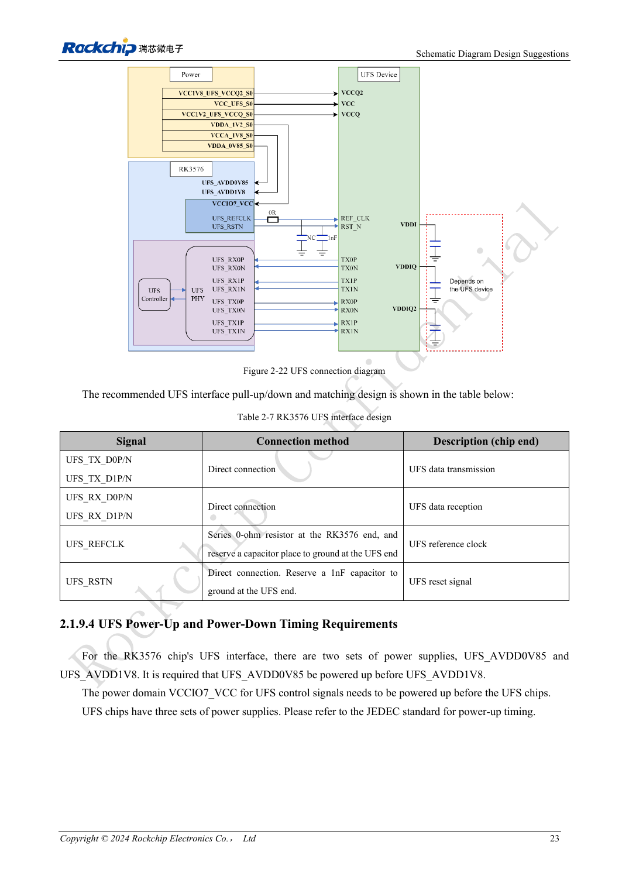
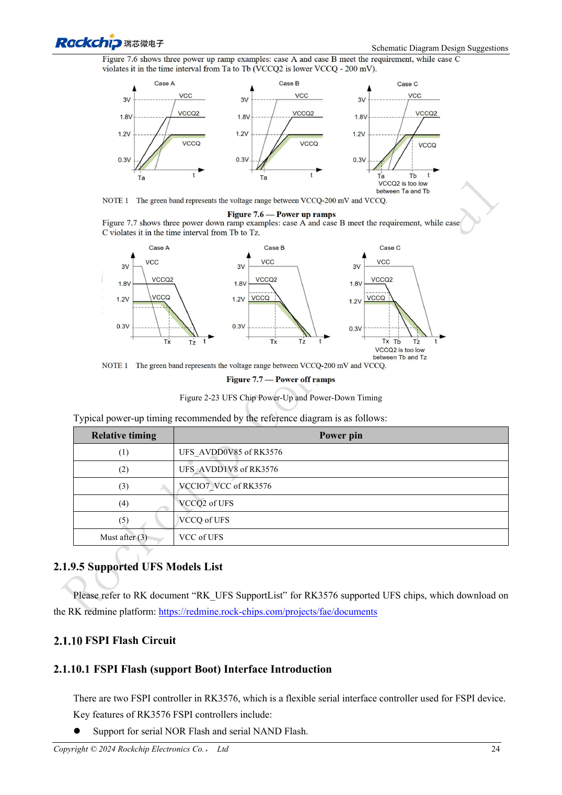

<!-- rk3576-hardware-v11-rest-20261109 -->

# RK3576 UFS hardware: device compatibility, sequencing and differential routing

Based on the Chinese and English RK3576 Hardware Design Guide V1.1 (2024-05-28), for SoC-board design. CM5 carriers must follow the module interface; Sige5 can establish a software/peripheral baseline. This guide does not prescribe one SDK/BSP or kernel for every product; verify each board. Values are source references, not ArmSoM measurements.

**RK3576_Hardware_Design_Guide_V1.1_20240528_EN.pdf** · §2.1.9; UFS PCB

## A device revision is not an operating mode

The RK3576 controller is UFS 2.0 with two lanes up to 5.8Gbps each. The guide lists compatible UFS 2.0/2.1/2.2/3.0/3.1 devices and excludes UFS 4.0. A newer memory device does not upgrade the host to UFS 3.x speeds. Lane rate is not file-transfer throughput.

## Recheck supplies for the selected device

RSTN and REFCLK use 1.2V; VCCIO7 is also 1.2V when UFS is used. VCCQ/VCCQ2/VCC are 1.2/1.8/3.3V for UFS 2.0, NC/1.8/3.3V for 2.1/2.2, and 1.2/NC/2.5 or 3.3V for 3.0/3.1, subject to the actual part. The guide sequences AVDD0V85→AVDD1V8→VCCIO7→VCCQ2→VCCQ; device VCC follows VCCIO7. Do not connect an absent rail by mechanically copying the example.

## Differential link and recovery tests

Connect TX/RX directly. Use 0Ω on REFCLK at the SoC and reserve a capacitor at the device; connect RSTN directly with provision for 1nF. Preserve a continuous ground reference and inspect REFCLK return paths, with reference stitching-via distance within 25mil. Test power cycles, low-power recovery and sustained writes. Investigate sequencing before replacing the storage driver.

## Design parameters and review table

| Item | Source reference |
| --- | --- |
| Zdiff | 100Ω ±10% |
| Intra-pair mismatch | <6mil |
| Inter-pair mismatch | <100mil |
| Trace length | <4inch |
| Airgap | ≥4W; other ≥5W |
| Recommended via count | ≤2 |

## Source figures

The reference pages below contain the relevant circuit or timing figures; click for full resolution. Designators and component values belong to the reference design, not an ArmSoM product schematic.

English original · PDF 42 · 2-22

English original · PDF 43 · 2-23

## ArmSoM development path

CM5 reduces repeated compute-core design on custom carriers; Sige5 provides a starting point for software and peripheral evaluation. Verify exposed interfaces, connector pins, voltages and image support in board documentation rather than inferring them from SoC features.

- [ArmSoM CM5](https://www.armsom.org/cm5) · [CM5 Docs](https://docs.armsom.org/armsom-cm5)
- [ArmSoM Sige5](https://www.armsom.org/sige5) · [Sige5 Docs](https://docs.armsom.org/armsom-sige5)

## Continue reading

- [RK3576 hardware design: 30 topics](/articles/rk3576-hardware-design-series/)
- [RK3576 eMMC hardware: supplies, pull-ups and HS400 routing](/articles/rk3576-emmc-hardware-design/)
- [RK3576 FSPI boot hardware: NOR/NAND, voltage and chip-select defaults](/articles/rk3576-fspi-boot-hardware/)
