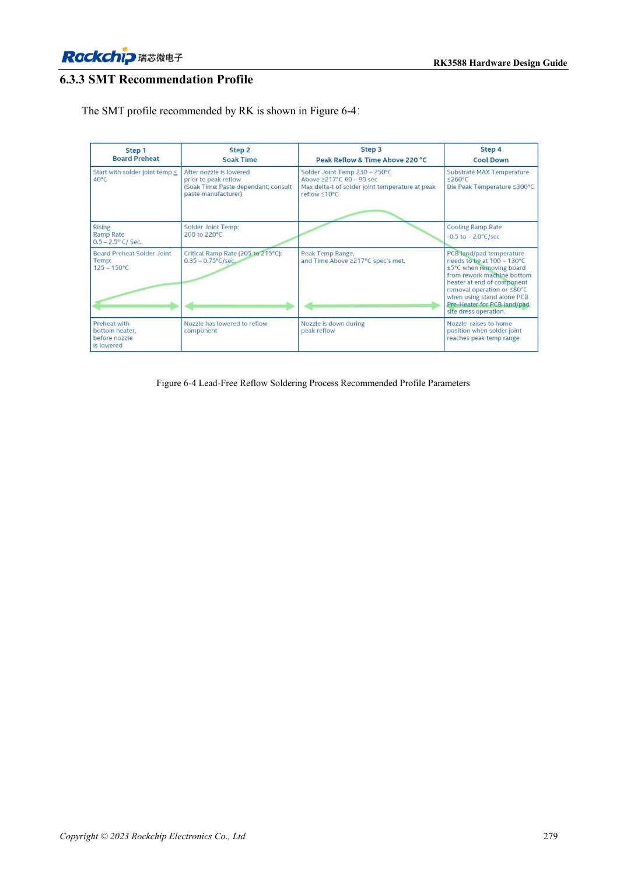
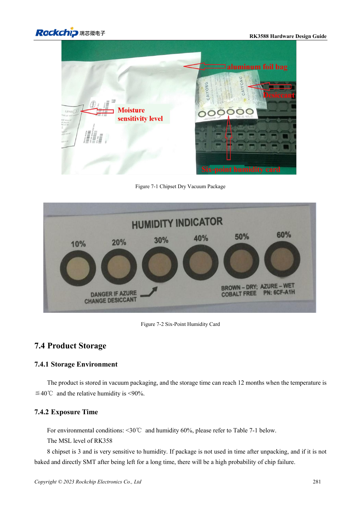

<!-- rk3588-hardware-v13-20261109 -->

# RK3588 assembly and storage: reflow, MSL3 and bake records

Based on the Chinese and English RK3588 Hardware Design Guide V1.3 (2023-02-13), for reviewing SoC boards and carriers. AIM7 and LM7 carriers must follow module interface definitions; Sige7 provides a starting point for software and peripheral validation. SoC capabilities are not a board connector list. Verify SDK/BSP, kernel, board revision and firmware. Values are source references, not ArmSoM hardware measurements.

**RK3588 Hardware Design Guide V1.3 (2023-02-13), EN** · §6–7

## Process values belong to the package

The guide reflow profile concerns the RK3588 chip, not universal permission to reflow an assembled ArmSoM module. Its paste reference is storage at 2–10°C and 3–4 hours room-temperature recovery with records. Confirm alloy, flux, board thermal mass and component limits with manufacturing. LM7 LGA assembly requires the module-level profile.

## Track cumulative moisture exposure

RK3588 is MSL3 with 168-hour floor life at ≤30°C/60%RH. Record humidity card, opening time and storage; resealing does not automatically reset exposure. Table 7-2 distinguishes floor-life overrun above/below 72 hours and bake temperature, with package thickness ≤1.4mm. The MSL1 row’s 300°C is suspect and is not treated here as a production condition.

## Design parameters and review table

| Item | Source reference |
| --- | --- |
| MSL3 floor life | 168h at ≤30°C /60%RH |
| Bake 125°C +10/-0°C (>72h / ≤72h overrun) | 9h /7h |
| Bake 90°C +8/-0°C (>72h / ≤72h overrun) | 33h /23h |
| Bake 40°C +5/-0°C (>72h / ≤72h overrun) | 13 days /9 days |
| Bake table package limit | Thickness ≤1.4mm |

## Source figures

The reference pages below contain the relevant circuit or timing figures; click for full resolution. Designators and component values belong to the reference design, not an ArmSoM product schematic.

English original · PDF 301 · 6-4

English original · PDF 303 · 7-2

## ArmSoM development path

AIM7 supports compute-module carrier development, LM7 targets LGA module integration, and Sige7 supports early software and peripheral evaluation. With modules, identify which supplies, DDR and boot circuits are already integrated before designing the carrier. Do not duplicate SoC reference circuits unnecessarily. Follow product documentation for connectors, exposed interfaces, voltages and system support.

- [ArmSoM AIM7](https://www.armsom.org/aim7) · [AIM7 Docs](https://docs.armsom.org/armsom-aim7)
- [ArmSoM Sige7](https://www.armsom.org/sige7) · [Sige7 Docs](https://docs.armsom.org/armsom-sige7)
- [ArmSoM LM7](https://www.armsom.org/lm7) · [LM7 Docs](https://docs.armsom.org/armsom-lm7)

## Continue reading

- [RK3588 hardware design: 30 topics](/articles/rk3588-hardware-design-series/)
- [RK3588 ESD and EMI: interface protection and return paths](/articles/rk3588-esd-emi-hardware-design/)
