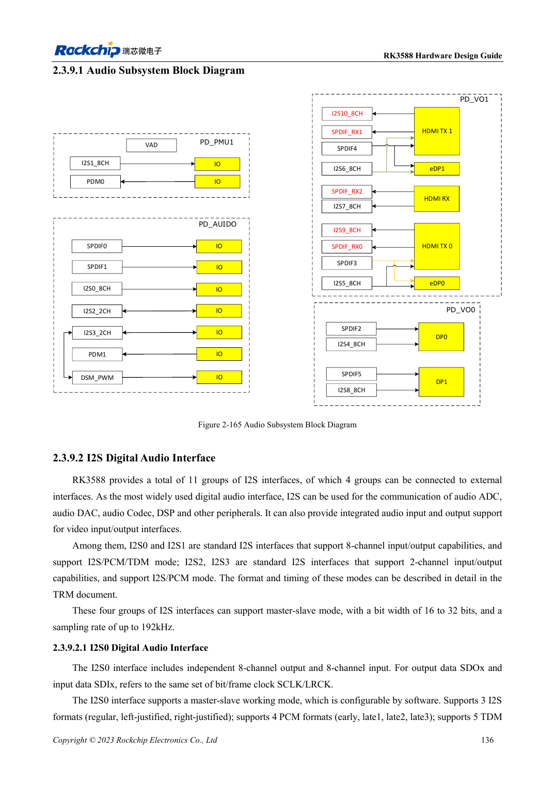
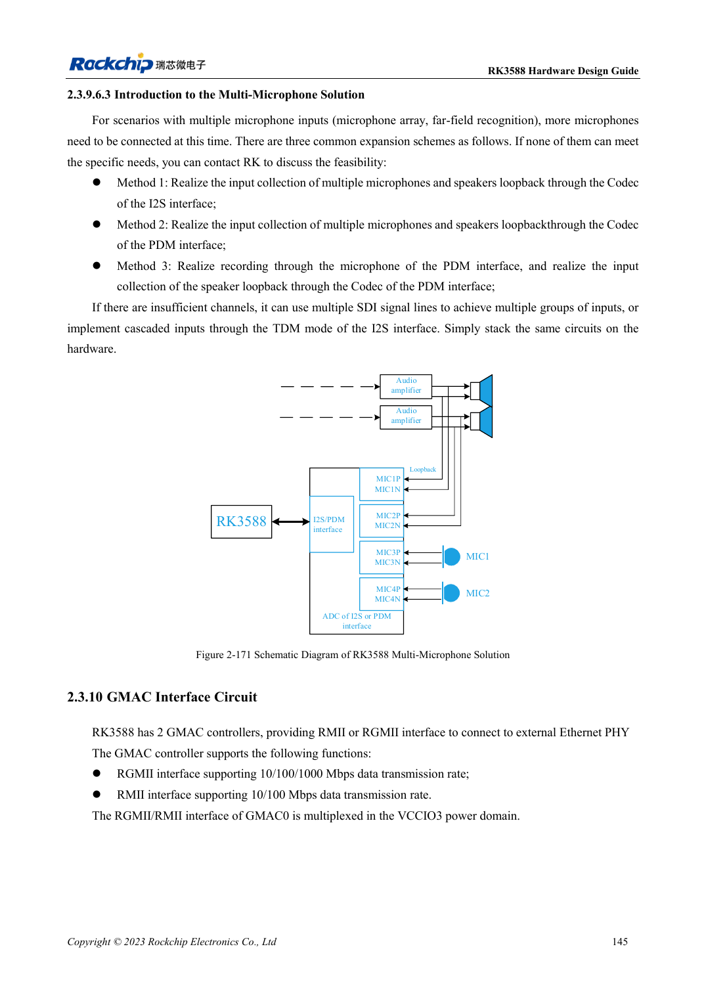

<!-- rk3588-hardware-v13-20261109 -->

# RK3588 audio hardware: I2S, PDM and microphone arrays

Based on the Chinese and English RK3588 Hardware Design Guide V1.3 (2023-02-13), for reviewing SoC boards and carriers. AIM7 and LM7 carriers must follow module interface definitions; Sige7 provides a starting point for software and peripheral validation. SoC capabilities are not a board connector list. Verify SDK/BSP, kernel, board revision and firmware. Values are source references, not ArmSoM hardware measurements.

**RK3588 Hardware Design Guide V1.3 (2023-02-13), EN** · §2.3.9; §3.4.20

## Separate internal and external interfaces

Only four of eleven I2S interfaces are externally exposed; others serve video. I2S0/1 support eight channels and I2S/PCM/TDM, while I2S2/3 provide two-channel I2S/PCM. Internal counts are not carrier port counts. After choosing Codec/ADC/DAC, define master/slave, MCLK, SCLK/LRCK, word width and sample rate.

## Review clocks and analog paths together

Use daisy-chain clocks for multiple I2S/PDM devices and avoid long branches. The guide recommends 22Ω at the SoC and separately guarded clock routes. Keep microphones and amplifier paths away from DDR, display, RF and inductors. Arrays with playback reference need channel synchronization and software mapping checks, not just audible recording.

## Design parameters and review table

| Item | Source reference |
| --- | --- |
| External I2S | 4 groups |
| I2S0/1; I2S2/3 | 8 channels; 2 channels |
| Source width / sample rate | 16–32bit / up to 192kHz |
| Clock series reference | 22Ω |

## Source figures

The reference pages below contain the relevant circuit or timing figures; click for full resolution. Designators and component values belong to the reference design, not an ArmSoM product schematic.

English original · PDF 158 · 2-165

English original · PDF 167 · 2-171

## ArmSoM development path

AIM7 supports compute-module carrier development, LM7 targets LGA module integration, and Sige7 supports early software and peripheral evaluation. With modules, identify which supplies, DDR and boot circuits are already integrated before designing the carrier. Do not duplicate SoC reference circuits unnecessarily. Follow product documentation for connectors, exposed interfaces, voltages and system support.

- [ArmSoM AIM7](https://www.armsom.org/aim7) · [AIM7 Docs](https://docs.armsom.org/armsom-aim7)
- [ArmSoM Sige7](https://www.armsom.org/sige7) · [Sige7 Docs](https://docs.armsom.org/armsom-sige7)
- [ArmSoM LM7](https://www.armsom.org/lm7) · [LM7 Docs](https://docs.armsom.org/armsom-lm7)

## Continue reading

- [RK3588 hardware design: 30 topics](/articles/rk3588-hardware-design-series/)
- [RK3588 DP and eDP: shared PHYs, AUX and coupling](/articles/rk3588-dp-edp-hardware-design/)
- [RK3588 Ethernet hardware: GMAC, PHY and clock direction](/articles/rk3588-gmac-hardware-design/)
