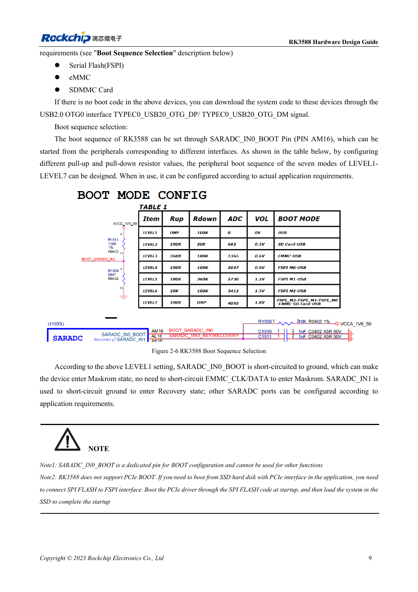
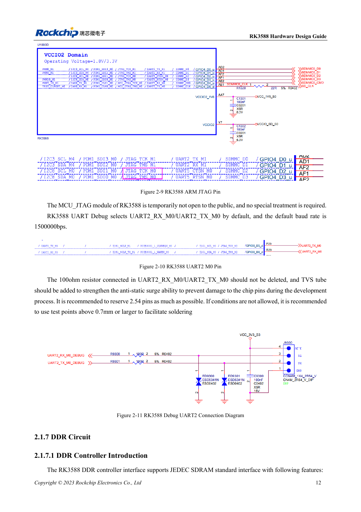

<!-- rk3588-hardware-v13-20261109 -->

# RK3588 boot and recovery: Maskrom, JTAG and UART

Based on the Chinese and English RK3588 Hardware Design Guide V1.3 (2023-02-13), for reviewing SoC boards and carriers. AIM7 and LM7 carriers must follow module interface definitions; Sige7 provides a starting point for software and peripheral validation. SoC capabilities are not a board connector list. Verify SDK/BSP, kernel, board revision and firmware. Values are source references, not ArmSoM hardware measurements.

**RK3588 Hardware Design Guide V1.3 (2023-02-13), EN** · §2.1.4–2.1.6; §2.3.2

## Keep a usable recovery path

SARADC_IN0_BOOT at AM16 is dedicated to boot selection; LEVEL1 selects Maskrom. Retain USB2.0 OTG0 for downloads. Boot ROM does not start directly from a PCIe SSD: FSPI Flash code first initializes PCIe and then loads the SSD system. An OS on NVMe does not imply native ROM NVMe boot.

## Preserve debug and default pull-ups

SDMMC_DET must be stable before reset ends: low for SDMMC, high for ARM JTAG. Logging defaults to UART2_M0 at 1500000bps; retain RX/TX 100Ω resistors and TVS. The SARADC_IN1 10kΩ pull-up avoids an undefined recovery input. Module users must check connector pins and levels rather than using SoC ball positions.

## Design parameters and review table

| Item | Source reference |
| --- | --- |
| Boot pin | SARADC_IN0_BOOT / AM16 |
| Debug | UART2_M0 / 1500000bps |
| SDMMC_DET | 0: SDMMC; 1: ARM JTAG |
| Recovery pull-up | SARADC_IN1: 10kΩ |

## Source figures

The reference pages below contain the relevant circuit or timing figures; click for full resolution. Designators and component values belong to the reference design, not an ArmSoM product schematic.

English original · PDF 31 · 2-6

English original · PDF 34 · 2-10

## ArmSoM development path

AIM7 supports compute-module carrier development, LM7 targets LGA module integration, and Sige7 supports early software and peripheral evaluation. With modules, identify which supplies, DDR and boot circuits are already integrated before designing the carrier. Do not duplicate SoC reference circuits unnecessarily. Follow product documentation for connectors, exposed interfaces, voltages and system support.

- [ArmSoM AIM7](https://www.armsom.org/aim7) · [AIM7 Docs](https://docs.armsom.org/armsom-aim7)
- [ArmSoM Sige7](https://www.armsom.org/sige7) · [Sige7 Docs](https://docs.armsom.org/armsom-sige7)
- [ArmSoM LM7](https://www.armsom.org/lm7) · [LM7 Docs](https://docs.armsom.org/armsom-lm7)

## Continue reading

- [RK3588 hardware design: 30 topics](/articles/rk3588-hardware-design-series/)
- [RK3588 reset, watchdog and thermal protection](/articles/rk3588-reset-watchdog-hardware/)
- [RK3588 rails: startup requirements and unused PHYs](/articles/rk3588-power-rail-planning/)
