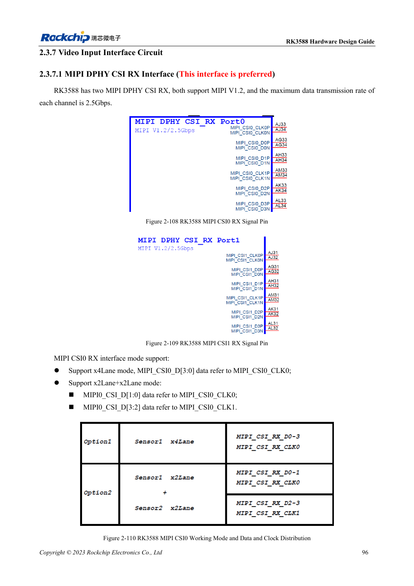
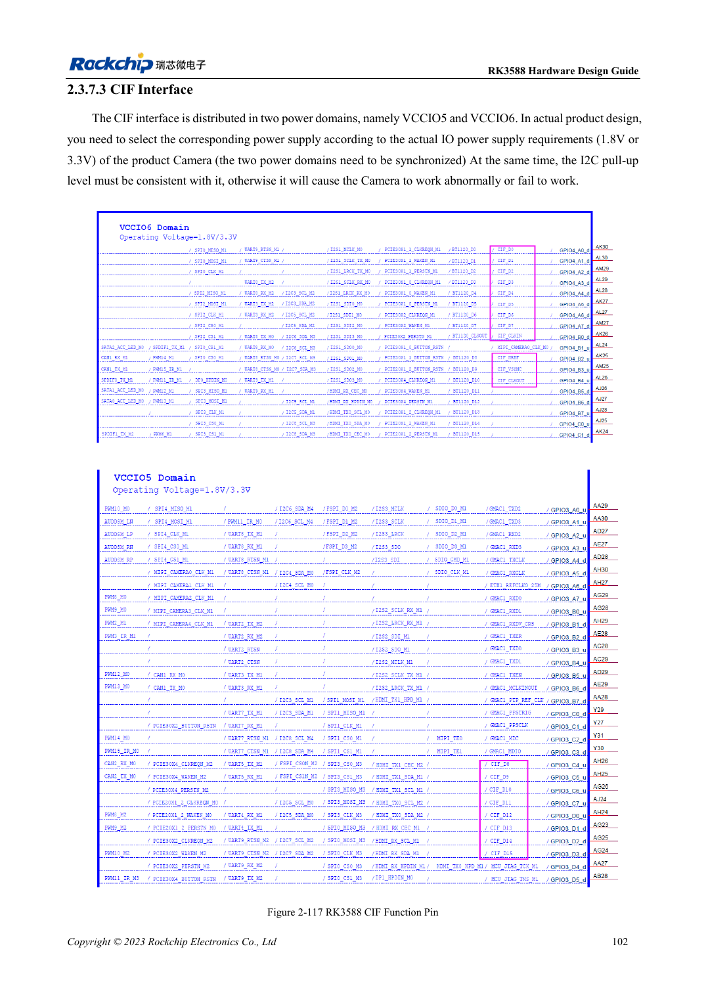

<!-- rk3588-hardware-v13-20261109 -->

# RK3588 cameras: CSI, D/C PHY and CIF planning

Based on the Chinese and English RK3588 Hardware Design Guide V1.3 (2023-02-13), for reviewing SoC boards and carriers. AIM7 and LM7 carriers must follow module interface definitions; Sige7 provides a starting point for software and peripheral validation. SoC capabilities are not a board connector list. Verify SDK/BSP, kernel, board revision and firmware. Values are source references, not ArmSoM hardware measurements.

**RK3588 Hardware Design Guide V1.3 (2023-02-13), EN** · §2.3.7.1–2.3.7.3; §3.4.12; §3.4.24

## Allocate by sensor and PHY

The guide prefers dedicated MIPI DPHY CSI RX. Each of the two interfaces supports four lanes or two two-lane groups with the correct clocks. D/C Combo PHYs have additional mode restrictions; spare pins do not allow arbitrary combinations. Check sensor format, rate, power, reset, MCLK and I2C before choosing connectors.

## CIF levels and system validation

CIF spans VCCIO5/VCCIO6; both supplies must agree with sensor IO, including I2C pull-ups. MIPI wiring does not establish BSP sensor support: drivers, device tree and ISP configuration are still required. Start with one stream, then validate the target multi-stream mode, sustained operation, dropped frames, clock stability and temperature.

## Design parameters and review table

| Item | Source reference |
| --- | --- |
| Dedicated DPHY RX source rate | 2.5Gbps/lane |
| DPHY target impedance | 100Ω ±10%; fallback 95Ω ±10% |
| DPHY pair / clock-data mismatch | <6mil / <12mil |

## Source figures

The reference pages below contain the relevant circuit or timing figures; click for full resolution. Designators and component values belong to the reference design, not an ArmSoM product schematic.

English original · PDF 118 · 2-110

English original · PDF 124 · 2-117

## ArmSoM development path

AIM7 supports compute-module carrier development, LM7 targets LGA module integration, and Sige7 supports early software and peripheral evaluation. With modules, identify which supplies, DDR and boot circuits are already integrated before designing the carrier. Do not duplicate SoC reference circuits unnecessarily. Follow product documentation for connectors, exposed interfaces, voltages and system support.

- [ArmSoM AIM7](https://www.armsom.org/aim7) · [AIM7 Docs](https://docs.armsom.org/armsom-aim7)
- [ArmSoM Sige7](https://www.armsom.org/sige7) · [Sige7 Docs](https://docs.armsom.org/armsom-sige7)
- [ArmSoM LM7](https://www.armsom.org/lm7) · [LM7 Docs](https://docs.armsom.org/armsom-lm7)

## Continue reading

- [RK3588 hardware design: 30 topics](/articles/rk3588-hardware-design-series/)
- [RK3588 PCIe: lanes, reference clocks and supplies](/articles/rk3588-pcie-hardware-design/)
- [RK3588 HDMI RX: capture input, CEC and DDC levels](/articles/rk3588-hdmi-rx-hardware-design/)
