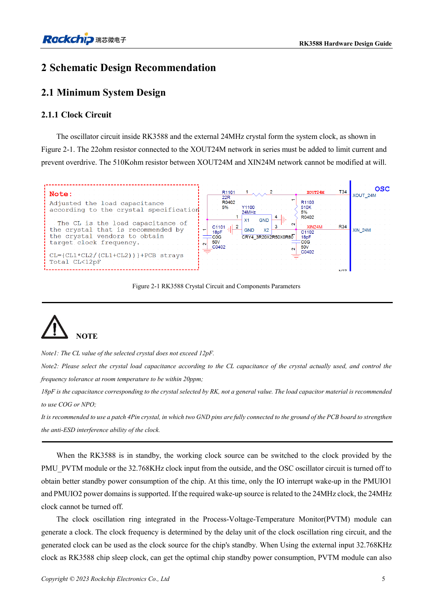
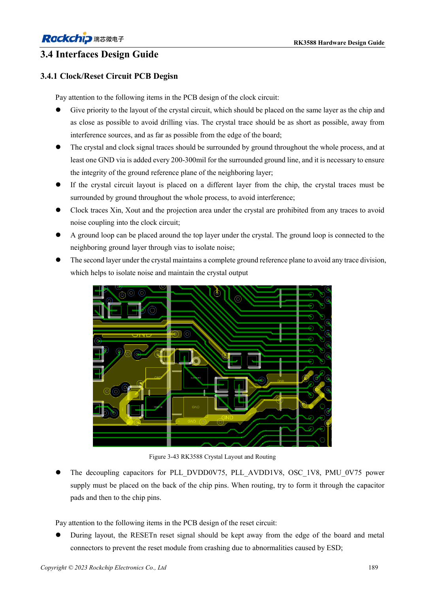

<!-- rk3588-hardware-v13-20261109 -->

# RK3588 clocks: 24MHz, 32kHz and layout

Based on the Chinese and English RK3588 Hardware Design Guide V1.3 (2023-02-13), for reviewing SoC boards and carriers. AIM7 and LM7 carriers must follow module interface definitions; Sige7 provides a starting point for software and peripheral validation. SoC capabilities are not a board connector list. Verify SDK/BSP, kernel, board revision and firmware. Values are source references, not ArmSoM hardware measurements.

**RK3588 Hardware Design Guide V1.3 (2023-02-13), EN** · §2.1.1; §3.4.1

## Match load to the crystal

The 22Ω at XOUT24M limits drive; do not arbitrarily change the 510kΩ between XOUT24M and XIN24M. Crystal CL must not exceed 12pF. The illustrated 18pF is specific to the reference crystal; determine the real load from CL and parasitics, preferably using C0G/NP0 and a four-pad crystal. Probe capacitance also affects oscillation.

## Review wake-up and PCB together

Before stopping 24MHz, check wake-source dependencies. The low-power path uses PMU_PVTM or external 32.768kHz and relevant PMUIO1/2 IO wake-up. Place the crystal near the SoC on the same side where possible; keep other signals out of the crystal/XIN/XOUT projection, maintain adjacent ground and stitch guard ground every 200–300mil.

## Design parameters and review table

| Item | Source reference |
| --- | --- |
| 24MHz tolerance | ≤20ppm |
| 32.768kHz tolerance | ±30ppm |
| 32kHz duty cycle | 45–55% |
| 32kHz amplitude | 0.7×VDD … VDD; VDD=PMUIO1 |

## Source figures

The reference pages below contain the relevant circuit or timing figures; click for full resolution. Designators and component values belong to the reference design, not an ArmSoM product schematic.

English original · PDF 27 · 2-1

English original · PDF 211 · 3-43

## ArmSoM development path

AIM7 supports compute-module carrier development, LM7 targets LGA module integration, and Sige7 supports early software and peripheral evaluation. With modules, identify which supplies, DDR and boot circuits are already integrated before designing the carrier. Do not duplicate SoC reference circuits unnecessarily. Follow product documentation for connectors, exposed interfaces, voltages and system support.

- [ArmSoM AIM7](https://www.armsom.org/aim7) · [AIM7 Docs](https://docs.armsom.org/armsom-aim7)
- [ArmSoM Sige7](https://www.armsom.org/sige7) · [Sige7 Docs](https://docs.armsom.org/armsom-sige7)
- [ArmSoM LM7](https://www.armsom.org/lm7) · [LM7 Docs](https://docs.armsom.org/armsom-lm7)

## Continue reading

- [RK3588 hardware design: 30 topics](/articles/rk3588-hardware-design-series/)
- [RK3588 edge AI hardware: from workload to validation](/articles/rk3588-edge-ai-hardware-design/)
- [RK3588 reset, watchdog and thermal protection](/articles/rk3588-reset-watchdog-hardware/)
