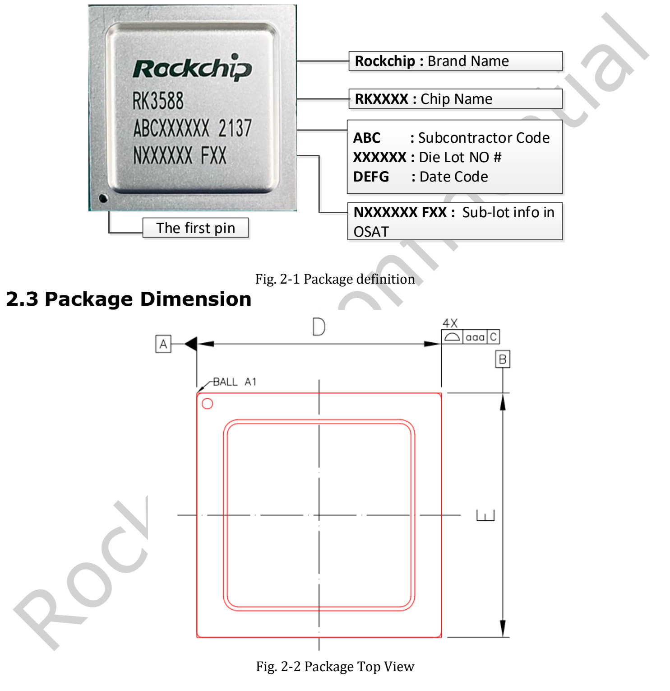
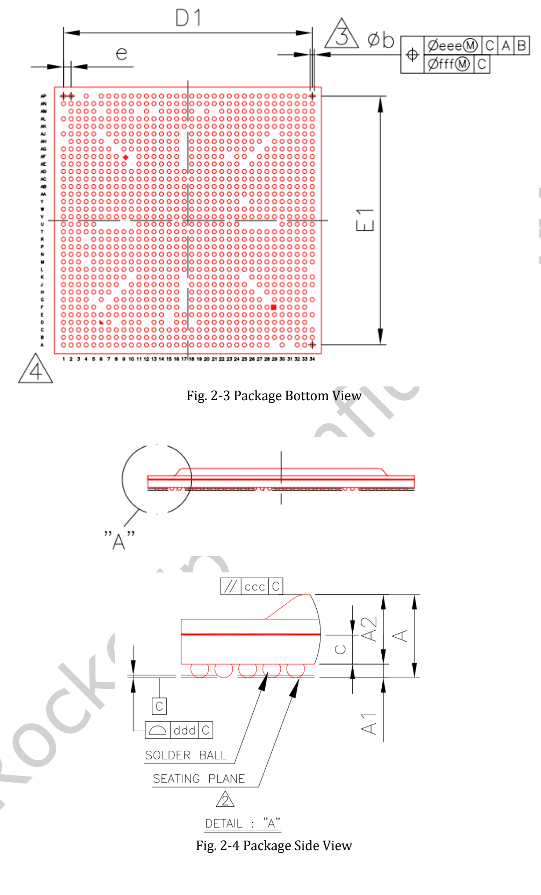
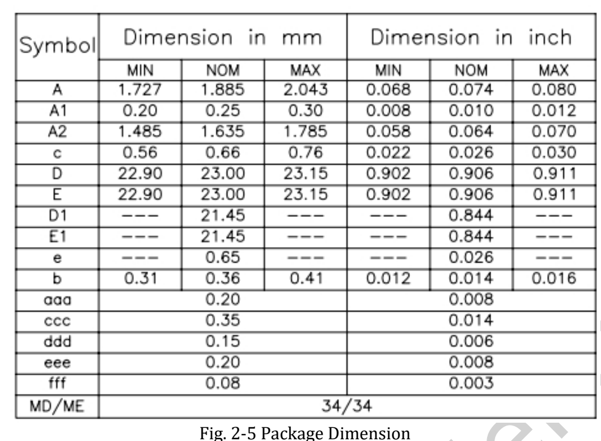

**RK3588 Datasheet V1.4, revised 2022-05-24, contains 34 pages** on features, package, pins, electrical conditions and thermal management. This is a reading and design guide, not a line-by-line translation. The complete original file remains available.

[Download the original RK3588 Datasheet V1.4 PDF](/assets/rk3588/Rockchip-RK3588-Datasheet-V1.4-20220524.pdf)

## Document map

| Pages | Contents | Use |
|---|---|---|
| 6–16 | CPU, memory, NPU, video, display and interfaces | System architecture and feature review |
| 16 | Block diagram | Blocks and multiplexing |
| 17–19 | Marking, package dimensions, MSL and ball material | Package/manufacturing reference |
| 19–27 | Pin-number table | SoC signals and power domains |
| 28 | Absolute maximum ratings | Limits, not recommended operating points |
| 29–33 | Recommended conditions and interface characteristics | Power and signal design |
| 34 | Thermal management | Reference with stated conditions |

## Architecture and compute

Four A76 and four A55 cores share 3MB L3; each A76 has 512KB L2 and each A55 128KB L2. Four 16-bit channels support LPDDR4/4X/5 with up to 32GB address space. The three-core NPU is rated up to 6 TOPS, with INT4/INT8/INT16, FP16, BF16 and TF32 listed. Chip formats do not guarantee every operator combination in every tool version.

## Video, ISP and source ambiguities

Detailed entries specify H.265/VP9/AVS2 8K60, H.264 8K30 and AV1 4K60 decoding, plus H.264/H.265 8K30 encoding. ISP modes include dual-ISP 48M@15 and 32M@30, and single-ISP 16M@30; retain the full resolution and mode when applying them.

The JPEG Decoder subsection on page 9 ends with “Embedded four encoder units”, inconsistent with its heading. This guide does not silently change it to four decoders; the original remains in the PDF and requires clarification for design. Public pages and the PDF also differ in graphics API, ISP and DP descriptions. This guide anchors its claims to the named revision without calling it the latest document.

## Package and dimensions

FCBGA1088L has a 23×23mm body, nominal 0.36mm ball diameter and 0.65mm pitch, MSL3 and SnAgCu ball material. V1.4's technical revisions include package dimensions and the diagram. Build a PCB footprint from full tolerances and official design files, not just nominal dimensions.

## Electrical and thermal design

Page 30 gives maximum CPU frequency as 2.2–2.4GHz, GPU/NPU as 1000MHz and ambient operation as 0–80°C. These are conditions in this revision, not guarantees of sustained maximum clocks on every board.

Page 34 requires junction temperature below 125°C and lists θJA=8.7, θJB=3.5 and θJC=0.12°C/W. The text calls them simulation references, with a 10-layer 114×101mm PCB and 25°C ambient, subject to physical validation. They cannot be applied directly to arbitrary heatsinks, enclosures or LM7/AIM7 modules. Junction and ambient temperature are different quantities.

## Using it with ArmSoM hardware

Sige7 users should start with board power and cooling. AIM7 carriers require module connector review; LM7 designs require the LGA module footprint and supply specifications. SoC balls are not module connector pins. Electrical parameters have not been retested here, and the PDF and original figure markings are preserved.

## Series and product links

- [RK3588 explained: eight CPU cores, 6 TOPS NPU and high-speed expansion](/articles/rk3588-chip-guide/)
- [AIM7 as a Jetson Nano/Orin alternative: hardware review and RKNN migration](/articles/aim7-jetson-nano-orin-alternative/)
- [Sige7 and LM7: six RK3588 application paths from prototype to product](/articles/sige7-lm7-rk3588-applications/)
- [ArmSoM AIM7](https://docs.armsom.org/armsom-aim7) · [Sige7](https://docs.armsom.org/armsom-sige7) · [LM7](https://docs.armsom.org/armsom-lm7)

## References

- [Rockchip RK3588](https://www.rock-chips.com/a/en/products/RK35_Series/2022/0926/1660.html)
- [ArmSoM AIM7](https://docs.armsom.org/armsom-aim7)
- [ArmSoM Sige7](https://docs.armsom.org/armsom-sige7)
- [ArmSoM LM7](https://docs.armsom.org/armsom-lm7)
- [NVIDIA Jetson modules](https://developer.nvidia.com/embedded/jetson-modules)
- [RKNN-Toolkit2](https://github.com/airockchip/rknn-toolkit2)
