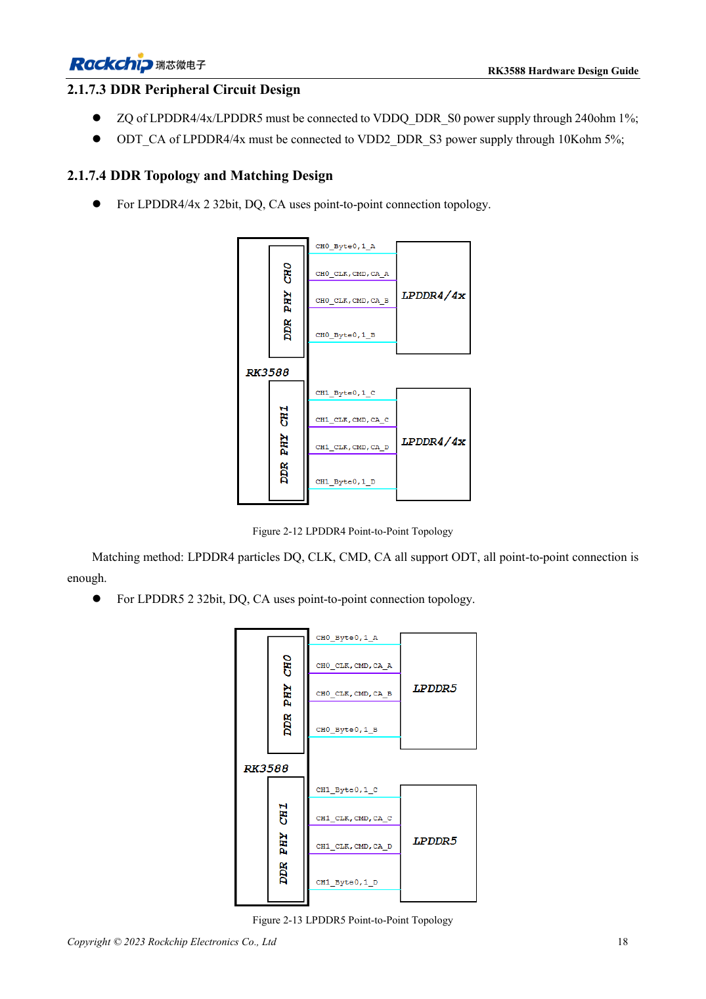
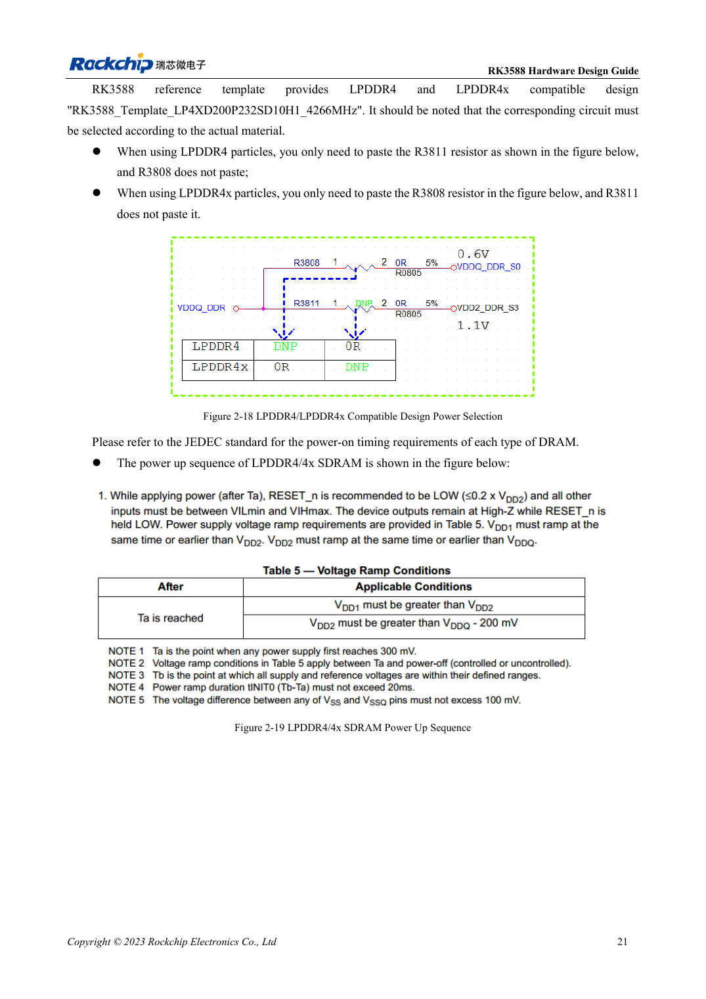

<!-- rk3588-hardware-v13-20261109 -->

# RK3588 DDR circuits: LPDDR4/4X/5 and capacity

Based on the Chinese and English RK3588 Hardware Design Guide V1.3 (2023-02-13), for reviewing SoC boards and carriers. AIM7 and LM7 carriers must follow module interface definitions; Sige7 provides a starting point for software and peripheral validation. SoC capabilities are not a board connector list. Verify SDK/BSP, kernel, board revision and firmware. Values are source references, not ArmSoM hardware measurements.

**RK3588 Hardware Design Guide V1.3 (2023-02-13), EN** · §2.1.7

## Select capacity and template together

V1.3 describes four 16-bit channels forming 64 bits, up to 8GB per channel and 32GB total. Schematic 32-bit CH0/CH1 cannot use unequal capacities such as 4GB+2GB. This is the guide version’s scope, not a statement about other variants or later BSPs. Confirm memory part, package, firmware and template as a set.

## Voltage and mapping are not label changes

Two 32-bit devices use point-to-point DQ/CA. The compatible template fits R3811 and omits R3808 for LPDDR4, reversing this for LPDDR4X. These designators belong to the source template; verify nets on another schematic. LPDDR5 needs its own WCK, mapping and supplies. AIM7/LM7 integrate DDR, shifting carrier work to input power, interfaces and cooling.

## Design parameters and review table

| Item | Source reference |
| --- | --- |
| V1.3 bus | 4×16bit =64bit |
| V1.3 addressing | 8GB/channel; 32GB total |
| CH0 / CH1 | Equal capacity |

## Source figures

The reference pages below contain the relevant circuit or timing figures; click for full resolution. Designators and component values belong to the reference design, not an ArmSoM product schematic.

English original · PDF 40 · 2-12

English original · PDF 43 · 2-18

## ArmSoM development path

AIM7 supports compute-module carrier development, LM7 targets LGA module integration, and Sige7 supports early software and peripheral evaluation. With modules, identify which supplies, DDR and boot circuits are already integrated before designing the carrier. Do not duplicate SoC reference circuits unnecessarily. Follow product documentation for connectors, exposed interfaces, voltages and system support.

- [ArmSoM AIM7](https://www.armsom.org/aim7) · [AIM7 Docs](https://docs.armsom.org/armsom-aim7)
- [ArmSoM Sige7](https://www.armsom.org/sige7) · [Sige7 Docs](https://docs.armsom.org/armsom-sige7)
- [ArmSoM LM7](https://www.armsom.org/lm7) · [LM7 Docs](https://docs.armsom.org/armsom-lm7)

## Continue reading

- [RK3588 hardware design: 30 topics](/articles/rk3588-hardware-design-series/)
- [RK3588 and RK806: single and dual PMIC power trees](/articles/rk3588-rk806-pmic-design/)
- [RK3588 DDR routing: length and delay matching](/articles/rk3588-ddr-pcb-routing/)
