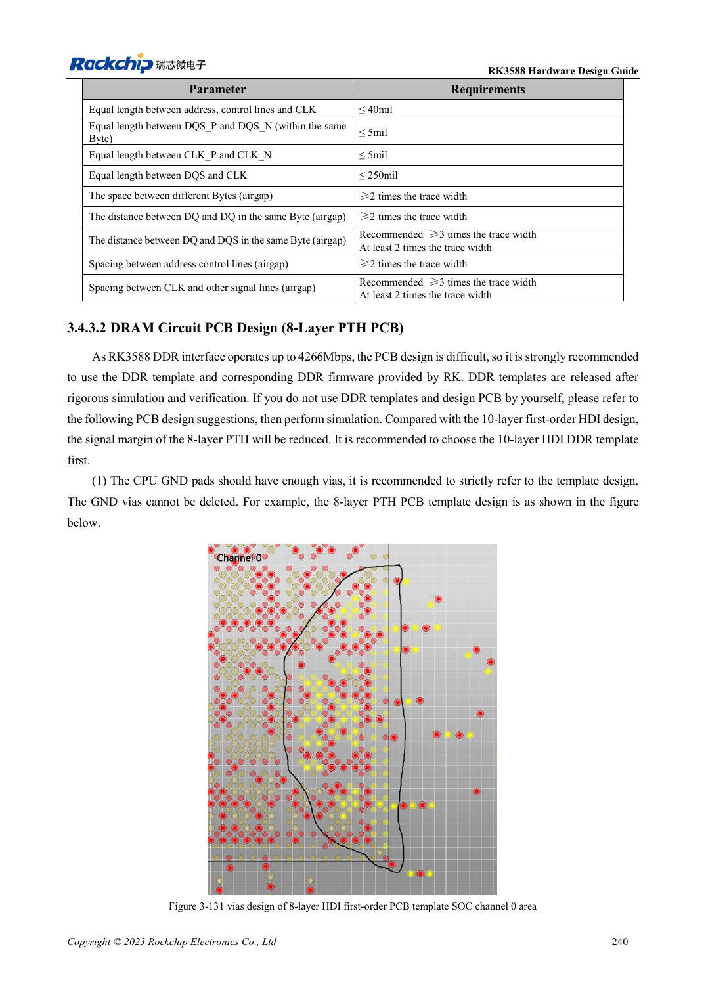
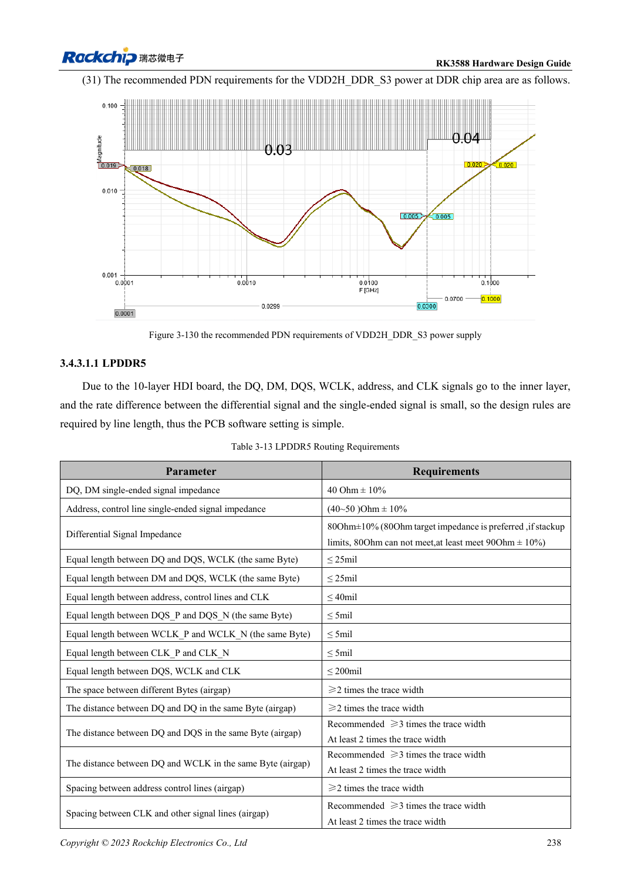

<!-- rk3588-hardware-v13-20261109 -->

# RK3588 DDR routing: length and delay matching

Based on the Chinese and English RK3588 Hardware Design Guide V1.3 (2023-02-13), for reviewing SoC boards and carriers. AIM7 and LM7 carriers must follow module interface definitions; Sige7 provides a starting point for software and peripheral validation. SoC capabilities are not a board connector list. Verify SDK/BSP, kernel, board revision and firmware. Values are source references, not ArmSoM hardware measurements.

**RK3588 Hardware Design Guide V1.3 (2023-02-13), EN** · §3.4.3

## Choose rules for the stackup

Ten-layer HDI is preferred and used for LPDDR5. Inner-layer signals use length matching; eight-layer through-hole LPDDR4/4X needs delay matching because surfaces, internal layers, vias and package propagation differ. 16ps is not 16mil; conversion depends on material. Record template, memory and DDR firmware versions together.

## Encode byte-group constraints

LPDDR5 table 3-13 gives DQ/DM to DQS/WCLK within a byte ≤25mil, address/control to CLK ≤40mil, and intra-pair ≤5mil. Eight-layer LPDDR4X table 3-16 instead gives ≤16ps within the byte and ≤1ps within a pair. Validate training logs, target-frequency stress, temperature and repeated cold boot; one boot does not establish margin.

## Design parameters and review table

| Item | Source reference |
| --- | --- |
| LPDDR5 DQ/DM impedance | 40Ω ±10% |
| LPDDR5 address/control | 40–50Ω ±10% |
| LPDDR5 differential target | 80Ω ±10%; source fallback 90Ω ±10% |
| 8-layer LPDDR4X Byte mismatch | ≤16ps |

## Source figures

The reference pages below contain the relevant circuit or timing figures; click for full resolution. Designators and component values belong to the reference design, not an ArmSoM product schematic.

English original · PDF 262 · 3-131

English original · PDF 260 · table:3-13

## ArmSoM development path

AIM7 supports compute-module carrier development, LM7 targets LGA module integration, and Sige7 supports early software and peripheral evaluation. With modules, identify which supplies, DDR and boot circuits are already integrated before designing the carrier. Do not duplicate SoC reference circuits unnecessarily. Follow product documentation for connectors, exposed interfaces, voltages and system support.

- [ArmSoM AIM7](https://www.armsom.org/aim7) · [AIM7 Docs](https://docs.armsom.org/armsom-aim7)
- [ArmSoM Sige7](https://www.armsom.org/sige7) · [Sige7 Docs](https://docs.armsom.org/armsom-sige7)
- [ArmSoM LM7](https://www.armsom.org/lm7) · [LM7 Docs](https://docs.armsom.org/armsom-lm7)

## Continue reading

- [RK3588 hardware design: 30 topics](/articles/rk3588-hardware-design-series/)
- [RK3588 DDR circuits: LPDDR4/4X/5 and capacity](/articles/rk3588-ddr-circuit-design/)
- [RK3588 eMMC: clock, pull-ups and strobe](/articles/rk3588-emmc-hardware-design/)
