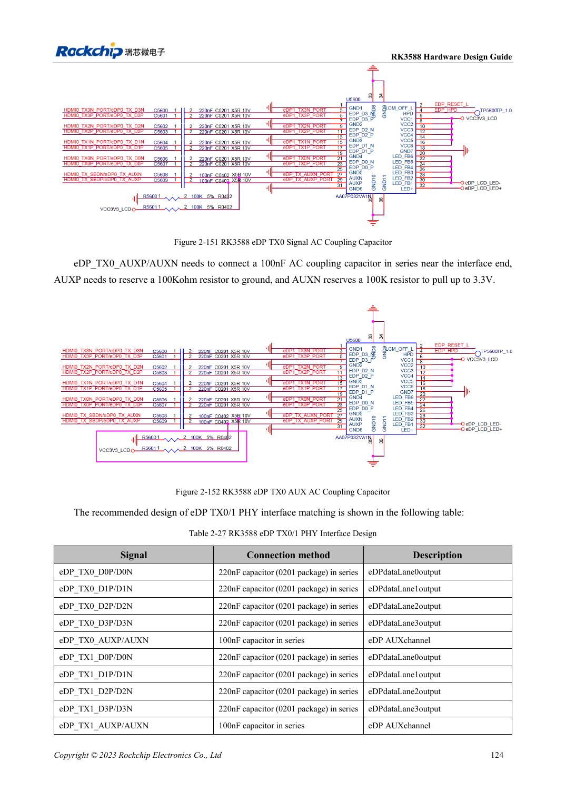
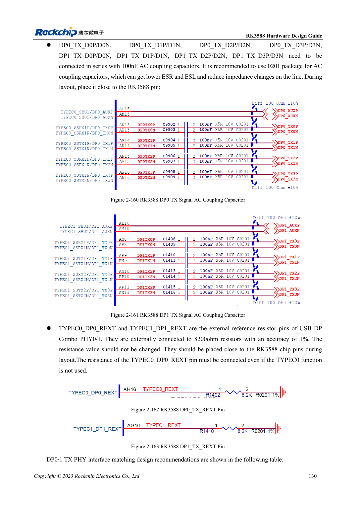

<!-- rk3588-hardware-v13-20261109 -->

# RK3588 DP and eDP: shared PHYs, AUX and coupling

Based on the Chinese and English RK3588 Hardware Design Guide V1.3 (2023-02-13), for reviewing SoC boards and carriers. AIM7 and LM7 carriers must follow module interface definitions; Sige7 provides a starting point for software and peripheral validation. SoC capabilities are not a board connector list. Verify SDK/BSP, kernel, board revision and firmware. Values are source references, not ArmSoM hardware measurements.

**RK3588 Hardware Design Guide V1.3 (2023-02-13), EN** · §2.3.8.1; §2.3.8.3; §3.4.4; §3.4.13

## Similar names do not mean identical circuits

DP0/1 share PHYs with USB Type-C; eDP shares with HDMI TX. DP main links use 100nF, eDP main links 220nF, and AUX 100nF. Do not interchange impedance, coupling and pins. Cable, connector, display input and BSP are all part of the channel.

## TYPEC0 has mandatory connections even when unused

Keep the three TYPEC0_DP0 supplies and 8.2kΩ, 1% REXT as instructed even when TYPEC0 is unused. Couple eDP AUX near the interface and retain the reference bias provisions. The source heading says eDP1.4 while the body says V1.3; use explicit electrical requirements without claiming additional protocol capability.

## Design parameters and review table

| Item | Source reference |
| --- | --- |
| DP-only / USB-DP impedance | 100Ω / 95Ω; ±10% |
| eDP impedance | 90Ω ±10%; match cable |
| Main link coupling DP / eDP | 100nF / 220nF |
| AUX coupling | 100nF |
| Length / intra-pair | <6in / <6mil |

## Source figures

The reference pages below contain the relevant circuit or timing figures; click for full resolution. Designators and component values belong to the reference design, not an ArmSoM product schematic.

English original · PDF 146 · 2-151

English original · PDF 152 · 2-160

## ArmSoM development path

AIM7 supports compute-module carrier development, LM7 targets LGA module integration, and Sige7 supports early software and peripheral evaluation. With modules, identify which supplies, DDR and boot circuits are already integrated before designing the carrier. Do not duplicate SoC reference circuits unnecessarily. Follow product documentation for connectors, exposed interfaces, voltages and system support.

- [ArmSoM AIM7](https://www.armsom.org/aim7) · [AIM7 Docs](https://docs.armsom.org/armsom-aim7)
- [ArmSoM Sige7](https://www.armsom.org/sige7) · [Sige7 Docs](https://docs.armsom.org/armsom-sige7)
- [ArmSoM LM7](https://www.armsom.org/lm7) · [LM7 Docs](https://docs.armsom.org/armsom-lm7)

## Continue reading

- [RK3588 hardware design: 30 topics](/articles/rk3588-hardware-design-series/)
- [RK3588 MIPI displays: D-PHY, C-PHY and panel integration](/articles/rk3588-mipi-display-hardware/)
- [RK3588 audio hardware: I2S, PDM and microphone arrays](/articles/rk3588-audio-hardware-design/)
