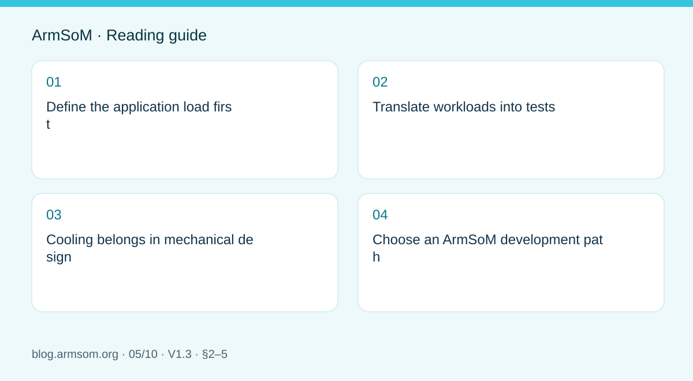
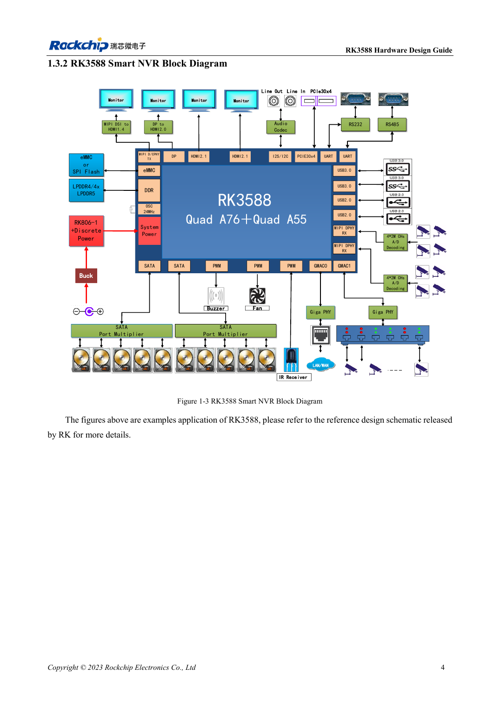

# RK3588 edge-AI hardware: plan power, cooling and expansion together

## Scope and sources

This is a task-focused engineering guide, not a page-by-page translation of the complete PDF. Source examples are not ArmSoM measurements. Check voltages, pins, SDK/BSP and kernel against the actual board revision.

**Rockchip:** `RK3588 Hardware Design Guide-CN-V1.3-20230213.pdf` · V1.3 · §2–5

## Define the application load first

An edge device runs more than a model. Capture, preprocessing, NPU inference, display, networking and storage compete for resources. Specify input count, resolution, latency, operating duration and ambient temperature before selecting hardware. The scenarios below are planning examples, not ArmSoM benchmarks.

The V1.3 guide covers schematics in chapter 2, thermal design in chapter 4 and ESD/EMI in chapter 5. EVB values and vendor thermal simulations are not measured results for AIM7, Sige7 or LM7.

## Translate workloads into tests

| Scenario | Main resources | Observe |
| --- | --- | --- |
| Visual inspection | Camera, memory, NPU, network | Dropped frames, end-to-end latency, supply transients |
| Multimedia terminal | Decode, display, audio, touch | Display combinations, temperature, long-term stability |
| Acquisition device | Network, storage, external IO | Sustained writes, power loss and recovery |

Budget the board, peripheral startup peaks and conversion losses; check cable and connector voltage drop. Processor typical power is not a complete-product supply rating. Do not mix numbers from different regulator topologies.

## Cooling belongs in mechanical design

Define the path from heat source to heatsink, enclosure and ambient. Check interface material, pressure, insulation and airflow. A closed enclosure differs from an open bench. Log ambient and chip temperature, frequency, inference latency and frame loss over time rather than presenting one peak result.

Throttling logs show whether protection is active. Falling performance requires checking heat transfer and power; disabling protection is not a sound route to a better benchmark.

## Choose an ArmSoM development path

Evaluate AIM7, Sige7 and LM7 against their documented mechanics and interfaces. Prove the model, video pipeline and peripherals before freezing the enclosure or carrier. A Jetson migration needs separate assessment of CUDA dependencies and model deployment; similar form factors do not establish software compatibility.

The handover should include interface configuration, BSP and model versions, cables and sustained-load records. Claims should apply only to the configuration actually tested.

## Source illustration

Original from the English document, shared by EN/RU/DE. Reference design, not an ArmSoM board schematic.

`RK3588 hardware design guide-EN-V1.3-20230213.pdf` · PDF p. 25.

## Products and development resources

- **AIM7** — [Product page](https://www.armsom.org/aim7) · [Documentation](https://docs.armsom.org/armsom-aim7)
- **Sige7** — [Product page](https://www.armsom.org/sige7) · [Documentation](https://docs.armsom.org/armsom-sige7)
- **LM7** — [Product page](https://www.armsom.org/lm7) · [Documentation](https://docs.armsom.org/armsom-lm7)

## Continue this series

- [RK3576 hardware bring-up: minimum system and first-power checks](/articles/rk3576-hardware-bringup/)
- [ArmSoM CM5 carrier-board checklist: power, boot and interface planning](/articles/019-cm5-carrier-production/)
- [RK3576 high-speed interfaces: review schematics and PCB together](/articles/rk3576-high-speed-interface-design/)
- [RK3588S hardware design: from a reference circuit to a CM7s carrier](/articles/rk3588s-cm7s-carrier-design/)
- [RK3588 high-speed PCB review: stackup, impedance and routing](/articles/rk3588-high-speed-pcb-review/)
- [RK3506 industrial HMI hardware: choosing a CM1 or Forge1 development path](/articles/rk3506-industrial-hmi-hardware/)
- [RK3308 hardware variants: compatibility checks for P2 Pro audio projects](/articles/rk3308-hardware-variant-compatibility/)
- [RK3588S versus RK3588S2: what to check before a hardware revision](/articles/rk3588s-rk3588s2-hardware-differences/)
- [Rockchip prototype to production: process requirements and test records](/articles/rockchip-hardware-production-checklist/)

<!-- rk3588-hardware-v13-20261109 -->

## RK3588 edge AI hardware: from workload to validation

Based on the Chinese and English RK3588 Hardware Design Guide V1.3 (2023-02-13), for reviewing SoC boards and carriers. AIM7 and LM7 carriers must follow module interface definitions; Sige7 provides a starting point for software and peripheral validation. SoC capabilities are not a board connector list. Verify SDK/BSP, kernel, board revision and firmware. Values are source references, not ArmSoM hardware measurements.

**RK3588 Hardware Design Guide V1.3 (2023-02-13), EN** · §1.3; §2.2.5.3; §4

## Allocate resources first

NVR, vision and multi-display systems share memory, storage, networking and power. The NVR diagram is a SoC reference, not an interface list for AIM7, Sige7 or LM7. Specify cameras, video formats, inference tasks, traffic and writes before assigning controllers, PHYs, pins and supplies. Resolve PCIe/SATA/USB multiplexing before carrier design.

## Test in stages

Check cold boot, UART and recovery, then individual peripherals and finally combined sustained load. Table 2-12 reports separate module stress cases at 100°C junction temperature on a bare board without a heatsink, recorded after 15 minutes of stable operation. Their sum is not measured ArmSoM system power. Record supply minima, temperature, clocks, dropped frames and errors.

## Design parameters and review table

| Item | Source reference |
| --- | --- |
| Source test | 100°C; 15 min; no heatsink |
| CPU BIG0/BIG1 example | 0.980V; 4.00A each |
| GPU example | 0.850V; 6.50A |

## Source figures

The reference pages below contain the relevant circuit or timing figures; click for full resolution. Designators and component values belong to the reference design, not an ArmSoM product schematic.

English original · PDF 26 · 1-3

## ArmSoM development path

AIM7 supports compute-module carrier development, LM7 targets LGA module integration, and Sige7 supports early software and peripheral evaluation. With modules, identify which supplies, DDR and boot circuits are already integrated before designing the carrier. Do not duplicate SoC reference circuits unnecessarily. Follow product documentation for connectors, exposed interfaces, voltages and system support.

- [ArmSoM AIM7](https://www.armsom.org/aim7) · [AIM7 Docs](https://docs.armsom.org/armsom-aim7)
- [ArmSoM Sige7](https://www.armsom.org/sige7) · [Sige7 Docs](https://docs.armsom.org/armsom-sige7)
- [ArmSoM LM7](https://www.armsom.org/lm7) · [LM7 Docs](https://docs.armsom.org/armsom-lm7)

## Continue reading

- [RK3588 hardware design: 30 topics](/articles/rk3588-hardware-design-series/)
- [RK3588 clocks: 24MHz, 32kHz and layout](/articles/rk3588-clock-hardware-design/)
