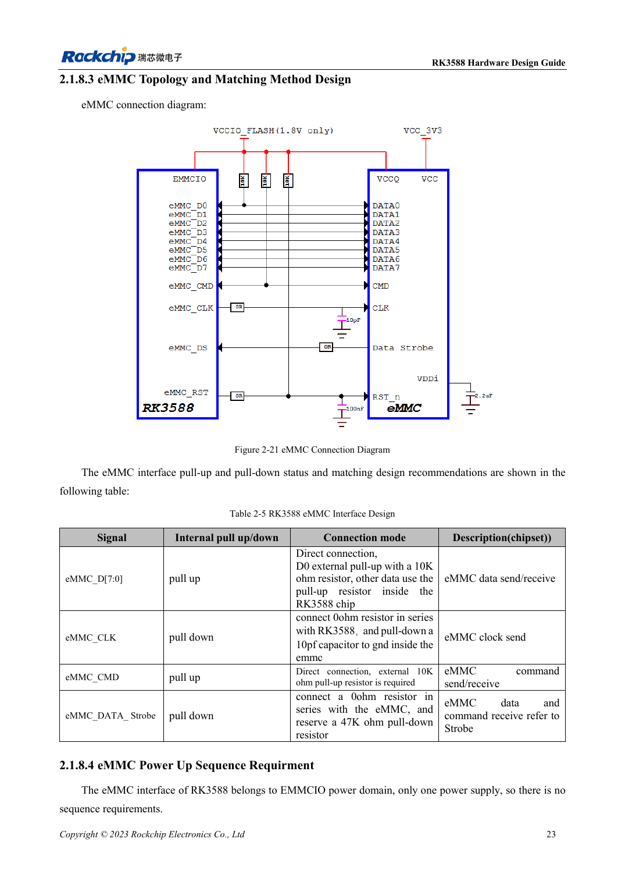
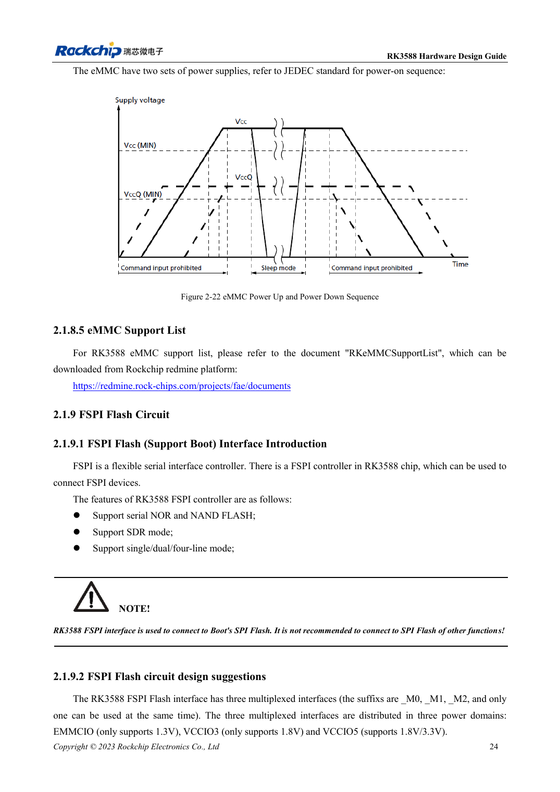

<!-- rk3588-hardware-v13-20261109 -->

# RK3588 eMMC: clock, pull-ups and strobe

Based on the Chinese and English RK3588 Hardware Design Guide V1.3 (2023-02-13), for reviewing SoC boards and carriers. AIM7 and LM7 carriers must follow module interface definitions; Sige7 provides a starting point for software and peripheral validation. SoC capabilities are not a board connector list. Verify SDK/BSP, kernel, board revision and firmware. Values are source references, not ArmSoM hardware measurements.

**RK3588 Hardware Design Guide V1.3 (2023-02-13), EN** · §2.1.8; §3.4.14

## Apply the V1.3 clock connection

Table 2-5 places 0Ω in CLK at RK3588 and 10pF to ground at the eMMC. D0 and CMD use external 10kΩ pull-ups; other data uses internal pull-ups. Strobe gets 0Ω at the device and a reserved 47kΩ pull-down. Do not apply one template to all signals; component location matters.

## Validate supplies and mode

EMMCIO and the device dual supplies are different concerns; verify device sequencing for the exact part. Check support lists and Loader/BSP versions, then test target mode, cold boot, sustained transfers and power-loss recovery. AIM7/LM7 eMMC is on the module; replacement or external access must follow module documentation, not inference from a SoC drawing.

## Design parameters and review table

| Item | Source reference |
| --- | --- |
| CLK | 0Ω at SoC; 10pF at eMMC |
| D0 / CMD | 10kΩ pull-up |
| Strobe | 0Ω at eMMC; reserve 47kΩ pull-down |
| PCB impedance / length | 50Ω ±10% / <3.5in |
| Clock-data mismatch | <120mil |

## Source figures

The reference pages below contain the relevant circuit or timing figures; click for full resolution. Designators and component values belong to the reference design, not an ArmSoM product schematic.

English original · PDF 45 · 2-21

English original · PDF 46 · 2-22

## ArmSoM development path

AIM7 supports compute-module carrier development, LM7 targets LGA module integration, and Sige7 supports early software and peripheral evaluation. With modules, identify which supplies, DDR and boot circuits are already integrated before designing the carrier. Do not duplicate SoC reference circuits unnecessarily. Follow product documentation for connectors, exposed interfaces, voltages and system support.

- [ArmSoM AIM7](https://www.armsom.org/aim7) · [AIM7 Docs](https://docs.armsom.org/armsom-aim7)
- [ArmSoM Sige7](https://www.armsom.org/sige7) · [Sige7 Docs](https://docs.armsom.org/armsom-sige7)
- [ArmSoM LM7](https://www.armsom.org/lm7) · [LM7 Docs](https://docs.armsom.org/armsom-lm7)

## Continue reading

- [RK3588 hardware design: 30 topics](/articles/rk3588-hardware-design-series/)
- [RK3588 DDR routing: length and delay matching](/articles/rk3588-ddr-pcb-routing/)
- [RK3588 FSPI Flash: boot, supply and matching](/articles/rk3588-fspi-boot-hardware/)
