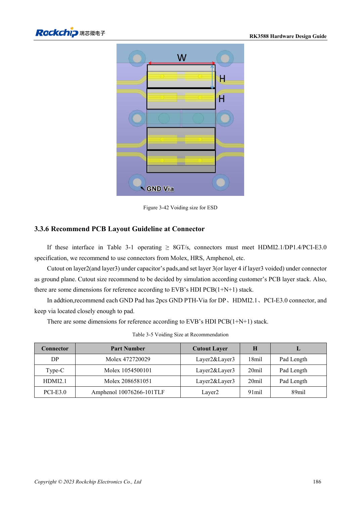

<!-- rk3588-hardware-v13-20261109 -->

# RK3588 ESD and EMI: interface protection and return paths

Based on the Chinese and English RK3588 Hardware Design Guide V1.3 (2023-02-13), for reviewing SoC boards and carriers. AIM7 and LM7 carriers must follow module interface definitions; Sige7 provides a starting point for software and peripheral validation. SoC capabilities are not a board connector list. Verify SDK/BSP, kernel, board revision and firmware. Values are source references, not ArmSoM hardware measurements.

**RK3588 Hardware Design Guide V1.3 (2023-02-13), EN** · §5; §3.3.5

## Place protection where current enters

TVS belongs near connectors or discharge entry points with short low-impedance ground return. Keep reset, clock and interrupt nets away from edges; the guide suggests at least 5mm. Include ESD capacitance and pads in signal-integrity analysis rather than assuming higher ratings or more capacitance always help.

## Start EMI diagnosis at source and coupling path

Check broken returns, long stubs, common-mode conversion and switching supplies before choosing filters or shields. Heatsinks can radiate coupled energy; provide grounding options and test. General series-resistor advice does not override USB/HDMI/PCIe rules. Test real enclosure, cables, grounding and certification conditions; design guidance is not certification.

## Design parameters and review table

| Item | Source reference |
| --- | --- |
| Sensitive-net edge distance | ≥5mm |
| Clock source-to-series resistor | ≤400mil |
| Power-plane edge reference | 20H; H=power/ground dielectric spacing |
| High-speed ESD | Use interface-specific capacitance limits |

## Source figures

The reference pages below contain the relevant circuit or timing figures; click for full resolution. Designators and component values belong to the reference design, not an ArmSoM product schematic.

English original · PDF 208 · 3-42

## ArmSoM development path

AIM7 supports compute-module carrier development, LM7 targets LGA module integration, and Sige7 supports early software and peripheral evaluation. With modules, identify which supplies, DDR and boot circuits are already integrated before designing the carrier. Do not duplicate SoC reference circuits unnecessarily. Follow product documentation for connectors, exposed interfaces, voltages and system support.

- [ArmSoM AIM7](https://www.armsom.org/aim7) · [AIM7 Docs](https://docs.armsom.org/armsom-aim7)
- [ArmSoM Sige7](https://www.armsom.org/sige7) · [Sige7 Docs](https://docs.armsom.org/armsom-sige7)
- [ArmSoM LM7](https://www.armsom.org/lm7) · [LM7 Docs](https://docs.armsom.org/armsom-lm7)

## Continue reading

- [RK3588 hardware design: 30 topics](/articles/rk3588-hardware-design-series/)
- [RK3588 thermal design: reference resistance and system validation](/articles/rk3588-thermal-hardware-design/)
- [RK3588 assembly and storage: reflow, MSL3 and bake records](/articles/rk3588-assembly-storage-design/)
