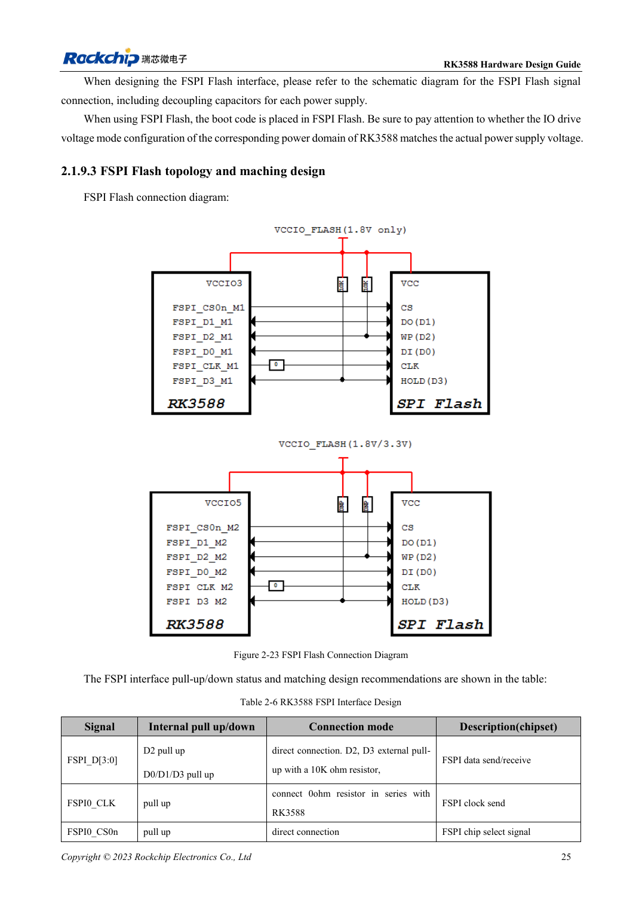

<!-- rk3588-hardware-v13-20261109 -->

# RK3588 FSPI Flash: boot, supply and matching

Based on the Chinese and English RK3588 Hardware Design Guide V1.3 (2023-02-13), for reviewing SoC boards and carriers. AIM7 and LM7 carriers must follow module interface definitions; Sige7 provides a starting point for software and peripheral validation. SoC capabilities are not a board connector list. Verify SDK/BSP, kernel, board revision and firmware. Values are source references, not ArmSoM hardware measurements.

**RK3588 Hardware Design Guide V1.3 (2023-02-13), EN** · §2.1.9; §2.1.4; §3.4.17

## Select boot role and domain

FSPI can provide early boot code, including PCIe initialization before loading an SSD system. The selected mux group determines the IO domain, and Flash must use the same supply as that domain. Package compatibility alone does not establish interchangeability: verify part support, capacity, loader and programming procedure.

## Keep test and recovery options

Table 2-6 reserves 10kΩ pull-ups on D2/D3, 0Ω in CLK at the SoC and direct CS. Review placement, length and startup together, then repeat cold boot and full read-back comparison. Preserve USB recovery for production so corrupted Flash does not prevent servicing.

## Design parameters and review table

| Item | Source reference |
| --- | --- |
| D2 / D3 | Reserve 10kΩ pull-up |
| CLK | 0Ω at SoC |
| Supply | Same rail as selected FSPI IO domain |
| PCB impedance / length | 50Ω ±10% / <4in |
| Clock-data mismatch | <200mil |

## Source figures

The reference pages below contain the relevant circuit or timing figures; click for full resolution. Designators and component values belong to the reference design, not an ArmSoM product schematic.

English original · PDF 47 · 2-23

## ArmSoM development path

AIM7 supports compute-module carrier development, LM7 targets LGA module integration, and Sige7 supports early software and peripheral evaluation. With modules, identify which supplies, DDR and boot circuits are already integrated before designing the carrier. Do not duplicate SoC reference circuits unnecessarily. Follow product documentation for connectors, exposed interfaces, voltages and system support.

- [ArmSoM AIM7](https://www.armsom.org/aim7) · [AIM7 Docs](https://docs.armsom.org/armsom-aim7)
- [ArmSoM Sige7](https://www.armsom.org/sige7) · [Sige7 Docs](https://docs.armsom.org/armsom-sige7)
- [ArmSoM LM7](https://www.armsom.org/lm7) · [LM7 Docs](https://docs.armsom.org/armsom-lm7)

## Continue reading

- [RK3588 hardware design: 30 topics](/articles/rk3588-hardware-design-series/)
- [RK3588 eMMC: clock, pull-ups and strobe](/articles/rk3588-emmc-hardware-design/)
- [RK3588 SDMMC and SDIO Wi-Fi: voltage switching and protection](/articles/rk3588-sdmmc-sdio-wifi-design/)
