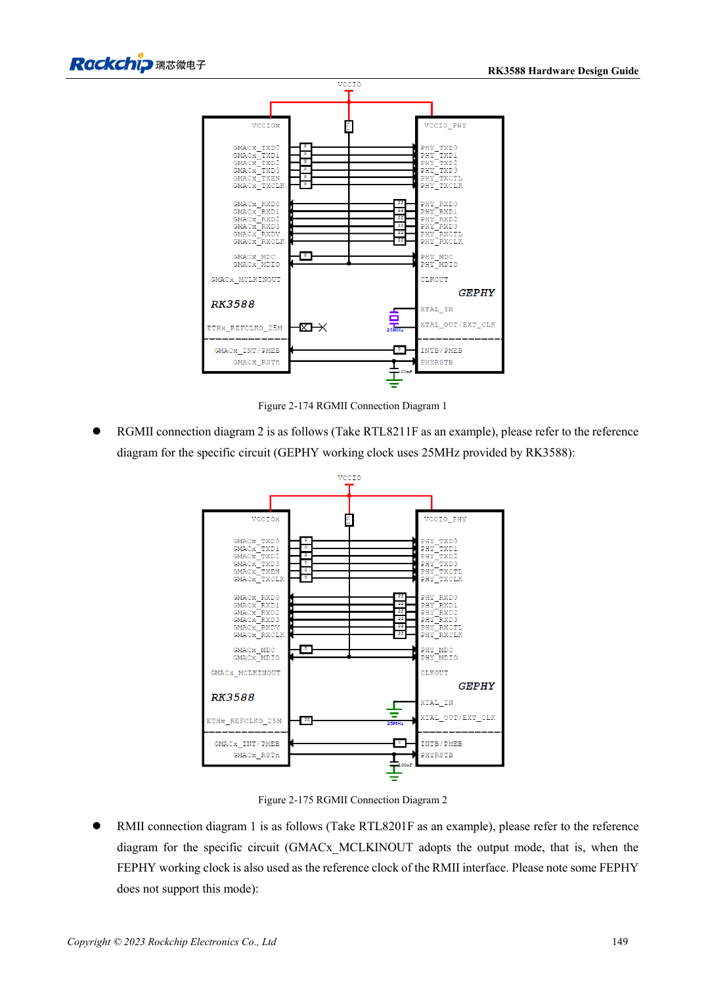

<!-- rk3588-hardware-v13-20261109 -->

# RK3588 Ethernet hardware: GMAC, PHY and clock direction

Based on the Chinese and English RK3588 Hardware Design Guide V1.3 (2023-02-13), for reviewing SoC boards and carriers. AIM7 and LM7 carriers must follow module interface definitions; Sige7 provides a starting point for software and peripheral validation. SoC capabilities are not a board connector list. Verify SDK/BSP, kernel, board revision and firmware. Values are source references, not ArmSoM hardware measurements.

**RK3588 Hardware Design Guide V1.3 (2023-02-13), EN** · §2.3.10; §3.4.19

## Choose levels and clock source

Two GMACs connect to external RGMII/RMII PHYs. GMAC0 uses VCCIO3 at 1.8V only; GMAC1 uses VCCIO5 at 1.8V/3.3V while retaining the fixed 1.8V supply. RMII 50MHz input/output configuration must agree between MAC and PHY to avoid two drivers.

## Validate delay and termination separately

Reserve 0Ω on TX at the SoC, use 22Ω on RX at the PHY and 1.5–1.8kΩ MDIO pull-up. Review PHY internal delay, PCB delay and BSP configuration together to avoid double compensation. Test speeds, sustained bidirectional traffic, errors and reset recovery. RGMII is not the twisted-pair port and cannot connect directly to RJ45.

## Design parameters and review table

| Item | Source reference |
| --- | --- |
| RGMII impedance | 50Ω ±10% single-ended |
| TX/RX group to clock | <120mil |
| Trace length | <5in |
| MDIO pull-up | 1.5–1.8kΩ |

## Source figures

The reference pages below contain the relevant circuit or timing figures; click for full resolution. Designators and component values belong to the reference design, not an ArmSoM product schematic.

English original · PDF 171 · 2-175

## ArmSoM development path

AIM7 supports compute-module carrier development, LM7 targets LGA module integration, and Sige7 supports early software and peripheral evaluation. With modules, identify which supplies, DDR and boot circuits are already integrated before designing the carrier. Do not duplicate SoC reference circuits unnecessarily. Follow product documentation for connectors, exposed interfaces, voltages and system support.

- [ArmSoM AIM7](https://www.armsom.org/aim7) · [AIM7 Docs](https://docs.armsom.org/armsom-aim7)
- [ArmSoM Sige7](https://www.armsom.org/sige7) · [Sige7 Docs](https://docs.armsom.org/armsom-sige7)
- [ArmSoM LM7](https://www.armsom.org/lm7) · [LM7 Docs](https://docs.armsom.org/armsom-lm7)

## Continue reading

- [RK3588 hardware design: 30 topics](/articles/rk3588-hardware-design-series/)
- [RK3588 audio hardware: I2S, PDM and microphone arrays](/articles/rk3588-audio-hardware-design/)
- [RK3588 GPIO and SARADC: domains and button inputs](/articles/rk3588-gpio-saradc-hardware/)
