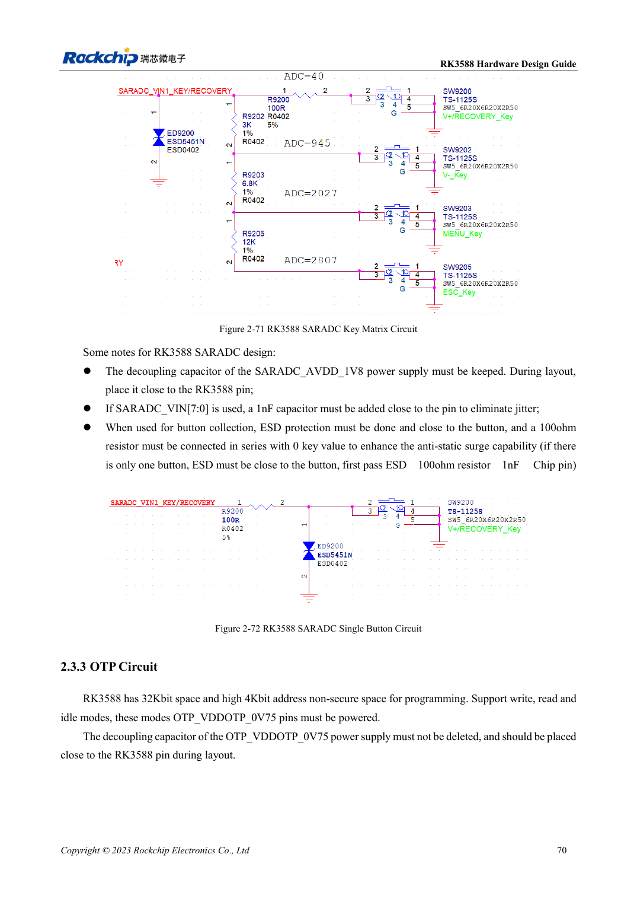

<!-- rk3588-hardware-v13-20261109 -->

# RK3588 GPIO and SARADC: domains and button inputs

Based on the Chinese and English RK3588 Hardware Design Guide V1.3 (2023-02-13), for reviewing SoC boards and carriers. AIM7 and LM7 carriers must follow module interface definitions; Sige7 provides a starting point for software and peripheral validation. SoC capabilities are not a board connector list. Verify SDK/BSP, kernel, board revision and firmware. Values are source references, not ArmSoM hardware measurements.

**RK3588 Hardware Design Guide V1.3 (2023-02-13), EN** · §2.1.10; §2.3.2; §2.3.16

## Check domains before connecting peripherals

PMUIO1, EMMCIO, VCCIO1 and VCCIO3 are fixed 1.8V; PMUIO2, VCCIO2 and VCCIO4/5/6 select 1.8V or 3.3V. Fixed 1.8V companion pins and selectable pins must not mix S0/S3 retention. Automatic recognition of some domains does not permit 5V signals.

## Not all ADC channels are free

SARADC is 12-bit, 1MS/s, 0–1.8V with eight inputs; IN0_BOOT is dedicated and IN1 retains recovery with 10kΩ pull-up. Add 1nF near used inputs and ESD before the button series resistor. The source’s ±35 key-code/123mV relationship is unclear alongside 12-bit resolution; determine thresholds from actual driver scaling and measured voltages, not an assumed conversion.

## Design parameters and review table

| Item | Source reference |
| --- | --- |
| SARADC | 12bit; 1MS/s; 0–1.8V |
| Reserved inputs | IN0_BOOT; IN1 recovery |
| Input filter | 1nF |
| Recovery pull-up | 10kΩ |

## Source figures

The reference pages below contain the relevant circuit or timing figures; click for full resolution. Designators and component values belong to the reference design, not an ArmSoM product schematic.

English original · PDF 92 · 2-71

## ArmSoM development path

AIM7 supports compute-module carrier development, LM7 targets LGA module integration, and Sige7 supports early software and peripheral evaluation. With modules, identify which supplies, DDR and boot circuits are already integrated before designing the carrier. Do not duplicate SoC reference circuits unnecessarily. Follow product documentation for connectors, exposed interfaces, voltages and system support.

- [ArmSoM AIM7](https://www.armsom.org/aim7) · [AIM7 Docs](https://docs.armsom.org/armsom-aim7)
- [ArmSoM Sige7](https://www.armsom.org/sige7) · [Sige7 Docs](https://docs.armsom.org/armsom-sige7)
- [ArmSoM LM7](https://www.armsom.org/lm7) · [LM7 Docs](https://docs.armsom.org/armsom-lm7)

## Continue reading

- [RK3588 hardware design: 30 topics](/articles/rk3588-hardware-design-series/)
- [RK3588 Ethernet hardware: GMAC, PHY and clock direction](/articles/rk3588-gmac-hardware-design/)
- [RK3588 UART, SPI, CAN, I2C and PWM allocation](/articles/rk3588-serial-control-hardware/)
