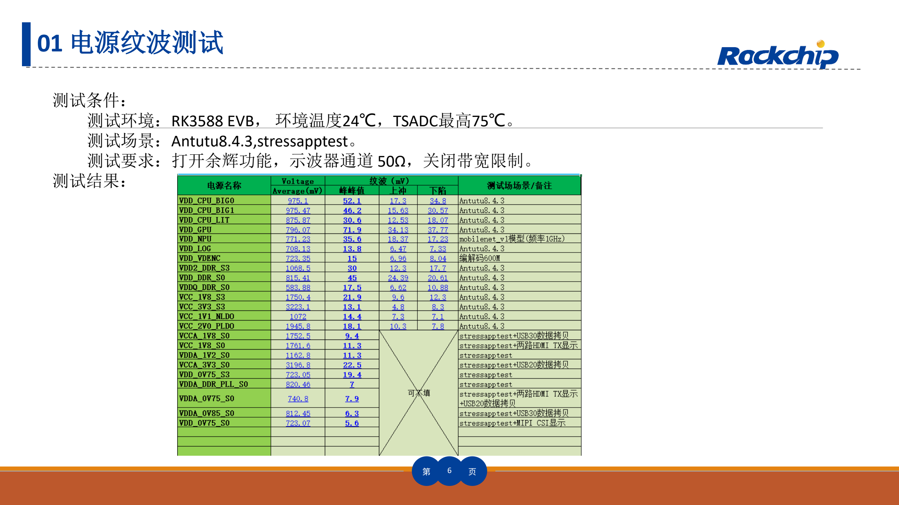
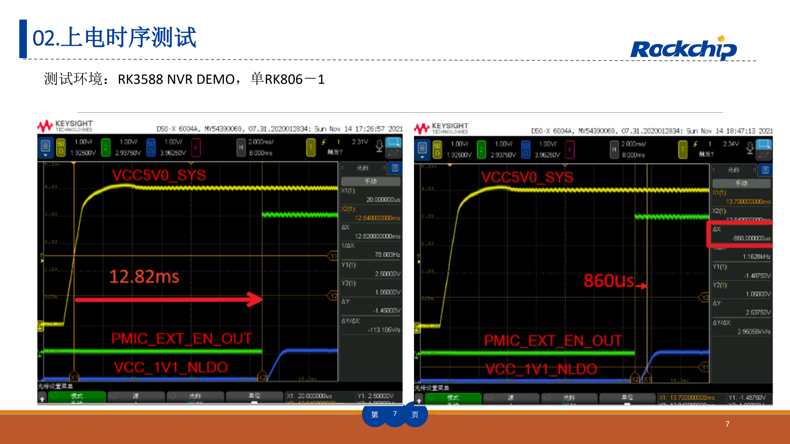
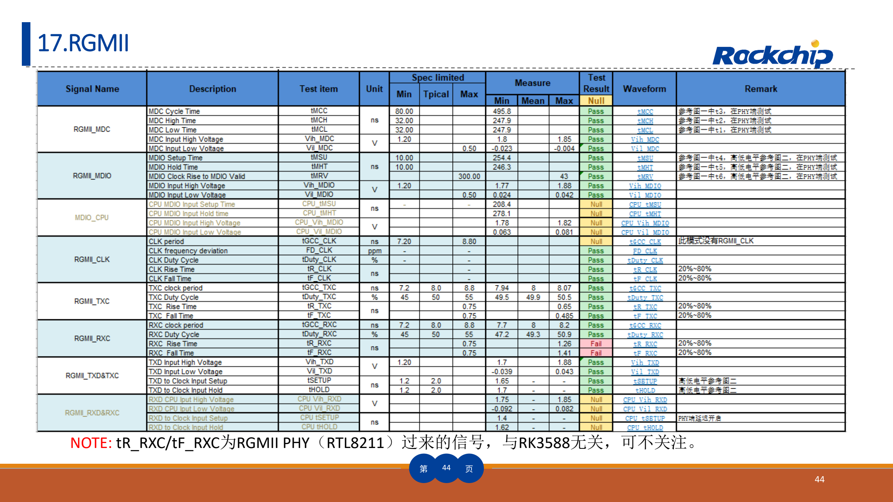

This task-focused guide explains the source with key specifications, limitations and original figures. It is not a page-by-page translation or a complete pin/register manual. Vendor examples are not ArmSoM measurements. Check the actual board revision, schematic, SDK/BSP, kernel and drivers before applying them; no new hardware validation was performed for this article.

**Primary source：** `RK3588_HW_Test_Report_Summary V1.3_20230215.pdf` · PDF 51 pages.

## A reference method, not approval for your board

The 51-page report contains 23 groups spanning power, DDR, storage, video, networking and audio. It helps define measurements, retain conditions and investigate marginal behaviour. AIM7, Sige7 and LM7 are documented RK3588 products, but different carriers, interfaces, cooling and supplies need their own results.

The filename says V1.3_20230215, while the cover still says V1.2_20220829. The revision table adds V1.3 and an RGMII update on p. 44. This guide follows the actual file and retains that version discrepancy.

## Organize the 23 groups

| Source numbers | Test groups | Conditions and evidence to retain |
| --- | --- | --- |
| 01–03 | Supply ripple, power sequence, consumption | Load, ambient, rails, test points, probes, triggers and measurement boundary |
| 04–06 | LPDDR4, LPDDR5, eMMC | Device/BOM, DDR initialization, frequency, temperature, timing and sustained I/O |
| 07–09 | PCIe3.0, PCIe2.0, SATA3.0 | Link mode, lanes, cables/adapters, eye/waveform and sustained traffic |
| 10–12 | HDMI TX, Type-C DP, eDP | Output mode, lanes, display/load, connectors and fixtures |
| 13–16 | MIPI D/C PHY, MIPI DPHY, USB3.0, USB2.0 | Rate, direction, mode, load, cable and test point |
| 17–20 | RGMII, SDMMC, SPDIF, UART | I/O voltage, frequency, direction, timing and error conditions |
| 21–23 | I2S, PDM, I2C | Clock, sample/bus rate, load, pull-ups and edges |

Start with power and boot, then memory stability, individual interfaces and finally concurrent loads and temperature boundaries. Reaching a desktop, establishing a network link or playing one video does not cover this plan.

*Vendor supply-ripple test and conditions — Original Chinese figure; no corresponding English figure was found in this batch. `RK3588_HW_Test_Report_Summary V1.3_20230215.pdf`, PDF p. 6.*

## Ripple measurements require a defined setup

Page 6 uses an RK3588 EVB, 24℃ ambient, maximum TSADC 75℃, and Antutu 8.4.3/stressapptest loads. It also records persistence, 50Ω and disabled bandwidth limiting. These describe that measurement setup, not a universal connection method. Before using a 50Ω input, verify the probe and coupling do not load the rail improperly.

Record ground-lead length, test point, bandwidth, peak-to-peak ripple, average voltage and repetitions. Idle and burst loads can produce different results. A screenshot without load conditions is difficult to reproduce.

*RK3588 NVR DEMO power-sequence example — Original Chinese figure; no corresponding English figure was found in this batch. `RK3588_HW_Test_Report_Summary V1.3_20230215.pdf`, PDF p. 7.*

## Successful boot does not establish correct sequencing

The p. 7 sequence example uses an RK3588 NVR DEMO with one RK806-1. Map those signals to your power tree, enables, reset and reference clock. Check cold boot, rapid restart, undervoltage and slow power removal. Example delays are not default AIM7, Sige7 or LM7 timings.

The p. 12 consumption summary refers separately to `RK3588 Power Consumption Test Report V1.1_20220829_CN`. This article does not derive a board-adapter rating from that summary alone. Peripheral startup current, conversion loss and cooling belong in the budget.

## Accept function, signal quality and stability separately

Device enumeration demonstrates only part of a working link. For PCIe/SATA/USB, check negotiated rate, downgrades, errors and throughput after thermal stabilization. For displays, check pixel format, refresh rate, jitter and receiver. DDR results must identify the actual memory, routing and initialization.

Tested LPDDR4/LPDDR5 devices and interface modes do not imply identical parts in every ArmSoM product. A memory, carrier, connector or cable change requires reassessing affected tests; old screenshots cannot qualify new hardware.

*Original RGMII test table and note — Original Chinese figure; no corresponding English figure was found in this batch. `RK3588_HW_Test_Report_Summary V1.3_20230215.pdf`, PDF p. 44.*

## RGMII illustrates signal ownership

Page 44 identifies `tR_RXC/tF_RXC` as originating in the external RTL8211 PHY. This distinguishes the source of the signal; it does not justify ignoring the clock arriving at the SoC during system validation. Identify transmitter, receiver, delay configuration and probe point before assigning a timing failure.

## Minimum evidence for a useful test record

Keep board/carrier revision, BOM, image/kernel, ambient temperature, equipment/calibration, connection diagram, load, acceptance basis, raw results and retest conclusion. Separate vendor references, project targets and measurements on your board. Add reproducible steps to each failure.

Sige7 can provide an application/peripheral evaluation starting point. AIM7 or LM7 projects must include their carrier, connections and cooling in the same record. Product choice follows system form and interfaces, not the existence of this vendor report alone.

## Products and development resources

- **AIM7** — [Product](https://www.armsom.org/aim7) · [Documentation](https://docs.armsom.org/armsom-aim7)
- **Sige7** — [Product](https://www.armsom.org/sige7) · [Documentation](https://docs.armsom.org/armsom-sige7)
- **LM7** — [Product](https://www.armsom.org/lm7) · [Documentation](https://docs.armsom.org/armsom-lm7)

## Further reading

- [RK3588 NVR reference design](/articles/rk3588-nvr-reference-design/)
- [Production process and checklist](/articles/rockchip-hardware-production-checklist/)
