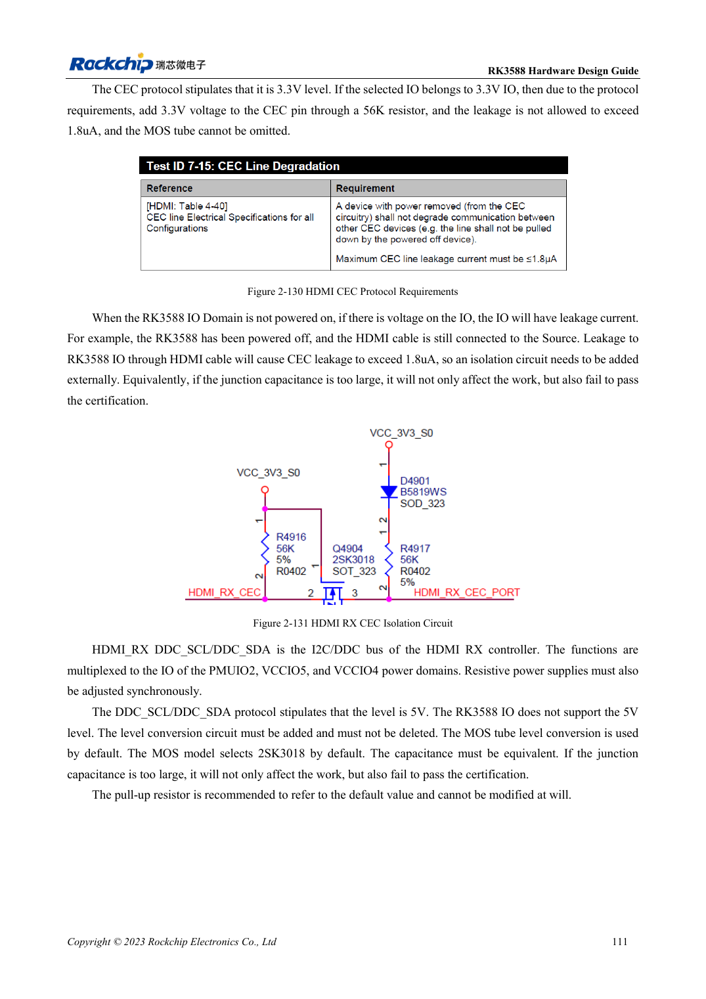

<!-- rk3588-hardware-v13-20261109 -->

# RK3588 HDMI RX: capture input, CEC and DDC levels

Based on the Chinese and English RK3588 Hardware Design Guide V1.3 (2023-02-13), for reviewing SoC boards and carriers. AIM7 and LM7 carriers must follow module interface definitions; Sige7 provides a starting point for software and peripheral validation. SoC capabilities are not a board connector list. Verify SDK/BSP, kernel, board revision and firmware. Values are source references, not ArmSoM hardware measurements.

**RK3588 Hardware Design Guide V1.3 (2023-02-13), EN** · §2.3.7.4; §3.4.7

## RX is not TX wired backwards

Table 2-24 uses 2.2Ω in RX data/clock and 200Ω, 1% from REXT to ground. HPD is driven from the receiver toward the source through the reference MOS circuit. Do not copy TX coupling and bias networks into the receiver. Confirm direction, reference resistor and supplies first.

## Check leakage while powered off

HDMI DDC uses 5V but RK3588 IO does not tolerate 5V; retain level conversion. CEC needs isolation, with a 56kΩ RX reference resistor rather than the TX 27kΩ value. Test powered-source/unpowered-receiver leakage, HPD, EDID reading, target capture format and cable stability.

## Design parameters and review table

| Item | Source reference |
| --- | --- |
| RX series / REXT | 2.2Ω / 200Ω ±1% |
| RX CEC reference | 56kΩ |
| Differential / length | 100Ω ±10% / <6in |
| Clock-data mismatch | <480mil |

## Source figures

The reference pages below contain the relevant circuit or timing figures; click for full resolution. Designators and component values belong to the reference design, not an ArmSoM product schematic.

English original · PDF 133 · 2-131

## ArmSoM development path

AIM7 supports compute-module carrier development, LM7 targets LGA module integration, and Sige7 supports early software and peripheral evaluation. With modules, identify which supplies, DDR and boot circuits are already integrated before designing the carrier. Do not duplicate SoC reference circuits unnecessarily. Follow product documentation for connectors, exposed interfaces, voltages and system support.

- [ArmSoM AIM7](https://www.armsom.org/aim7) · [AIM7 Docs](https://docs.armsom.org/armsom-aim7)
- [ArmSoM Sige7](https://www.armsom.org/sige7) · [Sige7 Docs](https://docs.armsom.org/armsom-sige7)
- [ArmSoM LM7](https://www.armsom.org/lm7) · [LM7 Docs](https://docs.armsom.org/armsom-lm7)

## Continue reading

- [RK3588 hardware design: 30 topics](/articles/rk3588-hardware-design-series/)
- [RK3588 cameras: CSI, D/C PHY and CIF planning](/articles/rk3588-camera-hardware-design/)
- [RK3588 HDMI TX: FRL, TMDS and compatibility circuits](/articles/rk3588-hdmi-tx-hardware-design/)
