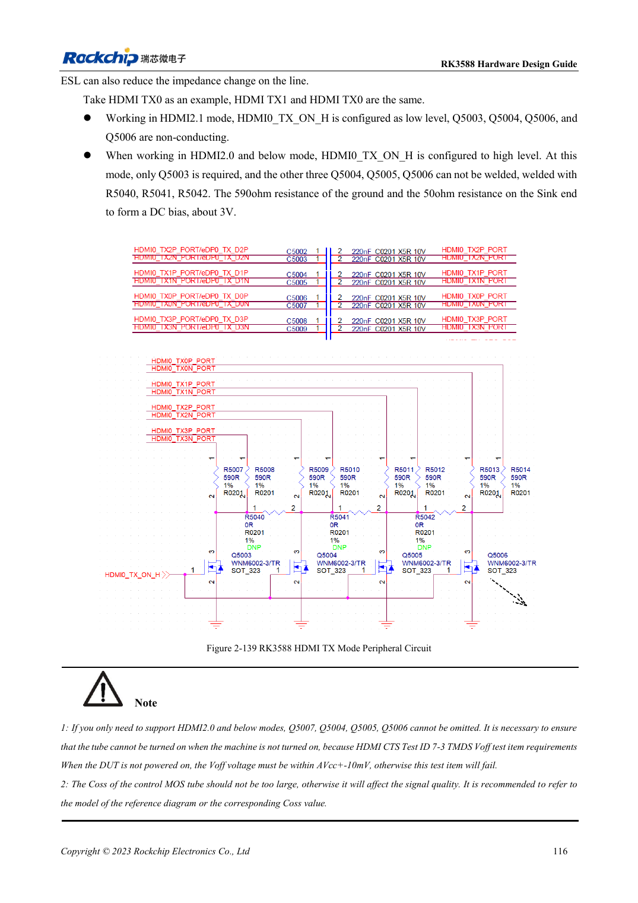
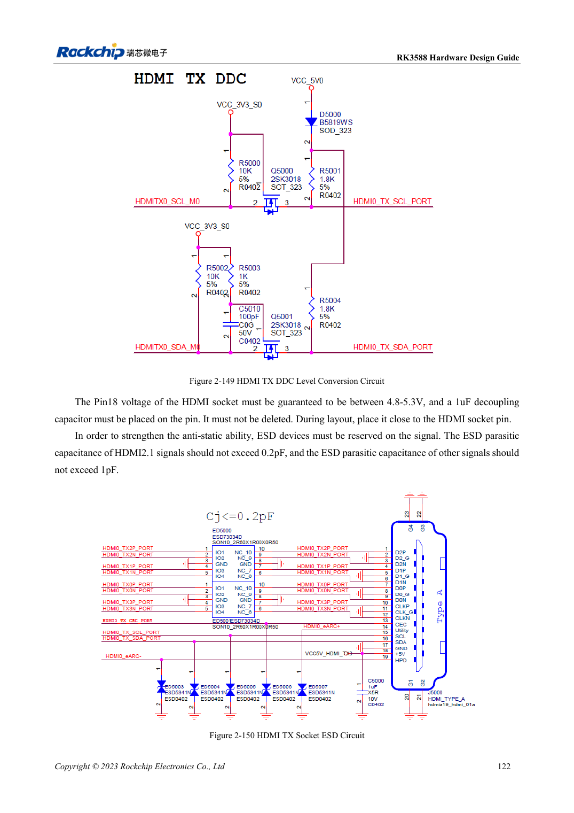

<!-- rk3588-hardware-v13-20261109 -->

# RK3588 HDMI TX: FRL, TMDS and compatibility circuits

Based on the Chinese and English RK3588 Hardware Design Guide V1.3 (2023-02-13), for reviewing SoC boards and carriers. AIM7 and LM7 carriers must follow module interface definitions; Sige7 provides a starting point for software and peripheral validation. SoC capabilities are not a board connector list. Verify SDK/BSP, kernel, board revision and firmware. Values are source references, not ArmSoM hardware measurements.

**RK3588 Hardware Design Guide V1.3 (2023-02-13), EN** · §2.3.8.1; §3.4.8

## FRL and TMDS need different circuit states

HDMI2.1 uses FRL, while compatibility with HDMI2.0 and earlier uses TMDS. The reference has 220nF coupling and switched bias; TMDS uses 590Ω with receiver bias. MOS off-state behavior and parasitic capacitance matter. A working picture does not justify removing control circuitry. Shared HDMI/eDP PHYs also constrain simultaneous use.

## Validate control and high-speed paths

REXT is 8.2kΩ, 1%. DDC requires 5V translation; the TX CEC reference uses 27kΩ and isolation against off-state leakage. Connector pin 18 must be 4.8–5.3V. HDMI2.1 ESD capacitance must not exceed 0.2pF. Test hot-plug, powered-off connection and multiple displays/cables. Historical unsupported-feature notes describe this source version, not every current BSP.

## Design parameters and review table

| Item | Source reference |
| --- | --- |
| TX coupling / bias reference | 220nF / 590Ω |
| REXT | 8.2kΩ ±1% |
| PCB differential / length | 100Ω ±10% / <4in |
| Vias / airgap | Prefer no vias / ≥7× trace width |

## Source figures

The reference pages below contain the relevant circuit or timing figures; click for full resolution. Designators and component values belong to the reference design, not an ArmSoM product schematic.

English original · PDF 138 · 2-139

English original · PDF 144 · 2-150

## ArmSoM development path

AIM7 supports compute-module carrier development, LM7 targets LGA module integration, and Sige7 supports early software and peripheral evaluation. With modules, identify which supplies, DDR and boot circuits are already integrated before designing the carrier. Do not duplicate SoC reference circuits unnecessarily. Follow product documentation for connectors, exposed interfaces, voltages and system support.

- [ArmSoM AIM7](https://www.armsom.org/aim7) · [AIM7 Docs](https://docs.armsom.org/armsom-aim7)
- [ArmSoM Sige7](https://www.armsom.org/sige7) · [Sige7 Docs](https://docs.armsom.org/armsom-sige7)
- [ArmSoM LM7](https://www.armsom.org/lm7) · [LM7 Docs](https://docs.armsom.org/armsom-lm7)

## Continue reading

- [RK3588 hardware design: 30 topics](/articles/rk3588-hardware-design-series/)
- [RK3588 HDMI RX: capture input, CEC and DDC levels](/articles/rk3588-hdmi-rx-hardware-design/)
- [RK3588 MIPI displays: D-PHY, C-PHY and panel integration](/articles/rk3588-mipi-display-hardware/)
