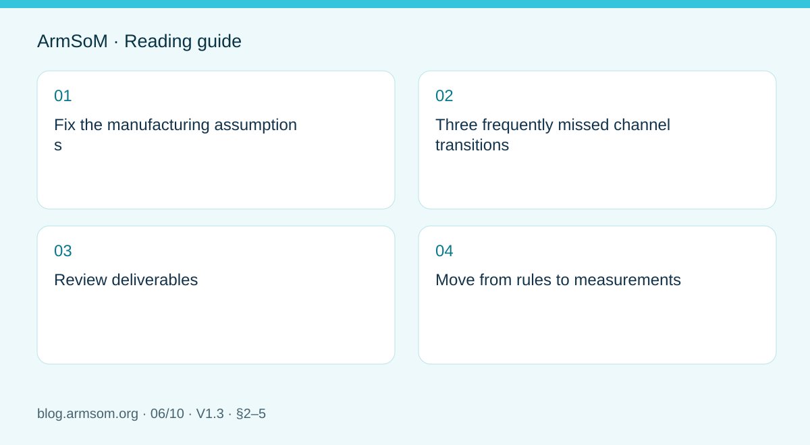
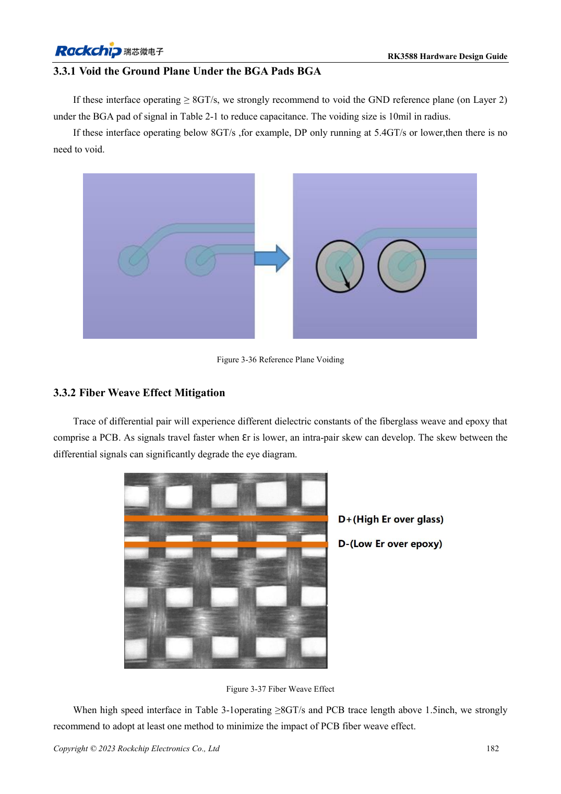
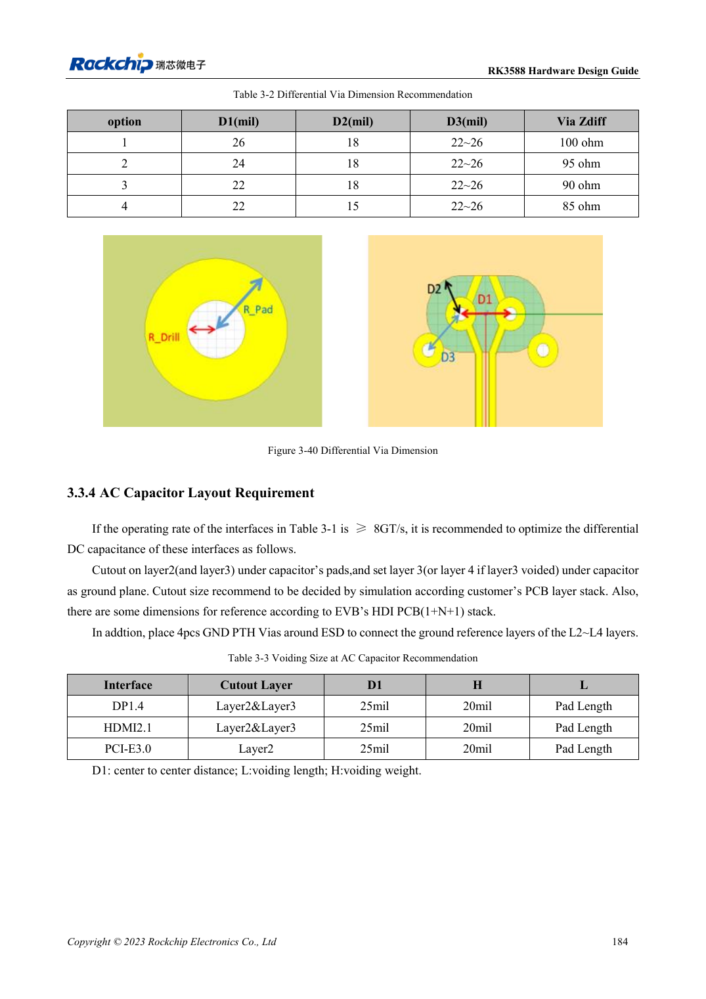
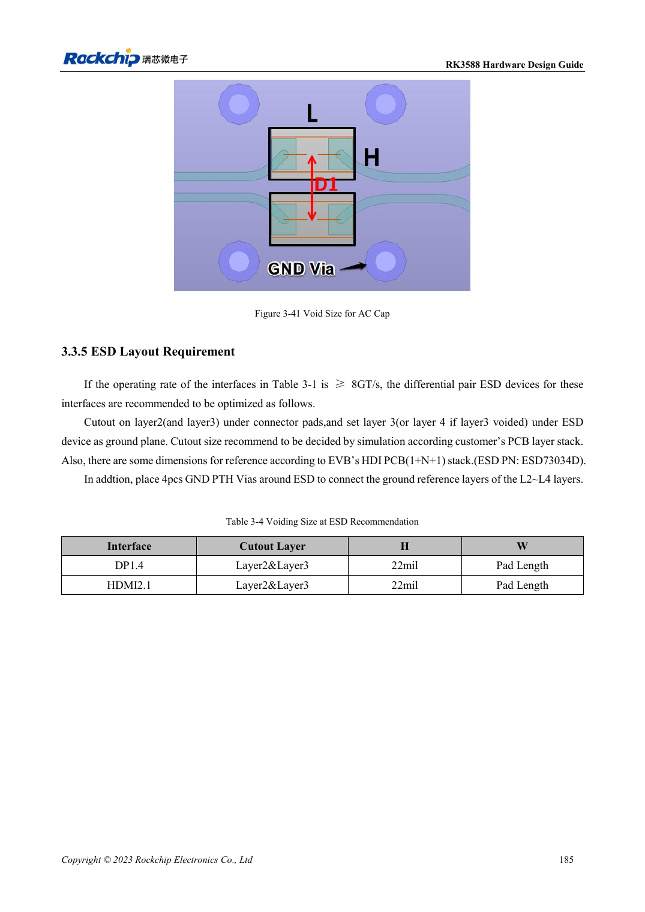

# RK3588 high-speed PCB review: stackup, impedance and routing

## Scope and sources

This is a task-focused engineering guide, not a page-by-page translation of the complete PDF. Source examples are not ArmSoM measurements. Check voltages, pins, SDK/BSP and kernel against the actual board revision.

**Rockchip:** `RK3588 Hardware Design Guide-CN-V1.3-20230213.pdf` · V1.3 · §2–5

## Fix the manufacturing assumptions

A stackup is more than a layer count. Dielectric thickness, material, copper and tolerances determine impedance and loss. Agree interface targets, reference layers and trace geometry with the fabricator, then record them as constraints. Copying a reference board's trace width does not reproduce its impedance.

The source covers stackup and escape in §3.1, general routing in §3.2, signals at 8GT/s and above in §3.3, and interface-specific rules in §3.4. Numerical limits still require the relevant section.

## Three frequently missed channel transitions

1. **BGA and connector pads:** local capacitance changes impedance; reference-plane treatment needs the actual footprint and stackup.
2. **Vias and layer changes:** examine stubs and return-current transitions rather than the signal via alone.
3. **Coupling and protection parts:** electrical function and pad discontinuity both matter. Adding ESD protection does not automatically preserve high-speed margin.

The guide also addresses glass-weave effects. Their dependence on material and geometry cannot be solved merely by adding length compensation at the far end.

## Review deliverables

| Check | Evidence |
| --- | --- |
| Reference continuity | Inspection along critical routes |
| Impedance and length | Fabricator-confirmed values, mode-specific limits and margin |
| Vias and connectors | Count, position, parts and models |
| Power and return paths | Decoupling loops, ground and shield connections |
| Testability | Access methods that do not materially disturb the channel |

Avoid unevaluated long test-point branches. Do not create unnecessary coupling and meanders simply to achieve equal length.

## Move from rules to measurements

DRC only checks encoded rules; it cannot demonstrate channel margin. Plan signal-integrity checks, enumeration or training, target-rate operation and sustained transfers using actual cables and enclosure. If low speed works but high speed fails, investigate the channel, supply and software separately.

A carrier is only part of an ArmSoM module's channel. Likewise, successful application tests on Sige7 do not certify another PCB.

## Source illustration

Original from the English document, shared by EN/RU/DE. Reference design, not an ArmSoM board schematic.

`RK3588 hardware design guide-EN-V1.3-20230213.pdf` · PDF p. 25.

## Products and development resources

- **AIM7** — [Product page](https://www.armsom.org/aim7) · [Documentation](https://docs.armsom.org/armsom-aim7)
- **Sige7** — [Product page](https://www.armsom.org/sige7) · [Documentation](https://docs.armsom.org/armsom-sige7)
- **LM7** — [Product page](https://www.armsom.org/lm7) · [Documentation](https://docs.armsom.org/armsom-lm7)

## Continue this series

- [RK3576 hardware bring-up: minimum system and first-power checks](/articles/rk3576-hardware-bringup/)
- [ArmSoM CM5 carrier-board checklist: power, boot and interface planning](/articles/019-cm5-carrier-production/)
- [RK3576 high-speed interfaces: review schematics and PCB together](/articles/rk3576-high-speed-interface-design/)
- [RK3588S hardware design: from a reference circuit to a CM7s carrier](/articles/rk3588s-cm7s-carrier-design/)
- [RK3588 edge-AI hardware: plan power, cooling and expansion together](/articles/rk3588-edge-ai-hardware-design/)
- [RK3506 industrial HMI hardware: choosing a CM1 or Forge1 development path](/articles/rk3506-industrial-hmi-hardware/)
- [RK3308 hardware variants: compatibility checks for P2 Pro audio projects](/articles/rk3308-hardware-variant-compatibility/)
- [RK3588S versus RK3588S2: what to check before a hardware revision](/articles/rk3588s-rk3588s2-hardware-differences/)
- [Rockchip prototype to production: process requirements and test records](/articles/rockchip-hardware-production-checklist/)

<!-- rk3588-hardware-v13-20261109 -->

## RK3588 high-speed PCB: pads and vias above 8GT/s

Based on the Chinese and English RK3588 Hardware Design Guide V1.3 (2023-02-13), for reviewing SoC boards and carriers. AIM7 and LM7 carriers must follow module interface definitions; Sige7 provides a starting point for software and peripheral validation. SoC capabilities are not a board connector list. Verify SDK/BSP, kernel, board revision and firmware. Values are source references, not ArmSoM hardware measurements.

**RK3588 Hardware Design Guide V1.3 (2023-02-13), EN** · §3.2; §3.3

## Identify the applicable rates

Section 3.3 addresses links such as DP1.4 8.1Gbps, HDMI2.1 12Gbps and PCIe3 8GT/s. Relevant BGA pads at these rates use reference L2 voiding with R=10mil; this is not a requirement to remove ground under every signal. Reassess lower-rate links and other stackups instead of applying one rule to the entire PCB.

## Preserve return paths after voiding

If L2 is removed below a capacitor, L3 must provide ground; if L2/L3 are removed, L4 must provide ground, with nearby ground stitching. Dimensions apply to the EVB stack and parts. Relevant high-speed traces longer than 1.5in need glass-weave attention, for example angled routing. Evaluate the complete module/carrier/connector channel by simulation or measurement.

## Design parameters and review table

| Item | Source reference |
| --- | --- |
| Reference BGA void | R=10mil; applicable ≥8GT/s links |
| Glass-weave review | 8GT/s and length >1.5in |
| Angle example | 10°–35° |
| Reference via radii | Drill 0.1mm; pad 0.2mm |

## Source figures

The reference pages below contain the relevant circuit or timing figures; click for full resolution. Designators and component values belong to the reference design, not an ArmSoM product schematic.

English original · PDF 204 · 3-36

English original · PDF 206 · 3-40

English original · PDF 207 · 3-41

## ArmSoM development path

AIM7 supports compute-module carrier development, LM7 targets LGA module integration, and Sige7 supports early software and peripheral evaluation. With modules, identify which supplies, DDR and boot circuits are already integrated before designing the carrier. Do not duplicate SoC reference circuits unnecessarily. Follow product documentation for connectors, exposed interfaces, voltages and system support.

- [ArmSoM AIM7](https://www.armsom.org/aim7) · [AIM7 Docs](https://docs.armsom.org/armsom-aim7)
- [ArmSoM Sige7](https://www.armsom.org/sige7) · [Sige7 Docs](https://docs.armsom.org/armsom-sige7)
- [ArmSoM LM7](https://www.armsom.org/lm7) · [LM7 Docs](https://docs.armsom.org/armsom-lm7)

## Continue reading

- [RK3588 hardware design: 30 topics](/articles/rk3588-hardware-design-series/)
- [RK3588 stackup and fanout: HDI versus through-hole](/articles/rk3588-pcb-stackup-fanout/)
- [RK3588 power PCB and PDN: copper, returns and decoupling](/articles/rk3588-power-pcb-pdn-design/)
