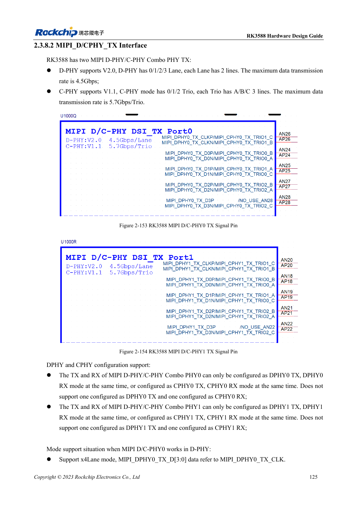
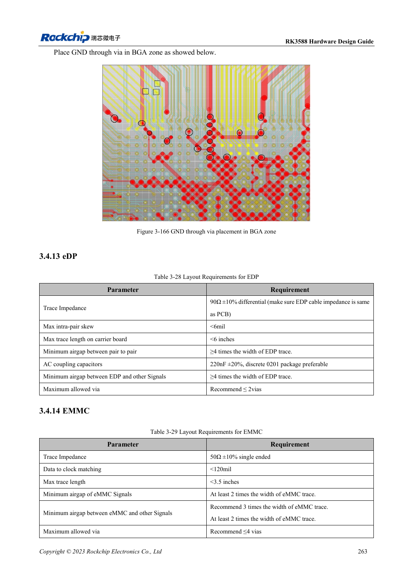

<!-- rk3588-hardware-v13-20261109 -->

# RK3588 MIPI displays: D-PHY, C-PHY and panel integration

Based on the Chinese and English RK3588 Hardware Design Guide V1.3 (2023-02-13), for reviewing SoC boards and carriers. AIM7 and LM7 carriers must follow module interface definitions; Sige7 provides a starting point for software and peripheral validation. SoC capabilities are not a board connector list. Verify SDK/BSP, kernel, board revision and firmware. Values are source references, not ArmSoM hardware measurements.

**RK3588 Hardware Design Guide V1.3 (2023-02-13), EN** · §2.3.8.2; §3.4.12; §3.4.23

## Design lanes and trios separately

The two D/C Combo PHYs provide four two-wire data lanes in D-PHY or three A/B/C trios in C-PHY. TX and RX of the same PHY must both use D-PHY or both C-PHY, not mixed modes. Check panel protocol, lane/trio count and timing before wiring.

## A panel needs more than high-speed data

Match backlight power, enable, reset, touch I2C and interrupt voltages and sequence. D-PHY differential and C-PHY single-ended impedances require separate DRC rules. Validate panel initialization on the actual BSP, then brightness transitions, sleep/wake, touch interference and sustained display.

## Design parameters and review table

| Item | Source reference |
| --- | --- |
| D-PHY source rate | 4.5Gbps/lane |
| C-PHY source rate | 5.7Gbps/trio |
| C-PHY impedance | 50Ω ±10% single-ended |
| C-PHY intra-trio / inter-trio | <6mil / <100mil |
| C-PHY length | <5in |

## Source figures

The reference pages below contain the relevant circuit or timing figures; click for full resolution. Designators and component values belong to the reference design, not an ArmSoM product schematic.

English original · PDF 147 · 2-153

English original · PDF 285 · 3-166

## ArmSoM development path

AIM7 supports compute-module carrier development, LM7 targets LGA module integration, and Sige7 supports early software and peripheral evaluation. With modules, identify which supplies, DDR and boot circuits are already integrated before designing the carrier. Do not duplicate SoC reference circuits unnecessarily. Follow product documentation for connectors, exposed interfaces, voltages and system support.

- [ArmSoM AIM7](https://www.armsom.org/aim7) · [AIM7 Docs](https://docs.armsom.org/armsom-aim7)
- [ArmSoM Sige7](https://www.armsom.org/sige7) · [Sige7 Docs](https://docs.armsom.org/armsom-sige7)
- [ArmSoM LM7](https://www.armsom.org/lm7) · [LM7 Docs](https://docs.armsom.org/armsom-lm7)

## Continue reading

- [RK3588 hardware design: 30 topics](/articles/rk3588-hardware-design-series/)
- [RK3588 HDMI TX: FRL, TMDS and compatibility circuits](/articles/rk3588-hdmi-tx-hardware-design/)
- [RK3588 DP and eDP: shared PHYs, AUX and coupling](/articles/rk3588-dp-edp-hardware-design/)
