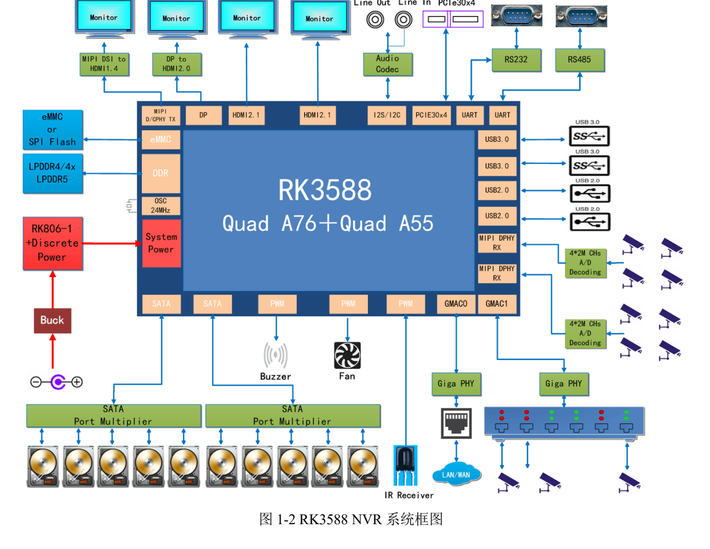
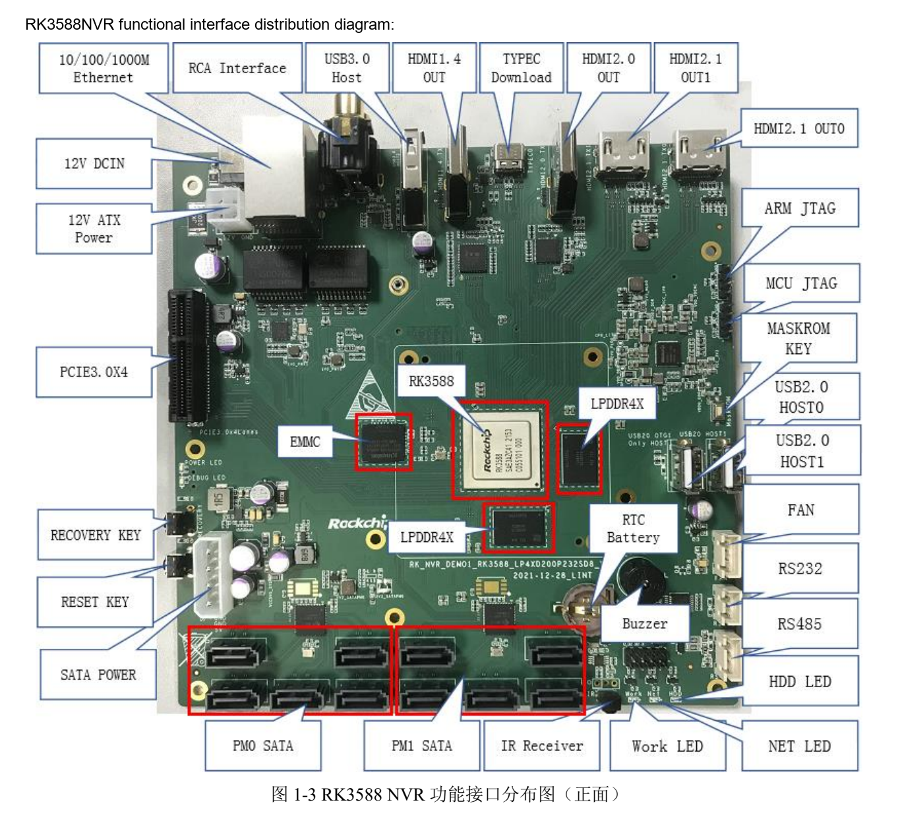

This task-focused guide explains the source with key specifications, limitations and original figures. It is not a page-by-page translation or a complete pin/register manual. Vendor examples are not ArmSoM measurements. Check the actual board revision, schematic, SDK/BSP, kernel and drivers before applying them; no new hardware validation was performed for this article.

**Primary source：** `Rockchip_RK3588_NVR_User_Guide_V1.0_CN_20220421.pdf` · PDF 49 pages.

## A vendor reference board, not an ArmSoM product configuration

The source targets `RK_NVR_DEMO1_RK3588_LP4XD200P232SD8_V21_20211228.DSN`, with RK3588, one RK806-1, 4GB LPDDR4x and 32GB eMMC. Its default adapter is 12V/3A. These values belong to that reference design, not automatically to AIM7, Sige7 or LM7 memory, input voltage or port count.

*RK3588 NVR system diagram — Original Chinese figure; no corresponding English figure was found in this batch. `Rockchip_RK3588_NVR_User_Guide_V1.0_CN_20220421.pdf`, PDF p. 12.*

## Map the path behind each connector

| Function | Source implementation | Product-planning check |
| --- | --- | --- |
| SATA | 2 JMB575 devices expand to as many as 10 disks | Shared upstream bandwidth, drivers, disk power and concurrent writes |
| PCIe | PCIe3.0 x4; PI6C557-05BLE reference clock | Device mode, clock, reset, card and sustained throughput |
| Networking | 2 Gigabit RJ45 ports with RTL8211F-CG | Capture/management allocation, loss and congestion |
| Camera | 2×4-lane or 4×2-lane MIPI DPHY RX through an 80pin connector | Connector, lanes, power and sensor drivers |
| Debug/download | MINI USB Debug; Type-C firmware download | Identify the different ports before connecting |

Ten SATA ports are created by expansion. They are not ten independent native RK3588 SATA controllers and do not establish simultaneous peak throughput for ten disks. Disk startup current and cooling cannot simply be assumed covered by the default adapter.

*RK3588 NVR reference-board layout — Original Chinese figure; no corresponding English figure was found in this batch. `Rockchip_RK3588_NVR_User_Guide_V1.0_CN_20220421.pdf`, PDF p. 14.*

## Separate native HDMI from bridged output

Pages 45–47 describe MIPI through IT6161 to HDMI1.4b, DP through IT6563FN to HDMI2.0, and two HDMI2.1 outputs. The overview on p. 12 says three HDMI outputs, whereas p. 13 lists one HDMI1.4, one HDMI2.0 and two HDMI2.1. The discrepancy remains recorded. This article follows individual paths without claiming that four outputs work concurrently in arbitrary modes.

For a monitoring wall or multi-display terminal, list resolution, refresh, colour format and source for each output. Check the display controller, bridge, connector and BSP together. Maximum interface capability is not a complete concurrency matrix.

## Budget the pipeline from camera to recording

Divide the system into capture, decode/image processing, optional inference, encode, disk writing and local display. Record stream count, bitrate, buffering, latency and recovery at every stage. Network cameras and raw MIPI capture use different bandwidth and software paths.

Storage tests should cover circular recording, full disks, removed/failed drives, sudden power loss and index recovery. Under concurrent I/O, retain aggregate throughput and the slowest stream, not just a single-drive benchmark. RAID/filesystem policy is a later system-design choice, not functionality already delivered by this EVB manual.

## Preserve configuration before recovery or flashing

The Windows driver example is `DriverAssitant_v5.1.1`. For Loader mode, the source connects Type-C to the PC, holds RECOVERY during power-on/reset and releases it after Loader detection. MASKROM uses its corresponding button and confirmed tool detection. Loader, Parameter, Uboot and other files must form a matching set for the board and storage; back up data first.

These are reference-board procedures. Do not transfer its ADC pins, 12V step or shorting method to ArmSoM boards. A production recovery plan needs an accessible download port, serial logs and version records.

## Check I2C and voltage before expansion

Page 23 lists ES8311 on I2C3 at `0x18`, 1.8V; FUSB302BMPX on I2C6 at `0x22`, 3.3V; and HYM8563TS on I2C6 at `0x51`, 3.3V. IT6161 appears as `0x98`; this guide does not assume it is a Linux 7-bit address. Verify the device's convention, multiplexing, voltage domains and pull-ups before connecting an extension.

The final page retains “RK3588S EVB” wording from a template. It does not change the RK3588 identity of this NVR design.

## Reduce development scope with ArmSoM

Sige7 provides a complete-board application starting point; AIM7 and LM7 support evaluation of different module/carrier approaches. Confirm actual interfaces and software before choosing storage expansion, video inputs and cooling. This guide does not claim ten SATA connectors or complete NVR software by default on those products.

## Products and development resources

- **AIM7** — [Product](https://www.armsom.org/aim7) · [Documentation](https://docs.armsom.org/armsom-aim7)
- **Sige7** — [Product](https://www.armsom.org/sige7) · [Documentation](https://docs.armsom.org/armsom-sige7)
- **LM7** — [Product](https://www.armsom.org/lm7) · [Documentation](https://docs.armsom.org/armsom-lm7)

## Further reading

- [RK3588 hardware validation](/articles/rk3588-hardware-test-report/)
