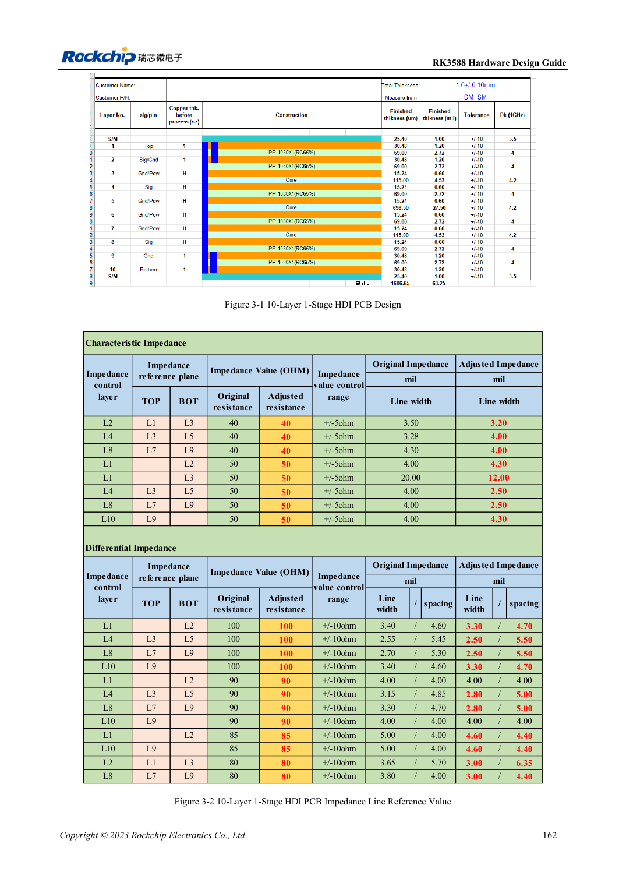
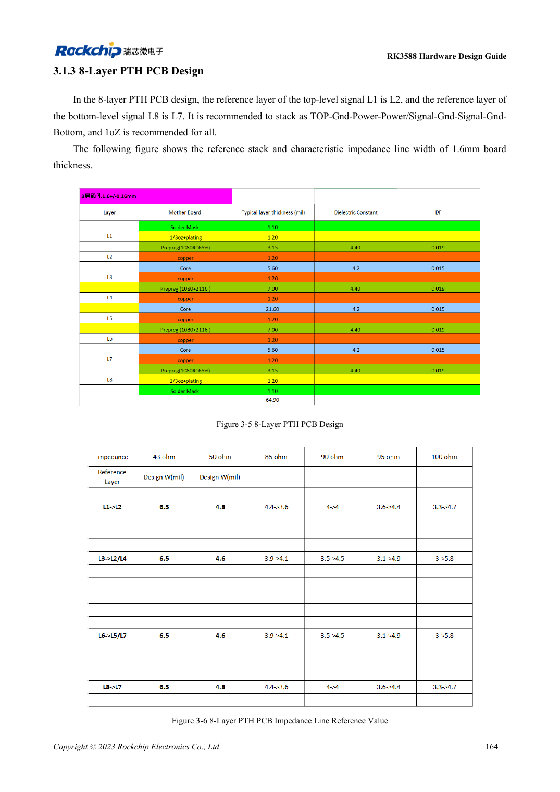
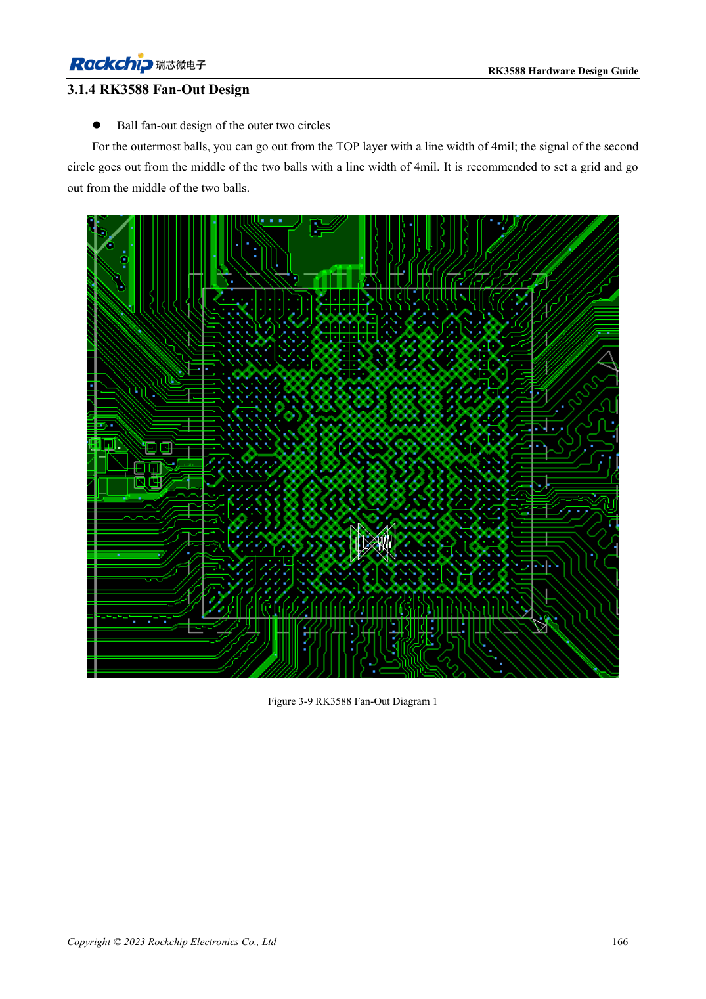

<!-- rk3588-hardware-v13-20261109 -->

# RK3588 stackup and fanout: HDI versus through-hole

Based on the Chinese and English RK3588 Hardware Design Guide V1.3 (2023-02-13), for reviewing SoC boards and carriers. AIM7 and LM7 carriers must follow module interface definitions; Sige7 provides a starting point for software and peripheral validation. SoC capabilities are not a board connector list. Verify SDK/BSP, kernel, board revision and firmware. Values are source references, not ArmSoM hardware measurements.

**RK3588 Hardware Design Guide V1.3 (2023-02-13), EN** · §3.1; §3.2

## Layer count is not the only decision

The guide illustrates ten-layer first-order HDI, ten-layer second-order HDI and eight-layer PTH. Stackup must satisfy single-ended/differential impedance, return paths, copper, fabrication and cost rather than merely matching layer count. Favor ground beside signals, control adjacent signal-layer coupling and retain symmetry. Recalculate geometry with the fabricator after material or thickness changes.

## Relate fanout to fabrication

The outer two ball rows illustrate 4mil escape traces, not a universal impedance width for the entire channel. Check vias, antipads, power connections and DDR template. AIM7/LM7 carriers use module connectors or LGA pads rather than reproducing SoC BGA escape; derive their process from module assembly and connection documents.

## Design parameters and review table

| Item | Source reference |
| --- | --- |
| Reference stackups | 10-layer HDI; 8-layer PTH |
| Example board thickness | 1.6mm |
| Outer-row local escape | 4mil |
| Routing length scope | PCB + vias + package |

## Source figures

The reference pages below contain the relevant circuit or timing figures; click for full resolution. Designators and component values belong to the reference design, not an ArmSoM product schematic.

English original · PDF 184 · 3-1

English original · PDF 186 · 3-5

English original · PDF 188 · 3-9

## ArmSoM development path

AIM7 supports compute-module carrier development, LM7 targets LGA module integration, and Sige7 supports early software and peripheral evaluation. With modules, identify which supplies, DDR and boot circuits are already integrated before designing the carrier. Do not duplicate SoC reference circuits unnecessarily. Follow product documentation for connectors, exposed interfaces, voltages and system support.

- [ArmSoM AIM7](https://www.armsom.org/aim7) · [AIM7 Docs](https://docs.armsom.org/armsom-aim7)
- [ArmSoM Sige7](https://www.armsom.org/sige7) · [Sige7 Docs](https://docs.armsom.org/armsom-sige7)
- [ArmSoM LM7](https://www.armsom.org/lm7) · [LM7 Docs](https://docs.armsom.org/armsom-lm7)

## Continue reading

- [RK3588 hardware design: 30 topics](/articles/rk3588-hardware-design-series/)
- [RK3588 UART, SPI, CAN, I2C and PWM allocation](/articles/rk3588-serial-control-hardware/)
- [RK3588 high-speed PCB: pads and vias above 8GT/s](/articles/rk3588-high-speed-pcb-review/)
