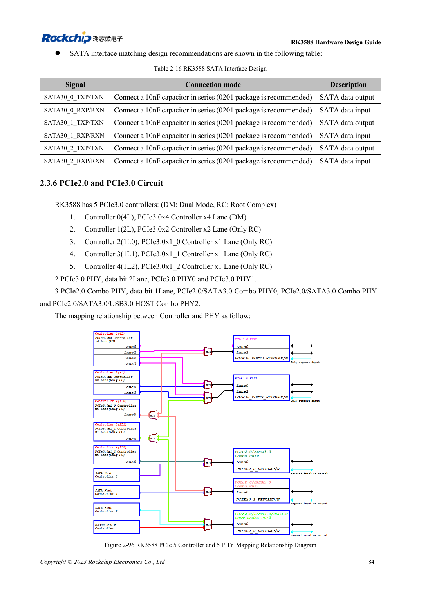
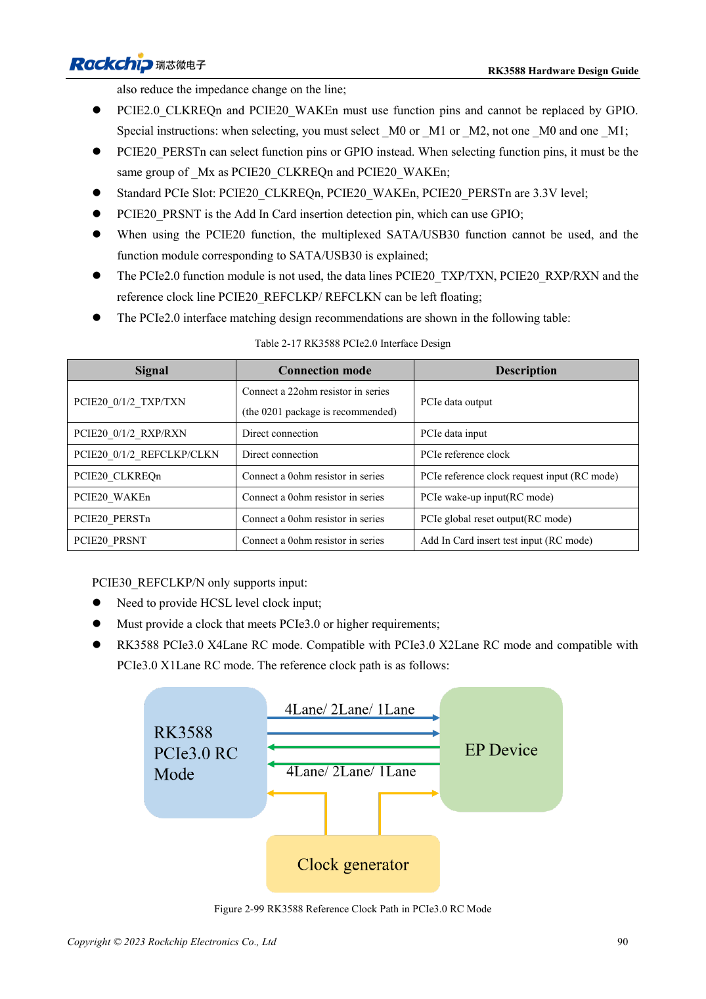

<!-- rk3588-hardware-v13-20261109 -->

# RK3588 PCIe: lanes, reference clocks and supplies

Based on the Chinese and English RK3588 Hardware Design Guide V1.3 (2023-02-13), for reviewing SoC boards and carriers. AIM7 and LM7 carriers must follow module interface definitions; Sige7 provides a starting point for software and peripheral validation. SoC capabilities are not a board connector list. Verify SDK/BSP, kernel, board revision and firmware. Values are source references, not ArmSoM hardware measurements.

**RK3588 Hardware Design Guide V1.3 (2023-02-13), EN** · §2.3.6; §2.2.2.16; §3.4.5–3.4.6

## Controller capability is not independent port count

Five controllers map to two PCIe3 PHYs and three PCIe2 Combo PHYs with shared resources. Do not add x4, x2 and all x1 widths as independent links. PCIe3 REFCLK is input-only and needs compliant HCSL; PCIe2 REFCLK supports input/output and defaults to output to the endpoint. ROM does not boot directly from a PCIe SSD.

## Review control pins and power

PCIe2 CLKREQn/WAKEn require function pins from the same Mx group. PERSTn may use GPIO, but its dedicated function must match that group. Standard slot controls are 3.3V; translate to the actual IO domain. Both PCIe3 ports need supply even when only one is active. Test cold enumeration, target rate, sleep and long transfers, not just device presence.

## Design parameters and review table

| Item | Source reference |
| --- | --- |
| PCIe data impedance | 85Ω ±10% |
| REFCLK impedance | 100Ω ±10% |
| PCIe2 / PCIe3 coupling | 100nF / 220nF; ±20% |
| Data / REFCLK intra-pair | <6mil / <12mil |
| Length / vias | <6in / recommended ≤2 |

## Source figures

The reference pages below contain the relevant circuit or timing figures; click for full resolution. Designators and component values belong to the reference design, not an ArmSoM product schematic.

English original · PDF 106 · 2-96

English original · PDF 112 · 2-99

## ArmSoM development path

AIM7 supports compute-module carrier development, LM7 targets LGA module integration, and Sige7 supports early software and peripheral evaluation. With modules, identify which supplies, DDR and boot circuits are already integrated before designing the carrier. Do not duplicate SoC reference circuits unnecessarily. Follow product documentation for connectors, exposed interfaces, voltages and system support.

- [ArmSoM AIM7](https://www.armsom.org/aim7) · [AIM7 Docs](https://docs.armsom.org/armsom-aim7)
- [ArmSoM Sige7](https://www.armsom.org/sige7) · [Sige7 Docs](https://docs.armsom.org/armsom-sige7)
- [ArmSoM LM7](https://www.armsom.org/lm7) · [LM7 Docs](https://docs.armsom.org/armsom-lm7)

## Continue reading

- [RK3588 hardware design: 30 topics](/articles/rk3588-hardware-design-series/)
- [RK3588 SATA: three controllers and shared PHYs](/articles/rk3588-sata-hardware-design/)
- [RK3588 cameras: CSI, D/C PHY and CIF planning](/articles/rk3588-camera-hardware-design/)
