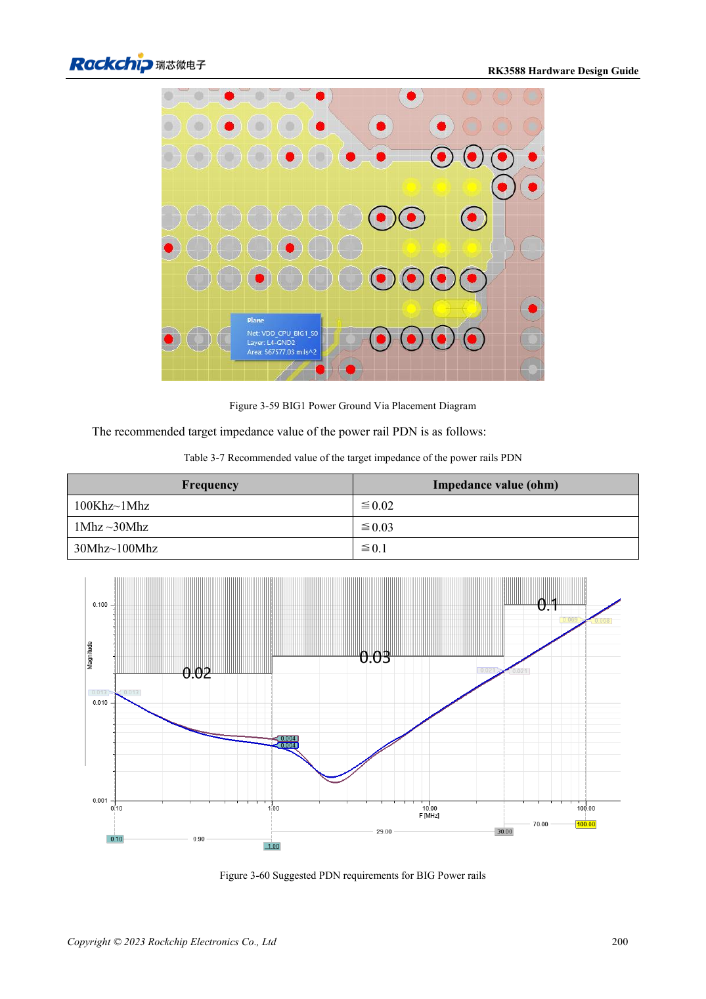

<!-- rk3588-hardware-v13-20261109 -->

# RK3588 power PCB and PDN: copper, returns and decoupling

Based on the Chinese and English RK3588 Hardware Design Guide V1.3 (2023-02-13), for reviewing SoC boards and carriers. AIM7 and LM7 carriers must follow module interface definitions; Sige7 provides a starting point for software and peripheral validation. SoC capabilities are not a board connector list. Verify SDK/BSP, kernel, board revision and firmware. Values are source references, not ArmSoM hardware measurements.

**RK3588 Hardware Design Guide V1.3 (2023-02-13), EN** · §3.4.2

## Capacitor count is not enough

Ground via count on high-current Buck input/output capacitors should match positive-side vias. Inspect effective copper width and bottlenecks after via perforation; avoid thermal-relief necks on critical power connections. RK806 placement balances short power paths with heat distribution rather than simply minimizing distance.

## Check impedance by frequency band

Table 3-7 sets frequency-dependent BIG PDN targets, not one universal capacitor value. Models need regulator, planes, vias, package and capacitor ESR/ESL. These are reference recommendations, not measured ArmSoM results. Measure droop and ringing during load steps and correlate with temperature, clocks and errors.

## Design parameters and review table

| Item | Source reference |
| --- | --- |
| BIG PDN 100kHz–1MHz | ≤0.02Ω |
| BIG PDN 1–30MHz | ≤0.03Ω |
| BIG PDN 30–100MHz | ≤0.1Ω |
| Reference via current (<1V) | 0.5A; source 0.5×0.3mm via example |

## Source figures

The reference pages below contain the relevant circuit or timing figures; click for full resolution. Designators and component values belong to the reference design, not an ArmSoM product schematic.

English original · PDF 222 · 3-60

## ArmSoM development path

AIM7 supports compute-module carrier development, LM7 targets LGA module integration, and Sige7 supports early software and peripheral evaluation. With modules, identify which supplies, DDR and boot circuits are already integrated before designing the carrier. Do not duplicate SoC reference circuits unnecessarily. Follow product documentation for connectors, exposed interfaces, voltages and system support.

- [ArmSoM AIM7](https://www.armsom.org/aim7) · [AIM7 Docs](https://docs.armsom.org/armsom-aim7)
- [ArmSoM Sige7](https://www.armsom.org/sige7) · [Sige7 Docs](https://docs.armsom.org/armsom-sige7)
- [ArmSoM LM7](https://www.armsom.org/lm7) · [LM7 Docs](https://docs.armsom.org/armsom-lm7)

## Continue reading

- [RK3588 hardware design: 30 topics](/articles/rk3588-hardware-design-series/)
- [RK3588 high-speed PCB: pads and vias above 8GT/s](/articles/rk3588-high-speed-pcb-review/)
- [RK3588 thermal design: reference resistance and system validation](/articles/rk3588-thermal-hardware-design/)
