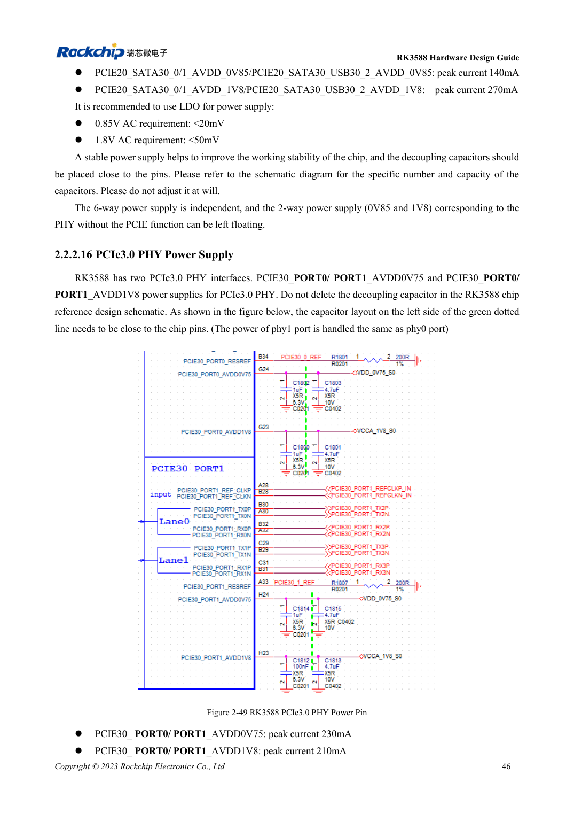
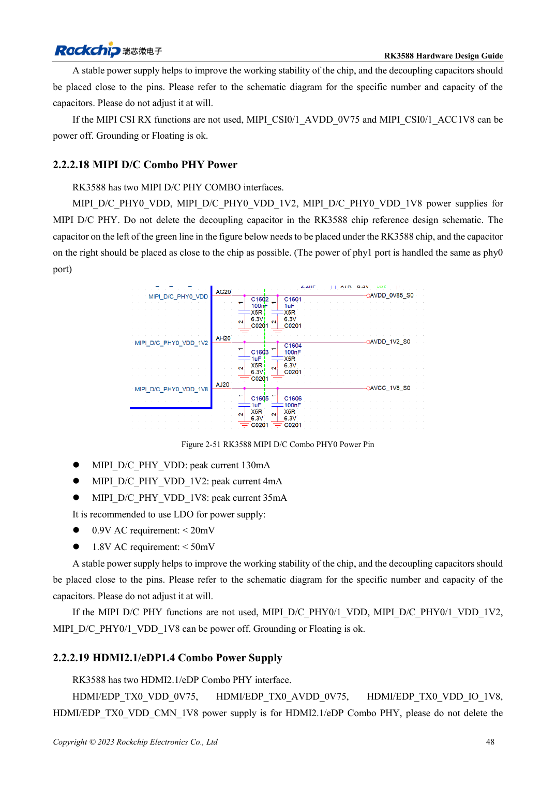

<!-- rk3588-hardware-v13-20261109 -->

# RK3588 rails: startup requirements and unused PHYs

Based on the Chinese and English RK3588 Hardware Design Guide V1.3 (2023-02-13), for reviewing SoC boards and carriers. AIM7 and LM7 carriers must follow module interface definitions; Sige7 provides a starting point for software and peripheral validation. SoC capabilities are not a board connector list. Verify SDK/BSP, kernel, board revision and firmware. Values are source references, not ArmSoM hardware measurements.

**RK3588 Hardware Design Guide V1.3 (2023-02-13), EN** · §2.2.1; §2.2.2

## Unused functions do not imply removable rails

Table 2-9 requires initial supplies for CPU, GPU, NPU, VDENC, DDR, PMU, SARADC, OTP, EMMCIO, VCCIO2, USB2 PHY and TYPEC0. Record startup, running, sleep, load, ripple and decoupling per rail. Software power-down does not waive initial supply requirements.

## Check the particular PHY

If either PCIe3.0 port is used, both ports require 0.75V and 1.8V. PCIe2.0 Combo-PHY rules are not interchangeable. The MIPI CSI section inconsistently names 0V75 and a 0V9 peak-current entry. This remains a source issue: resolve it against schematics and specifications instead of guessing a voltage.

## Design parameters and review table

| Item | Source reference |
| --- | --- |
| PCIe3.0 analog ripple | 0.75V: <20mV; 1.8V: <50mV |
| PCIe2.0 analog ripple | 0.85V: <20mV; 1.8V: <50mV |
| PCIe3.0 one port active | Both ports powered |

## Source figures

The reference pages below contain the relevant circuit or timing figures; click for full resolution. Designators and component values belong to the reference design, not an ArmSoM product schematic.

English original · PDF 68 · 2-49

English original · PDF 70 · 2-51

## ArmSoM development path

AIM7 supports compute-module carrier development, LM7 targets LGA module integration, and Sige7 supports early software and peripheral evaluation. With modules, identify which supplies, DDR and boot circuits are already integrated before designing the carrier. Do not duplicate SoC reference circuits unnecessarily. Follow product documentation for connectors, exposed interfaces, voltages and system support.

- [ArmSoM AIM7](https://www.armsom.org/aim7) · [AIM7 Docs](https://docs.armsom.org/armsom-aim7)
- [ArmSoM Sige7](https://www.armsom.org/sige7) · [Sige7 Docs](https://docs.armsom.org/armsom-sige7)
- [ArmSoM LM7](https://www.armsom.org/lm7) · [LM7 Docs](https://docs.armsom.org/armsom-lm7)

## Continue reading

- [RK3588 hardware design: 30 topics](/articles/rk3588-hardware-design-series/)
- [RK3588 boot and recovery: Maskrom, JTAG and UART](/articles/rk3588-boot-debug-hardware/)
- [RK3588 power sequencing: RESETn and S0/S3](/articles/rk3588-power-sequencing-design/)
