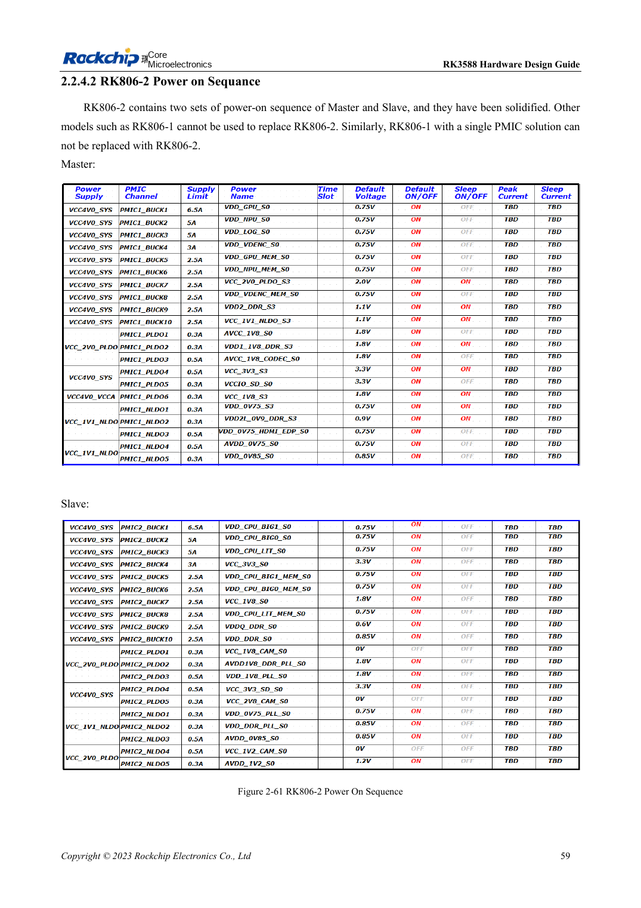

<!-- rk3588-hardware-v13-20261109 -->

# RK3588 power sequencing: RESETn and S0/S3

Based on the Chinese and English RK3588 Hardware Design Guide V1.3 (2023-02-13), for reviewing SoC boards and carriers. AIM7 and LM7 carriers must follow module interface definitions; Sige7 provides a starting point for software and peripheral validation. SoC capabilities are not a board connector list. Verify SDK/BSP, kernel, board revision and firmware. Values are source references, not ArmSoM hardware measurements.

**RK3588 Hardware Design Guide V1.3 (2023-02-13), EN** · §2.1.10.3; §2.2.1.2–2.2.1.3

## Explicit sequences take priority

A lower-voltage-first principle does not replace explicit orders such as MIPI_D/C_PHY_VDD → 1.8V → 1.2V. Use the particular power tree, not numerical sorting. Release RESETn ≥1ms after the final rail stabilizes while meeting shared peripheral requirements. On shutdown assert RESETn before removing supplies.

## Test sleep and back-powering

The fixed 1.8V and selectable-voltage pins of a domain must both belong to S0 or both S3. Measure cold start, warm reset, sleep and shutdown, checking back-power from USB, HDMI and external controllers. Module carriers follow module input and enable requirements rather than recreating internal SoC supplies.

## Design parameters and review table

| Item | Source reference |
| --- | --- |
| Reset release | ≥1ms after final rail stable |
| Power-down | RESETn low → supplies off |
| MIPI D/C reference | VDD → 1.8V → 1.2V |

## Source figures

The reference pages below contain the relevant circuit or timing figures; click for full resolution. Designators and component values belong to the reference design, not an ArmSoM product schematic.

English original · PDF 81 · 2-61

## ArmSoM development path

AIM7 supports compute-module carrier development, LM7 targets LGA module integration, and Sige7 supports early software and peripheral evaluation. With modules, identify which supplies, DDR and boot circuits are already integrated before designing the carrier. Do not duplicate SoC reference circuits unnecessarily. Follow product documentation for connectors, exposed interfaces, voltages and system support.

- [ArmSoM AIM7](https://www.armsom.org/aim7) · [AIM7 Docs](https://docs.armsom.org/armsom-aim7)
- [ArmSoM Sige7](https://www.armsom.org/sige7) · [Sige7 Docs](https://docs.armsom.org/armsom-sige7)
- [ArmSoM LM7](https://www.armsom.org/lm7) · [LM7 Docs](https://docs.armsom.org/armsom-lm7)

## Continue reading

- [RK3588 hardware design: 30 topics](/articles/rk3588-hardware-design-series/)
- [RK3588 rails: startup requirements and unused PHYs](/articles/rk3588-power-rail-planning/)
- [RK3588 and RK806: single and dual PMIC power trees](/articles/rk3588-rk806-pmic-design/)
