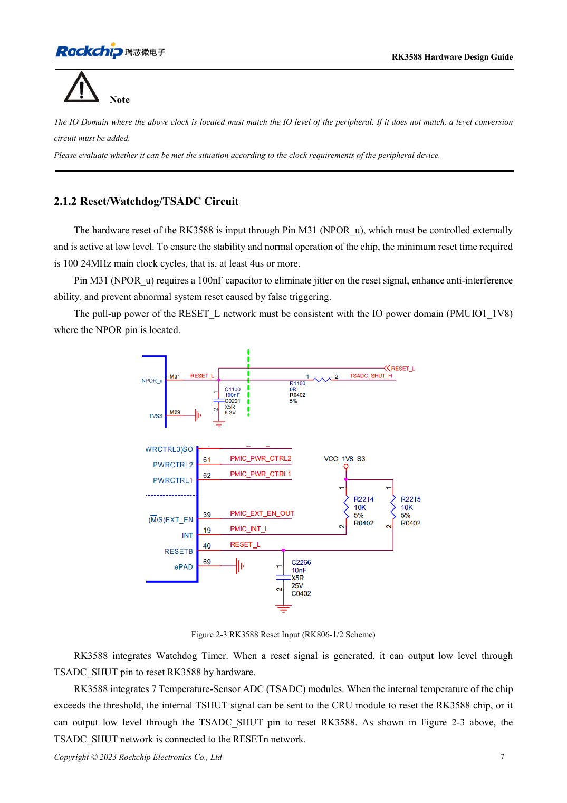
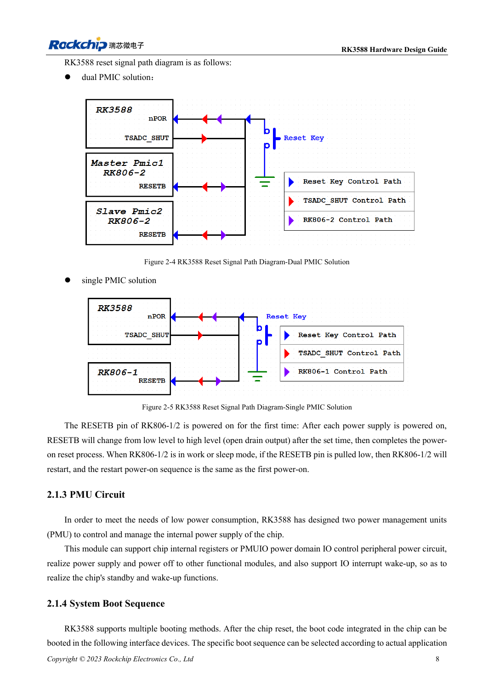

<!-- rk3588-hardware-v13-20261109 -->

# RK3588 reset, watchdog and thermal protection

Based on the Chinese and English RK3588 Hardware Design Guide V1.3 (2023-02-13), for reviewing SoC boards and carriers. AIM7 and LM7 carriers must follow module interface definitions; Sige7 provides a starting point for software and peripheral validation. SoC capabilities are not a board connector list. Verify SDK/BSP, kernel, board revision and firmware. Values are source references, not ArmSoM hardware measurements.

**RK3588 Hardware Design Guide V1.3 (2023-02-13), EN** · §2.1.2; §3.4.1

## Pulse width is separate from startup delay

NPOR_u at M31 is active low. The guide specifies 100 cycles of 24MHz and also at least 4μs; 100/24MHz≈4.167μs, so exactly 4.000μs is insufficient. Place 100nF near the pin and pull up to PMUIO1_1V8. Waiting ≥1ms after the last rail stabilizes before releasing reset is a separate requirement.

## Validate the whole reset network

RK806-1/2 releases RESETB after startup delay; pulling it low during operation or sleep repeats power sequencing. The watchdog and seven TSADC temperature modules also participate in reset protection. Observe RESETn, rails and UART together. Check button → TVS → 100Ω → filter → CPU/PMIC, keeping reset away from DC/DC, metal connectors and edges.

## Design parameters and review table

| Item | Source reference |
| --- | --- |
| NPOR_u | M31; active low |
| Minimum reset | 100 cycles @24MHz ≈4.167μs |
| Filter capacitor | 100nF |
| Pull-up | PMUIO1_1V8 |

## Source figures

The reference pages below contain the relevant circuit or timing figures; click for full resolution. Designators and component values belong to the reference design, not an ArmSoM product schematic.

English original · PDF 29 · 2-3

English original · PDF 30 · 2-5

## ArmSoM development path

AIM7 supports compute-module carrier development, LM7 targets LGA module integration, and Sige7 supports early software and peripheral evaluation. With modules, identify which supplies, DDR and boot circuits are already integrated before designing the carrier. Do not duplicate SoC reference circuits unnecessarily. Follow product documentation for connectors, exposed interfaces, voltages and system support.

- [ArmSoM AIM7](https://www.armsom.org/aim7) · [AIM7 Docs](https://docs.armsom.org/armsom-aim7)
- [ArmSoM Sige7](https://www.armsom.org/sige7) · [Sige7 Docs](https://docs.armsom.org/armsom-sige7)
- [ArmSoM LM7](https://www.armsom.org/lm7) · [LM7 Docs](https://docs.armsom.org/armsom-lm7)

## Continue reading

- [RK3588 hardware design: 30 topics](/articles/rk3588-hardware-design-series/)
- [RK3588 clocks: 24MHz, 32kHz and layout](/articles/rk3588-clock-hardware-design/)
- [RK3588 boot and recovery: Maskrom, JTAG and UART](/articles/rk3588-boot-debug-hardware/)
