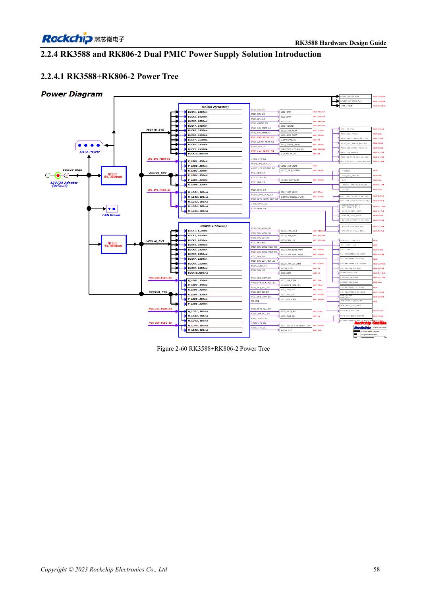
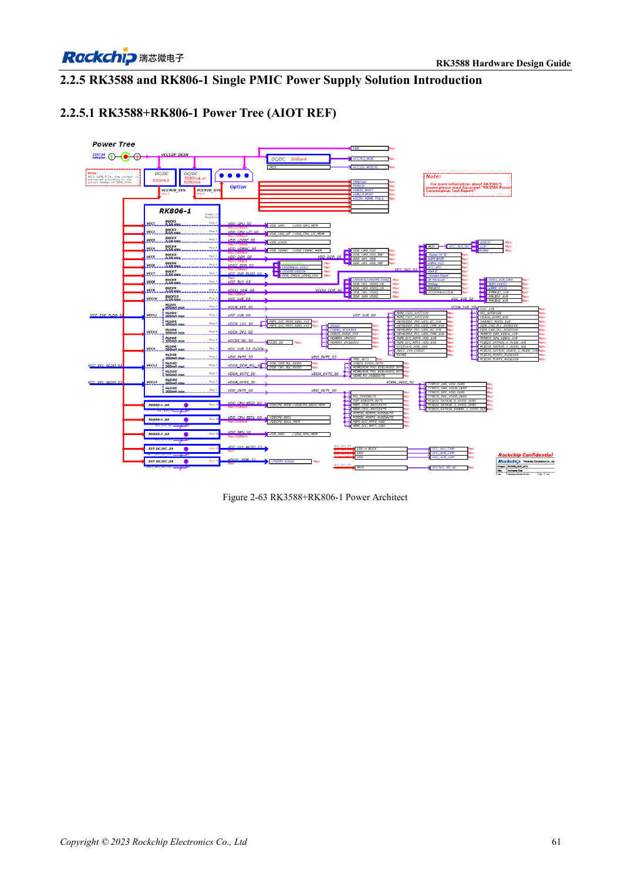

<!-- rk3588-hardware-v13-20261109 -->

# RK3588 and RK806: single and dual PMIC power trees

Based on the Chinese and English RK3588 Hardware Design Guide V1.3 (2023-02-13), for reviewing SoC boards and carriers. AIM7 and LM7 carriers must follow module interface definitions; Sige7 provides a starting point for software and peripheral validation. SoC capabilities are not a board connector list. Verify SDK/BSP, kernel, board revision and firmware. Values are source references, not ArmSoM hardware measurements.

**RK3588 Hardware Design Guide V1.3 (2023-02-13), EN** · §2.2.3–2.2.5

## Select the complete reference

Dual RK806-2 and single RK806-1 plus external supplies are distinct architectures, not a design with one chip removed. Migrate output allocation, defaults, sequencing, control bus, sleep and reset together. The PMIC 2.7–5.5V input is not an ArmSoM board input specification.

## Synchronization and layout

EXT_EN assigns master/slave; SYNC/SYNC_CLK synchronize the dual design, with VDC/PWRON/RESET connected as shown. A single PMIC uses master mode with SYNC/SYNC_CLK open. Prioritize high-current paths and capacitor ground loops while managing heat concentration. Maximum current is not a continuous rating at every temperature.

## Design parameters and review table

| Item | Source reference |
| --- | --- |
| RK806 input | 2.7–5.5V |
| Package | 7×7mm QFN68 |
| Dual reference | RK806-2 |
| Single reference | RK806-1 + external supplies |

## Source figures

The reference pages below contain the relevant circuit or timing figures; click for full resolution. Designators and component values belong to the reference design, not an ArmSoM product schematic.

English original · PDF 80 · 2-60

English original · PDF 83 · 2-63

## ArmSoM development path

AIM7 supports compute-module carrier development, LM7 targets LGA module integration, and Sige7 supports early software and peripheral evaluation. With modules, identify which supplies, DDR and boot circuits are already integrated before designing the carrier. Do not duplicate SoC reference circuits unnecessarily. Follow product documentation for connectors, exposed interfaces, voltages and system support.

- [ArmSoM AIM7](https://www.armsom.org/aim7) · [AIM7 Docs](https://docs.armsom.org/armsom-aim7)
- [ArmSoM Sige7](https://www.armsom.org/sige7) · [Sige7 Docs](https://docs.armsom.org/armsom-sige7)
- [ArmSoM LM7](https://www.armsom.org/lm7) · [LM7 Docs](https://docs.armsom.org/armsom-lm7)

## Continue reading

- [RK3588 hardware design: 30 topics](/articles/rk3588-hardware-design-series/)
- [RK3588 power sequencing: RESETn and S0/S3](/articles/rk3588-power-sequencing-design/)
- [RK3588 DDR circuits: LPDDR4/4X/5 and capacity](/articles/rk3588-ddr-circuit-design/)
