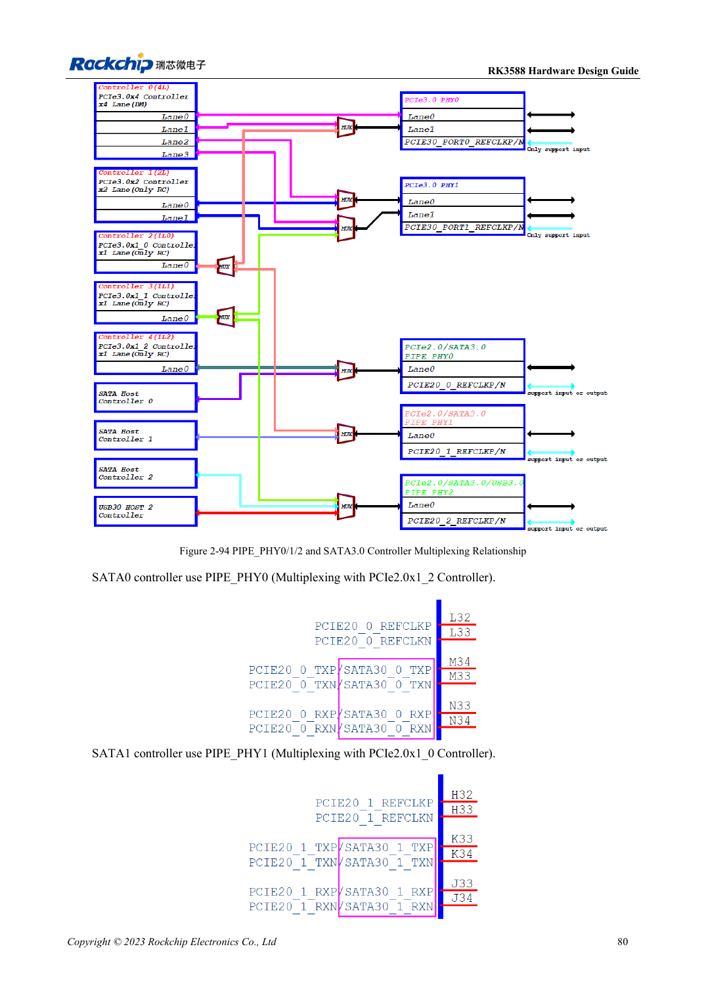

<!-- rk3588-hardware-v13-20261109 -->

# RK3588 SATA: three controllers and shared PHYs

Based on the Chinese and English RK3588 Hardware Design Guide V1.3 (2023-02-13), for reviewing SoC boards and carriers. AIM7 and LM7 carriers must follow module interface definitions; Sige7 provides a starting point for software and peripheral validation. SoC capabilities are not a board connector list. Verify SDK/BSP, kernel, board revision and firmware. Values are source references, not ArmSoM hardware measurements.

**RK3588 Hardware Design Guide V1.3 (2023-02-13), EN** · §2.3.5; §3.4.9

## Draw the mux matrix first

SATA0/1/2 use PIPE_PHY0/1/2, shared with PCIe; PHY2 also involves USB3 HOST2. The guide lists 1.5/3/6Gbps and port multipliers, not three exposed SATA ports on every ArmSoM board or full bandwidth for every attached device. Select ports before software and connector allocation.

## Validate signals and drive power separately

The reference uses 10nF in both TX and RX, preferably 0201; do not copy PCIe capacitors. SATA_CP_DET, MP_SWITCH and CP_POD are shared control resources, so hot-plug requires deliberate design. Supply and test drive spin-up current externally; check sustained writes, errors, hot-plug and power-loss recovery.

## Design parameters and review table

| Item | Source reference |
| --- | --- |
| SATA coupling | 10nF ±20%; TX and RX |
| Differential target | 100Ω ±10%; source fallback 90Ω ±10% |
| Length / intra-pair | <6in / <6mil |
| Recommended via count | Recommended ≤2 |

## Source figures

The reference pages below contain the relevant circuit or timing figures; click for full resolution. Designators and component values belong to the reference design, not an ArmSoM product schematic.

English original · PDF 102 · 2-94

## ArmSoM development path

AIM7 supports compute-module carrier development, LM7 targets LGA module integration, and Sige7 supports early software and peripheral evaluation. With modules, identify which supplies, DDR and boot circuits are already integrated before designing the carrier. Do not duplicate SoC reference circuits unnecessarily. Follow product documentation for connectors, exposed interfaces, voltages and system support.

- [ArmSoM AIM7](https://www.armsom.org/aim7) · [AIM7 Docs](https://docs.armsom.org/armsom-aim7)
- [ArmSoM Sige7](https://www.armsom.org/sige7) · [Sige7 Docs](https://docs.armsom.org/armsom-sige7)
- [ArmSoM LM7](https://www.armsom.org/lm7) · [LM7 Docs](https://docs.armsom.org/armsom-lm7)

## Continue reading

- [RK3588 hardware design: 30 topics](/articles/rk3588-hardware-design-series/)
- [RK3588 USB and Type-C: controllers, PHYs and recovery](/articles/rk3588-usb-typec-hardware-design/)
- [RK3588 PCIe: lanes, reference clocks and supplies](/articles/rk3588-pcie-hardware-design/)
