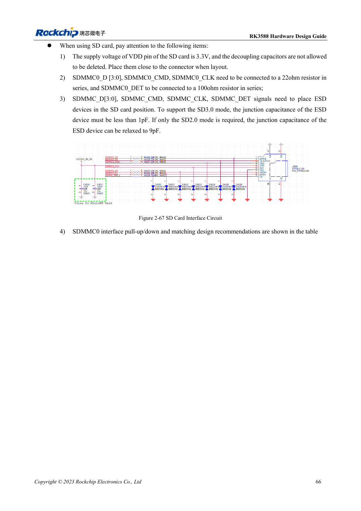

<!-- rk3588-hardware-v13-20261109 -->

# RK3588 SDMMC and SDIO Wi-Fi: voltage switching and protection

Based on the Chinese and English RK3588 Hardware Design Guide V1.3 (2023-02-13), for reviewing SoC boards and carriers. AIM7 and LM7 carriers must follow module interface definitions; Sige7 provides a starting point for software and peripheral validation. SoC capabilities are not a board connector list. Verify SDK/BSP, kernel, board revision and firmware. Values are source references, not ArmSoM hardware measurements.

**RK3588 Hardware Design Guide V1.3 (2023-02-13), EN** · §2.3.1; §3.4.15–3.4.16; §3.4.21

## Separate card power from IO voltage

SD card VDD is 3.3V. Switching VCCIO2 to 1.8V after SD3.0 negotiation does not mean switching card power to 1.8V. SDMMC/JTAG boot selection also depends on SDMMC_DET. The reference uses 22Ω on data/CMD/CLK, 100Ω on DET and decoupling plus ESD near the socket.

## Wi-Fi also needs clock and RF review

Check module IO, UART/PCM direction and 32.768kHz amplitude; reserve antenna π matching. Select crystal loading for the module; the guide gives 10ppm room-temperature tolerance for Wi-Fi. SD3.0 protection capacitance must be <1pF, so ESD additions must not arbitrarily load the bus. Test connection, throughput, sleep/wake and power cycles.

## Design parameters and review table

| Item | Source reference |
| --- | --- |
| SD card VDD | 3.3V |
| SD3.0 ESD capacitance | <1pF |
| SD2.0-only ESD reference | ≤9pF |
| Data/CMD/CLK; DET | 22Ω; 100Ω |
| PCB impedance / length | 50Ω ±10% / <4in |
| Clock-data mismatch | <120mil |

## Source figures

The reference pages below contain the relevant circuit or timing figures; click for full resolution. Designators and component values belong to the reference design, not an ArmSoM product schematic.

English original · PDF 88 · 2-67

## ArmSoM development path

AIM7 supports compute-module carrier development, LM7 targets LGA module integration, and Sige7 supports early software and peripheral evaluation. With modules, identify which supplies, DDR and boot circuits are already integrated before designing the carrier. Do not duplicate SoC reference circuits unnecessarily. Follow product documentation for connectors, exposed interfaces, voltages and system support.

- [ArmSoM AIM7](https://www.armsom.org/aim7) · [AIM7 Docs](https://docs.armsom.org/armsom-aim7)
- [ArmSoM Sige7](https://www.armsom.org/sige7) · [Sige7 Docs](https://docs.armsom.org/armsom-sige7)
- [ArmSoM LM7](https://www.armsom.org/lm7) · [LM7 Docs](https://docs.armsom.org/armsom-lm7)

## Continue reading

- [RK3588 hardware design: 30 topics](/articles/rk3588-hardware-design-series/)
- [RK3588 FSPI Flash: boot, supply and matching](/articles/rk3588-fspi-boot-hardware/)
- [RK3588 USB and Type-C: controllers, PHYs and recovery](/articles/rk3588-usb-typec-hardware-design/)
