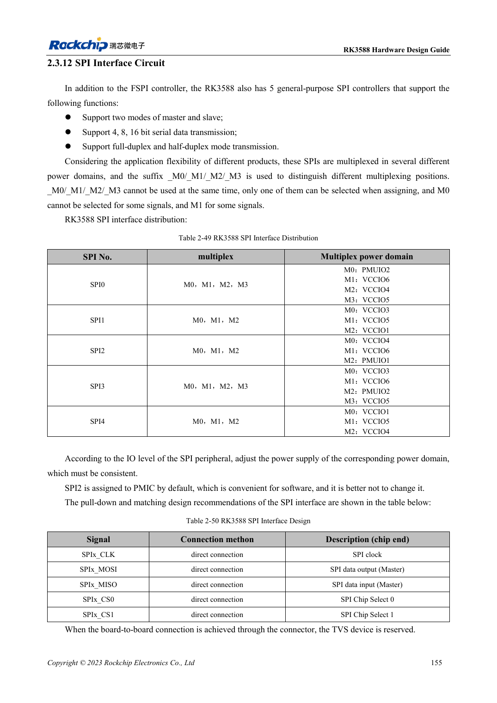

<!-- rk3588-hardware-v13-20261109 -->

# RK3588 UART, SPI, CAN, I2C and PWM allocation

Based on the Chinese and English RK3588 Hardware Design Guide V1.3 (2023-02-13), for reviewing SoC boards and carriers. AIM7 and LM7 carriers must follow module interface definitions; Sige7 provides a starting point for software and peripheral validation. SoC capabilities are not a board connector list. Verify SDK/BSP, kernel, board revision and firmware. Values are source references, not ArmSoM hardware measurements.

**RK3588 Hardware Design Guide V1.3 (2023-02-13), EN** · §2.3.11–2.3.15

## Do not mix mux groups

M0/M1/M2 locations for UART, SPI, CAN and I2C are mux choices, not additional independent controllers. Select a complete supported signal group and verify its supply domain. SPI2 is assigned to the PMIC by default and should not be casually repurposed. CAN requires an external transceiver; SoC TX/RX are not differential bus wires.

## Verify protocols separately from pin tables

I2C uses a 2.2kΩ reference pull-up, adjusted for bus loading and voltage; HDMI DDC is dedicated. V1.3 describes CAN2.0B at 1Mbps, not a CAN FD claim. Its I2C table includes PMUIO3/4/5/6 names inconsistent with the domain table. Resolve these against the actual TRM and schematic before pin configuration.

## Design parameters and review table

| Item | Source reference |
| --- | --- |
| UART / general SPI | 10 / 5 controllers |
| CAN source scope | 3 controllers; CAN2.0B; 1Mbps |
| I2C reference | Up to 400Kbit/s; 2.2kΩ pull-up |
| PWM source count | 4 controllers ×4 channels |

## Source figures

The reference pages below contain the relevant circuit or timing figures; click for full resolution. Designators and component values belong to the reference design, not an ArmSoM product schematic.

English original · PDF 177 · table:2-50

## ArmSoM development path

AIM7 supports compute-module carrier development, LM7 targets LGA module integration, and Sige7 supports early software and peripheral evaluation. With modules, identify which supplies, DDR and boot circuits are already integrated before designing the carrier. Do not duplicate SoC reference circuits unnecessarily. Follow product documentation for connectors, exposed interfaces, voltages and system support.

- [ArmSoM AIM7](https://www.armsom.org/aim7) · [AIM7 Docs](https://docs.armsom.org/armsom-aim7)
- [ArmSoM Sige7](https://www.armsom.org/sige7) · [Sige7 Docs](https://docs.armsom.org/armsom-sige7)
- [ArmSoM LM7](https://www.armsom.org/lm7) · [LM7 Docs](https://docs.armsom.org/armsom-lm7)

## Continue reading

- [RK3588 hardware design: 30 topics](/articles/rk3588-hardware-design-series/)
- [RK3588 GPIO and SARADC: domains and button inputs](/articles/rk3588-gpio-saradc-hardware/)
- [RK3588 stackup and fanout: HDI versus through-hole](/articles/rk3588-pcb-stackup-fanout/)
