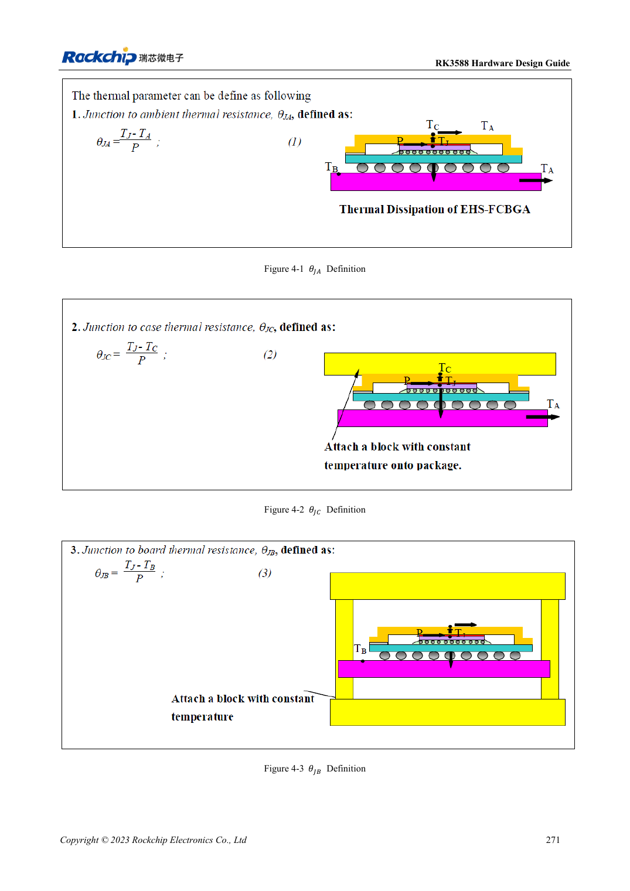

<!-- rk3588-hardware-v13-20261109 -->

# RK3588 thermal design: reference resistance and system validation

Based on the Chinese and English RK3588 Hardware Design Guide V1.3 (2023-02-13), for reviewing SoC boards and carriers. AIM7 and LM7 carriers must follow module interface definitions; Sige7 provides a starting point for software and peripheral validation. SoC capabilities are not a board connector list. Verify SDK/BSP, kernel, board revision and firmware. Values are source references, not ArmSoM hardware measurements.

**RK3588 Hardware Design Guide V1.3 (2023-02-13), EN** · §4

## Simulation is not module temperature rise

Table 4-1 comes from a specified package and JEDEC finite-element PCB model: 101×114mm, 1.6mm, ten layers, no heatsink. Do not apply it directly to AIM7, an LM7 carrier or a Sige7 enclosure. θJA, θJB and θJC use different reference points and are not interchangeable heatsink inputs.

## Validate thermal paths and protection

Check die-to-interface, heatsink, enclosure and ambient paths, mounting pressure and electrical isolation. The 20–50mm RK3588/RK806 spacing is a board reference, not an instruction to modify module internals. Test sustained workload, frequency, temperature and application latency with the actual BSP thermal policy; disabling protection does not demonstrate performance.

## Design parameters and review table

| Item | Source reference |
| --- | --- |
| Source θJA / θJB / θJC | 8.7 / 3.5 / 0.12 °C/W; simulation |
| Source PCB | 101×114mm; 1.6mm; 10 layers |
| PMIC–SoC reference spacing | RK3588–RK806: 20–50mm |

## Source figures

The reference pages below contain the relevant circuit or timing figures; click for full resolution. Designators and component values belong to the reference design, not an ArmSoM product schematic.

English original · PDF 293 · 4-1

## ArmSoM development path

AIM7 supports compute-module carrier development, LM7 targets LGA module integration, and Sige7 supports early software and peripheral evaluation. With modules, identify which supplies, DDR and boot circuits are already integrated before designing the carrier. Do not duplicate SoC reference circuits unnecessarily. Follow product documentation for connectors, exposed interfaces, voltages and system support.

- [ArmSoM AIM7](https://www.armsom.org/aim7) · [AIM7 Docs](https://docs.armsom.org/armsom-aim7)
- [ArmSoM Sige7](https://www.armsom.org/sige7) · [Sige7 Docs](https://docs.armsom.org/armsom-sige7)
- [ArmSoM LM7](https://www.armsom.org/lm7) · [LM7 Docs](https://docs.armsom.org/armsom-lm7)

## Continue reading

- [RK3588 hardware design: 30 topics](/articles/rk3588-hardware-design-series/)
- [RK3588 power PCB and PDN: copper, returns and decoupling](/articles/rk3588-power-pcb-pdn-design/)
- [RK3588 ESD and EMI: interface protection and return paths](/articles/rk3588-esd-emi-hardware-design/)
