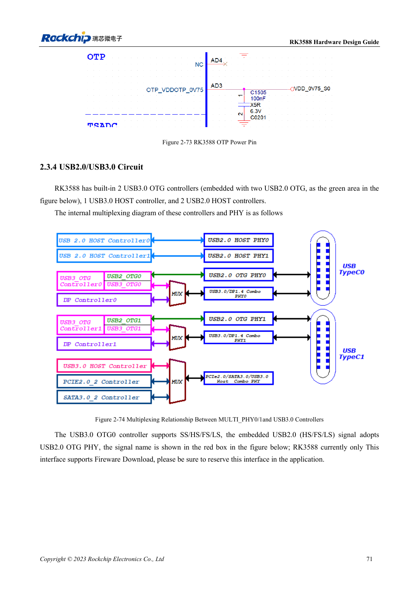
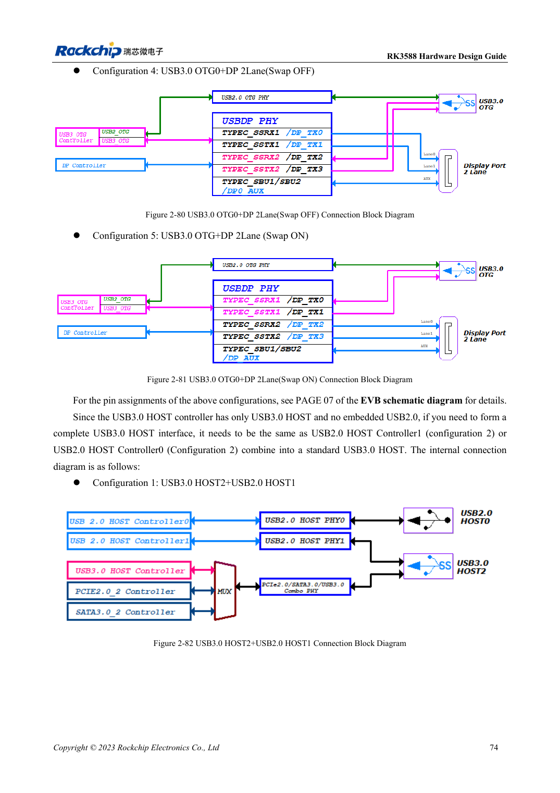

<!-- rk3588-hardware-v13-20261109 -->

# RK3588 USB and Type-C: controllers, PHYs and recovery

Based on the Chinese and English RK3588 Hardware Design Guide V1.3 (2023-02-13), for reviewing SoC boards and carriers. AIM7 and LM7 carriers must follow module interface definitions; Sige7 provides a starting point for software and peripheral validation. SoC capabilities are not a board connector list. Verify SDK/BSP, kernel, board revision and firmware. Values are source references, not ArmSoM hardware measurements.

**RK3588 Hardware Design Guide V1.3 (2023-02-13), EN** · §2.3.4; §3.4.10–3.4.11

## Distinguish controllers from ports

The SoC has two USB3 OTG, one USB3 HOST and two USB2 HOST controllers. The standalone USB3 HOST has no embedded USB2 and needs a USB2 HOST companion for a complete port. Preserve the OTG0 USB2 download path. Design Type-C USB3/DP allocation, orientation and external control together.

## Validate power roles and the full channel

USB3 HOST2 shares resources with SATA/PCIe; do not count all three as simultaneously available. Check VBUS source/sink roles, back-power protection, connectors and cables. Validate USB2 recovery, then USB3 enumeration, sustained transfer, hot-plug and both Type-C orientations. Carrier length budgets include module and connectors.

## Design parameters and review table

| Item | Source reference |
| --- | --- |
| USB2 differential | 90Ω ±10%; intra-pair <20mil |
| USB3 differential | 90Ω ±10%; intra-pair <6mil |
| USB3 length / vias | <6in; recommended ≤2 |
| USB3 ESD capacitance | ≤0.2pF |

## Source figures

The reference pages below contain the relevant circuit or timing figures; click for full resolution. Designators and component values belong to the reference design, not an ArmSoM product schematic.

English original · PDF 93 · 2-74

English original · PDF 96 · 2-82

## ArmSoM development path

AIM7 supports compute-module carrier development, LM7 targets LGA module integration, and Sige7 supports early software and peripheral evaluation. With modules, identify which supplies, DDR and boot circuits are already integrated before designing the carrier. Do not duplicate SoC reference circuits unnecessarily. Follow product documentation for connectors, exposed interfaces, voltages and system support.

- [ArmSoM AIM7](https://www.armsom.org/aim7) · [AIM7 Docs](https://docs.armsom.org/armsom-aim7)
- [ArmSoM Sige7](https://www.armsom.org/sige7) · [Sige7 Docs](https://docs.armsom.org/armsom-sige7)
- [ArmSoM LM7](https://www.armsom.org/lm7) · [LM7 Docs](https://docs.armsom.org/armsom-lm7)

## Continue reading

- [RK3588 hardware design: 30 topics](/articles/rk3588-hardware-design-series/)
- [RK3588 SDMMC and SDIO Wi-Fi: voltage switching and protection](/articles/rk3588-sdmmc-sdio-wifi-design/)
- [RK3588 SATA: three controllers and shared PHYs](/articles/rk3588-sata-hardware-design/)
