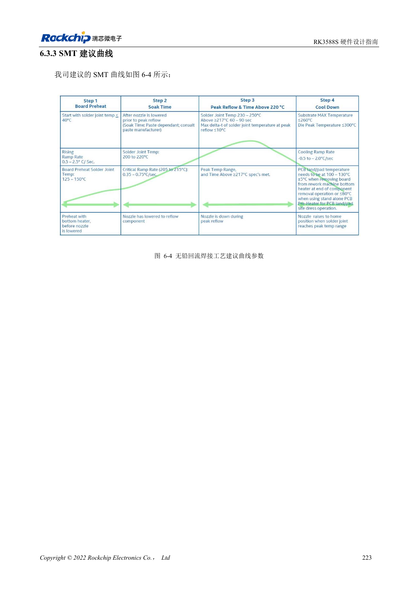
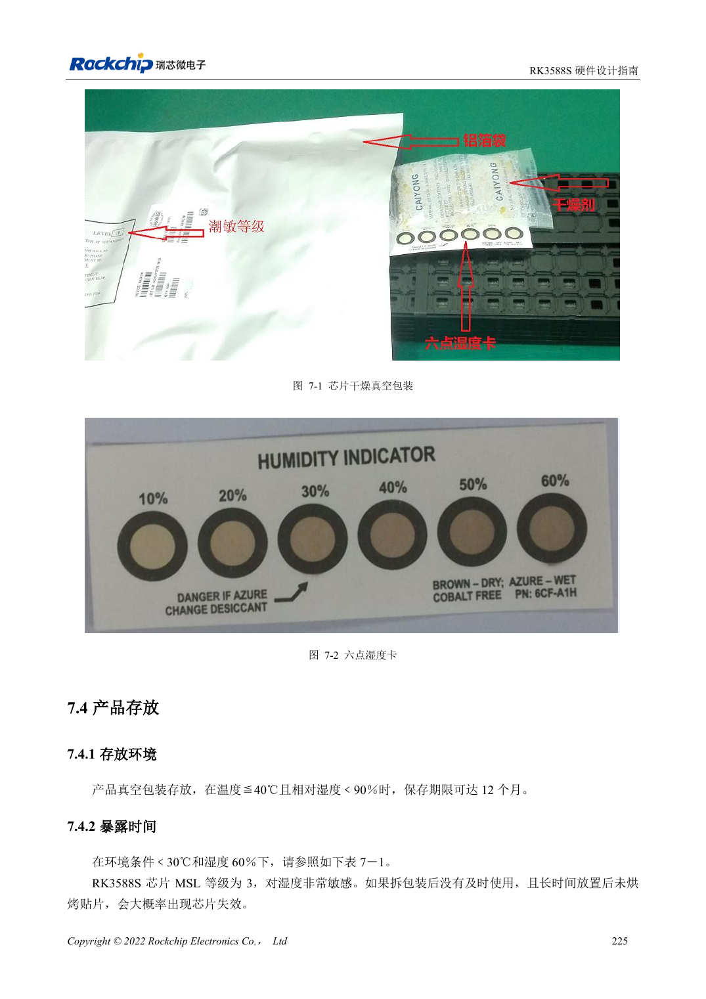

<!-- rk3588s-hardware-v12-20261109 -->

# RK3588S assembly and storage: reflow, MSL3 and bake records

Based on the Chinese RK3588S Hardware Design Guide V1.2 (2023-12-14) for circuit and PCB review. CM7S carriers must follow module interface definitions; Sige7S supports software and peripheral evaluation. SoC capabilities are not a board connector list. Verify SDK/BSP, kernel, board revision, firmware and multiplexing. Values are source references, not ArmSoM hardware measurements.

**RK3588S Hardware Design Guide V1.2 (2023-12-14), CN** · §6–7

## Process limits apply to the chip package

The reflow profile covers the RK3588S chip, not permission to reflow a complete CM7S module or Sige7S board. Reference solder-paste storage is 2–10°C with 3–4 hours warming at room temperature. Production engineering must reconcile alloy, flux, board thermal mass and connector limits. Follow product assembly instructions for module connections.

## Track cumulative moisture exposure

RK3588S is MSL3 with 168-hour floor life at ≤30°C/60%RH. Record humidity card, opening time and storage; resealing does not automatically reset exposure. Table 7-2 distinguishes floor-life overrun above/below 72 hours and bake temperature, with package thickness ≤1.4mm. The MSL1 row’s 300°C is suspect and is not treated here as a production condition.

## Design parameters and review table

| Item | Source reference |
| --- | --- |
| MSL3 floor life | 168h at ≤30°C /60%RH |
| Bake 125°C +10/-0°C (>72h / ≤72h overrun) | 9h /7h |
| Bake 90°C +8/-0°C (>72h / ≤72h overrun) | 33h /23h |
| Bake 40°C +5/-0°C (>72h / ≤72h overrun) | 13 days /9 days |
| Bake table package limit | Thickness ≤1.4mm |

## Source figures

No corresponding English design guide was found for this batch. All four editions use Chinese source screenshots with localized captions. Open an image for full resolution; the article text and parameter tables remain copyable. Page references are physical PDF pages.

Chinese original · PDF 238 · 6-4

Chinese original · PDF 240 · 7-2

## ArmSoM development path

CM7S supports custom carriers: first identify supplies, DDR and boot circuits already integrated in the module, then design outside its connectors. Sige7S provides a starting point for software and peripheral evaluation. For both products, verify exposed interfaces, pin assignments, levels, system images and cooling against the relevant revision. A chip reference schematic is not a product wiring diagram.

- [ArmSoM CM7S](https://www.armsom.org/cm7s) · [CM7S Docs](https://docs.armsom.org/armsom-cm7s)
- [ArmSoM Sige7S](https://www.armsom.org/sige7s) · [Sige7S Docs](https://docs.armsom.org/armsom-sige7s)

## Continue reading

- [RK3588S hardware design: 30 topics](/articles/rk3588s-hardware-design-series/)
- [RK3588S ESD and EMI: interface protection and return paths](/articles/rk3588s-esd-emi-hardware-design/)
