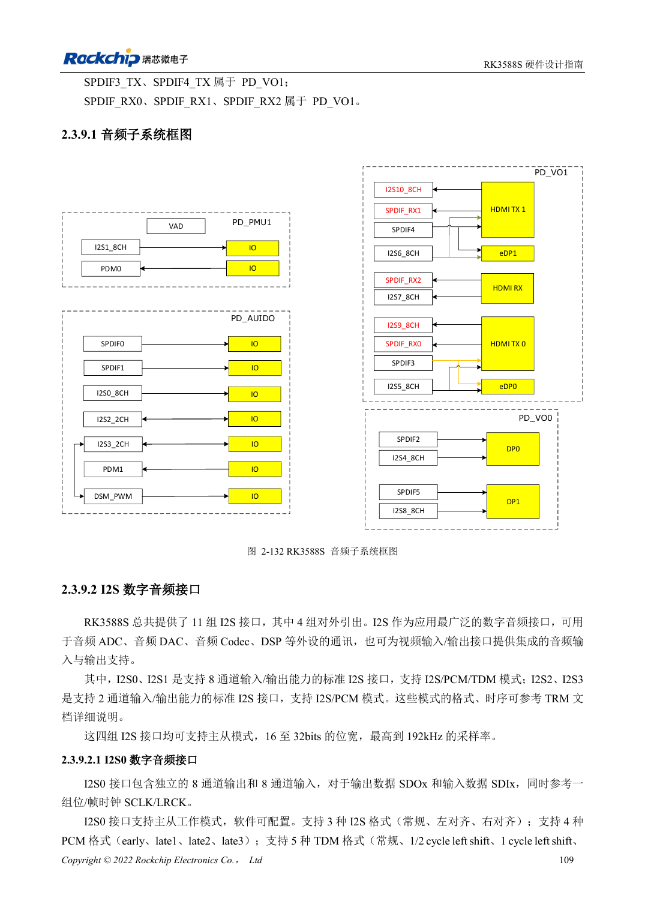
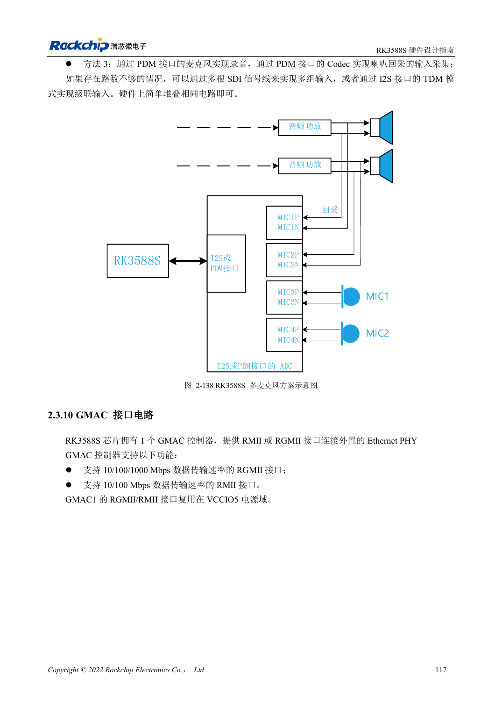

<!-- rk3588s-hardware-v12-20261109 -->

# RK3588S audio hardware: I2S, PDM and microphone arrays

Based on the Chinese RK3588S Hardware Design Guide V1.2 (2023-12-14) for circuit and PCB review. CM7S carriers must follow module interface definitions; Sige7S supports software and peripheral evaluation. SoC capabilities are not a board connector list. Verify SDK/BSP, kernel, board revision, firmware and multiplexing. Values are source references, not ArmSoM hardware measurements.

**RK3588S Hardware Design Guide V1.2 (2023-12-14), CN** · §2.3.9; §3.4.18

## Separate internal and external interfaces

Only four of eleven I2S interfaces are externally exposed; others serve video. I2S0/1 support eight channels and I2S/PCM/TDM, while I2S2/3 provide two-channel I2S/PCM. Internal counts are not carrier port counts. After choosing Codec/ADC/DAC, define master/slave, MCLK, SCLK/LRCK, word width and sample rate.

## Review clocks and analog paths together

Use daisy-chain clocks for multiple I2S/PDM devices and avoid long branches. The guide recommends 22Ω at the SoC and separately guarded clock routes. Keep microphones and amplifier paths away from DDR, display, RF and inductors. Arrays with playback reference need channel synchronization and software mapping checks, not just audible recording.

## Design parameters and review table

| Item | Source reference |
| --- | --- |
| External I2S | 4 groups |
| I2S0/1; I2S2/3 | 8 channels; 2 channels |
| Source width / sample rate | 16–32bit / up to 192kHz |
| Clock series reference | 22Ω |

## Source figures

No corresponding English design guide was found for this batch. All four editions use Chinese source screenshots with localized captions. Open an image for full resolution; the article text and parameter tables remain copyable. Page references are physical PDF pages.

Chinese original · PDF 124 · 2-132

Chinese original · PDF 132 · 2-138

## ArmSoM development path

CM7S supports custom carriers: first identify supplies, DDR and boot circuits already integrated in the module, then design outside its connectors. Sige7S provides a starting point for software and peripheral evaluation. For both products, verify exposed interfaces, pin assignments, levels, system images and cooling against the relevant revision. A chip reference schematic is not a product wiring diagram.

- [ArmSoM CM7S](https://www.armsom.org/cm7s) · [CM7S Docs](https://docs.armsom.org/armsom-cm7s)
- [ArmSoM Sige7S](https://www.armsom.org/sige7s) · [Sige7S Docs](https://docs.armsom.org/armsom-sige7s)

## Continue reading

- [RK3588S hardware design: 30 topics](/articles/rk3588s-hardware-design-series/)
- [RK3588S DP and eDP: shared PHYs, AUX and coupling](/articles/rk3588s-dp-edp-hardware-design/)
- [RK3588S Ethernet hardware: GMAC, PHY and clock direction](/articles/rk3588s-gmac-hardware-design/)
