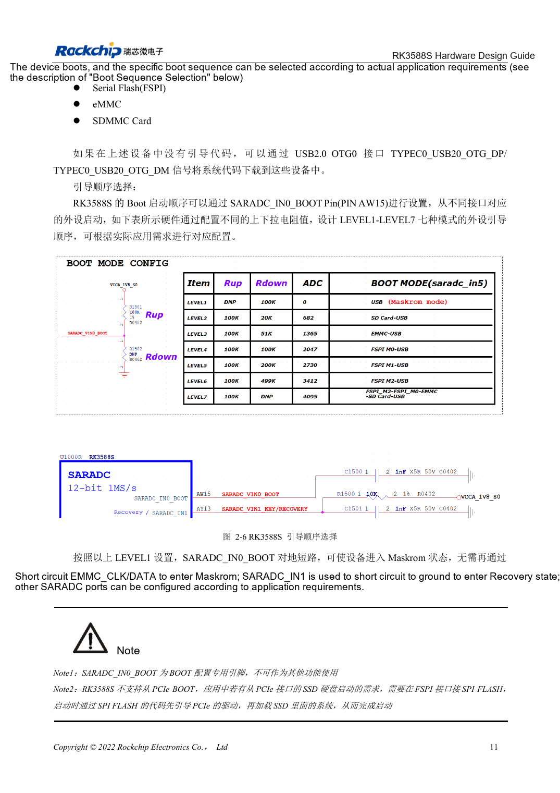
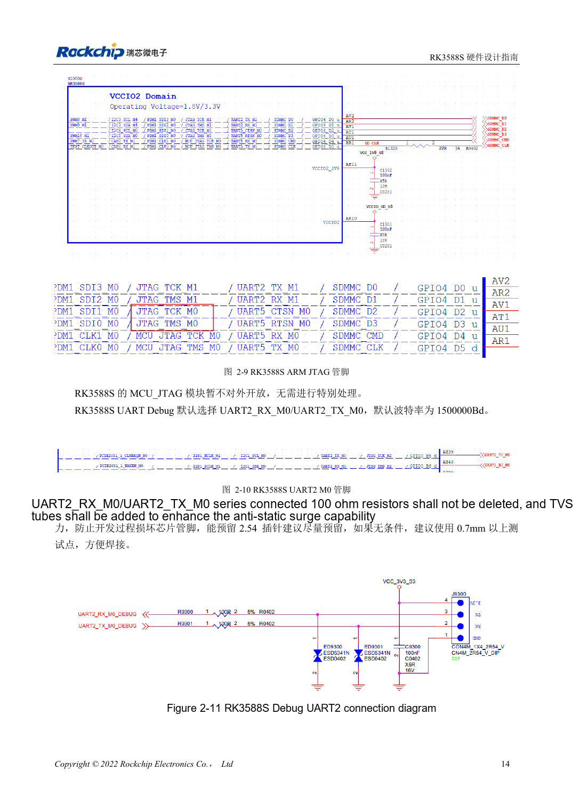

<!-- rk3588s-hardware-v12-20261109 -->

# RK3588S boot and recovery: Maskrom, JTAG and UART

Based on the Chinese RK3588S Hardware Design Guide V1.2 (2023-12-14) for circuit and PCB review. CM7S carriers must follow module interface definitions; Sige7S supports software and peripheral evaluation. SoC capabilities are not a board connector list. Verify SDK/BSP, kernel, board revision, firmware and multiplexing. Values are source references, not ArmSoM hardware measurements.

**RK3588S Hardware Design Guide V1.2 (2023-12-14), CN** · §2.1.4–2.1.6; §2.3.2

## Keep a usable recovery path

SARADC_IN0_BOOT at AW15 is dedicated to boot selection; LEVEL1 selects Maskrom. Retain USB2.0 OTG0 for downloads. Boot ROM does not start directly from a PCIe SSD: FSPI Flash code first initializes PCIe and then loads the SSD system. An OS on NVMe does not imply native ROM NVMe boot.

## Preserve debug and default pull-ups

SDMMC_DET must be stable before reset ends: low for SDMMC, high for ARM JTAG. Logging defaults to UART2_M0 at 1500000bps; retain RX/TX 100Ω resistors and TVS. The SARADC_IN1 10kΩ pull-up avoids an undefined recovery input. Module users must check connector pins and levels rather than using SoC ball positions.

## Design parameters and review table

| Item | Source reference |
| --- | --- |
| Boot pin | SARADC_IN0_BOOT / AW15 |
| Debug | UART2_M0 / 1500000bps |
| SDMMC_DET | 0: SDMMC; 1: ARM JTAG |
| Recovery pull-up | SARADC_IN1: 10kΩ |

## Source figures

No corresponding English design guide was found for this batch. All four editions use Chinese source screenshots with localized captions. Open an image for full resolution; the article text and parameter tables remain copyable. Page references are physical PDF pages.

Chinese original · PDF 26 · 2-6

Chinese original · PDF 29 · 2-10

## ArmSoM development path

CM7S supports custom carriers: first identify supplies, DDR and boot circuits already integrated in the module, then design outside its connectors. Sige7S provides a starting point for software and peripheral evaluation. For both products, verify exposed interfaces, pin assignments, levels, system images and cooling against the relevant revision. A chip reference schematic is not a product wiring diagram.

- [ArmSoM CM7S](https://www.armsom.org/cm7s) · [CM7S Docs](https://docs.armsom.org/armsom-cm7s)
- [ArmSoM Sige7S](https://www.armsom.org/sige7s) · [Sige7S Docs](https://docs.armsom.org/armsom-sige7s)

## Continue reading

- [RK3588S hardware design: 30 topics](/articles/rk3588s-hardware-design-series/)
- [RK3588S reset, watchdog and thermal protection](/articles/rk3588s-reset-watchdog-hardware/)
- [RK3588S rails: startup requirements and unused PHYs](/articles/rk3588s-power-rail-planning/)
