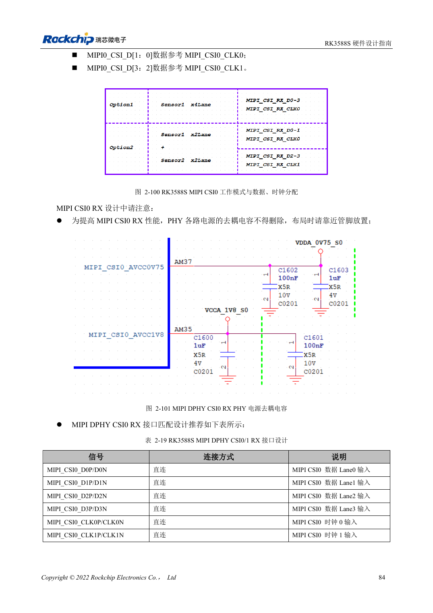
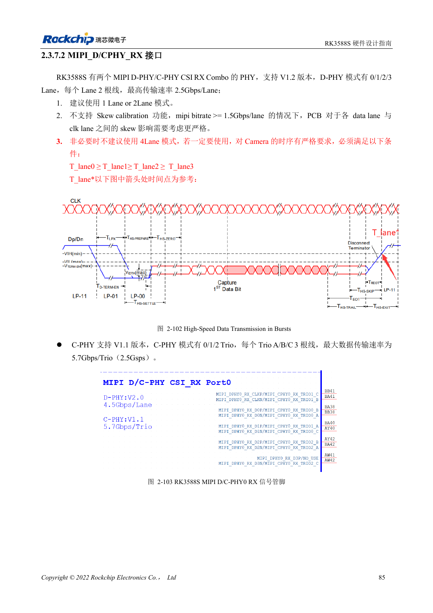

<!-- rk3588s-hardware-v12-20261109 -->

# RK3588S cameras: CSI, D/C PHY and CIF planning

Based on the Chinese RK3588S Hardware Design Guide V1.2 (2023-12-14) for circuit and PCB review. CM7S carriers must follow module interface definitions; Sige7S supports software and peripheral evaluation. SoC capabilities are not a board connector list. Verify SDK/BSP, kernel, board revision, firmware and multiplexing. Values are source references, not ArmSoM hardware measurements.

**RK3588S Hardware Design Guide V1.2 (2023-12-14), CN** · §2.3.7.1–2.3.7.3; §3.4.10; §3.4.22

## Plan dedicated and Combo PHYs separately

RK3588S has one dedicated DPHY RX supporting 1×4 or 2×2 lanes, plus two D/C Combo receivers. The dedicated DPHY reference rate is 2.5Gbps/lane. Combo DPHY mode lacks skew calibration and prefers one or two lanes. A four-lane design must satisfy T_lane0≥T_lane1≥T_lane2≥T_lane3; review timing particularly at ≥1.5Gbps/lane.

## CIF levels and system validation

CIF spans VCCIO5/VCCIO6; both supplies must agree with sensor IO, including I2C pull-ups. MIPI wiring does not establish BSP sensor support: drivers, device tree and ISP configuration are still required. Start with one stream, then validate the target multi-stream mode, sustained operation, dropped frames, clock stability and temperature.

## Design parameters and review table

| Item | Source reference |
| --- | --- |
| Dedicated DPHY RX source rate | 2.5Gbps/lane |
| DPHY target impedance | 100Ω ±10%; fallback 95Ω ±10% |
| DPHY pair / clock-data mismatch | <6mil / <12mil |

## Source figures

No corresponding English design guide was found for this batch. All four editions use Chinese source screenshots with localized captions. Open an image for full resolution; the article text and parameter tables remain copyable. Page references are physical PDF pages.

Chinese original · PDF 99 · 2-100

Chinese original · PDF 100 · 2-102

## ArmSoM development path

CM7S supports custom carriers: first identify supplies, DDR and boot circuits already integrated in the module, then design outside its connectors. Sige7S provides a starting point for software and peripheral evaluation. For both products, verify exposed interfaces, pin assignments, levels, system images and cooling against the relevant revision. A chip reference schematic is not a product wiring diagram.

- [ArmSoM CM7S](https://www.armsom.org/cm7s) · [CM7S Docs](https://docs.armsom.org/armsom-cm7s)
- [ArmSoM Sige7S](https://www.armsom.org/sige7s) · [Sige7S Docs](https://docs.armsom.org/armsom-sige7s)

## Continue reading

- [RK3588S hardware design: 30 topics](/articles/rk3588s-hardware-design-series/)
- [RK3588S PCIe: lanes, reference clocks and supplies](/articles/rk3588s-pcie-hardware-design/)
- [RK3588S versus RK3588S2: camera PHYs and compatibility](/articles/rk3588s-rk3588s2-hardware-differences/)
