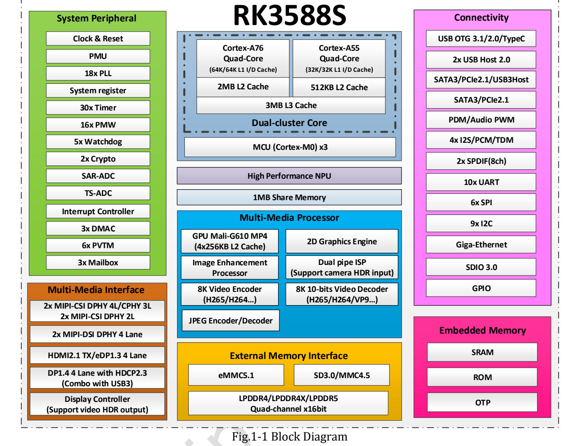

RK3588S brings application processing, graphics, neural-network inference, video codecs and camera processing into one SoC. ArmSoM offers two ways to build around it: a **Sige7S single-board computer** for application prototyping, or a **CM7S system-on-module** for a custom carrier.

## Separate the roles of CPU, GPU and NPU

Four Cortex-A76 cores and four Cortex-A55 cores provide general-purpose processing. A76 cores suit heavier application threads; A55 cores can handle background work, subject to the operating-system scheduler. V1.3 specifies 64KB instruction cache, 64KB data cache and 512KB L2 per A76; 32KB instruction cache, 32KB data cache and 128KB L2 per A55; and a shared 3MB L3.

The Mali-G610 MP4 handles graphics and supported compute workloads. The separate NPU is rated at up to 6 TOPS. This is neither application frame rate nor an LLM tokens-per-second figure. Model structure, precision, input size, operator support and data transfers affect actual results.

## Silicon capabilities at a glance

| Block | V1.3 capability | Check for your product |
|---|---|---|
| CPU | 4× Cortex-A76 + 4× Cortex-A55, Armv8-A | Image, cooling and operating frequency |
| GPU | Mali-G610 MP4; OpenGL ES 3.2, OpenCL 2.2, Vulkan 1.2 | Installed driver and exposed APIs |
| NPU | Up to 6 TOPS; INT4/INT8/INT16/FP16 mixed operations | Throughput at the selected precision and SDK support |
| Memory controller | LPDDR4/LPDDR4X/LPDDR5, 4×16-bit, up to 32GB address space | Memory actually fitted to the SKU |
| Decode | H.265/VP9 8K60; H.264 8K30; AV1 4K60 | Format, bit depth and concurrent bandwidth |
| Encode | H.264/H.265 up to 8K30 | Input format and complete encoding path |
| ISP | Up to 48MP-class input | Sensor integration, lens and IQ tuning |

## Do not copy an RK3588 interface list onto RK3588S

Similar names do not guarantee identical expansion. V1.3 lists one Gigabit Ethernet controller and Combo PHY resources shared by PCIe 2.1, SATA and USB. These do not establish PCIe 3.0 x4, dual Ethernet or simultaneous availability of every multiplexed interface.

Likewise, silicon support for LPDDR5 does not mean CM7S or Sige7S is populated with LPDDR5: their product documentation lists LPDDR4/LPDDR4X configurations. Use the actual SKU, hardware revision and schematic for purchasing and design.

## What can you build with RK3588S?

RK3588S can combine capture, processing, inference and display on one platform. These eight scenarios are proposed development directions based on silicon capabilities and board formats, not completed customer projects or benchmarks. Evaluate interfaces, software support and sustained load together.

### 1. Machine vision and industrial inspection

A camera captures parts or packaging; image processing resizes and converts the input; an adapted NPU model detects or classifies objects; and the CPU passes results to the application system. Local processing can reduce the need to upload every frame.

Start with Sige7S and a validated USB camera. Consider a CM7S carrier for dedicated cameras, triggers or enclosure requirements. Lighting, exposure, optics, calibration and false detections still require engineering. Deterministic triggering, isolated IO or control may need a separate controller.

### 2. Smart cameras and video analysis gateways

A retail, warehouse or site-monitoring pipeline can connect stream ingestion, hardware decoding, preprocessing, detection and event recording. Video engines and the NPU handle their respective workloads while the CPU manages rules, services and data.

Validate one complete stream on Sige7S before increasing load; CM7S can support a dedicated gateway design. Neither 8K decoding nor 6 TOPS determines the supported stream count. Test actual streams, models, network, memory and cooling, and plan recording capacity and write endurance.

### 3. Digital signage, kiosks and interactive displays

Wayfinding, meeting-room panels, ordering kiosks and exhibition installations combine video, web content and graphics. RK3588S provides GPU, decoding and display hardware for integrating playback, touch interaction and local application logic.

Use Sige7S for an external-display prototype or CM7S for a custom screen device. Validate multiple displays, touch, rotation and decoding in the selected image. A supported display standard does not guarantee every output combination at its maximum specification.

### 4. Robot perception and higher-level computing

RK3588S can handle visual recognition, UI, task planning or logs while a dedicated MCU/controller manages motor loops and emergency stopping. This separates compute-intensive work from deterministic control.

Sige7S suits bench testing of algorithms and communication; CM7S is an option when space, connector placement or power needs customization. Verify ARM64 dependencies, OS versions, camera drivers and the intended ROS packages. Booting Linux does not prove that a complete robotics stack is supported.

### 5. Local voice interaction and AI assistants

Meeting terminals, exhibition devices and offline interfaces may combine audio capture, recognition, text processing and speech synthesis. CPU and NPU resources can serve different stages, but models may require different software paths. Evaluate vision with RKNN-Toolkit2 and check RKNN-LLM support separately for language models.

Validate an entire interaction on Sige7S before choosing memory capacity or a custom CM7S design. Measure initial response time, sustained generation, context length, peak memory and microphone performance. No specific model size or tokens/s is promised here.

### 6. ARM Linux workstations and teaching platforms

Eight CPU cores, graphics and configurable memory make RK3588S a candidate for ARM Linux desktop evaluation, software development, container services and embedded courses. GPIO, video and model-deployment exercises can connect software concepts with hardware.

Sige7S offers an assembled starting point for a monitor, keyboard and network. Experience depends on the image, desktop, drivers and storage; x86-only software does not run natively merely because Linux is installed. CM7S is more relevant to a later custom-product design stage.

### 7. Home media services and lightweight storage

RK3588S can provide compute for media management, file services and application containers. The CPU runs services, and compatible software can use video acceleration. Transcoding depends on the framework, drivers and exact input/output formats.

Prototype basic services on Sige7S; consider a CM7S carrier for specialized storage connections or an enclosure. Check network bandwidth, drive connectivity, power, backups and cooling. Do not present RK3588S as inherently providing a multi-drive SATA or PCIe 3.0 NAS platform; verify multiplexed resources against schematics.

### 8. Industrial HMI, monitoring and protocol gateways

Machine interfaces display status, record data, provide network management and communicate with controllers. RK3588S can handle these higher-level functions alongside a graphical UI and remote maintenance.

Sige7S helps validate the UI and communication flow. A CM7S carrier can add suitable transceivers, isolation and connectors. Fieldbus electrical requirements, EMC, operating temperature and long-term stability need system validation; an SoC controller list alone does not establish industrial suitability.

### Choose a board around the application

| Stage or constraint | Route to evaluate | First validation |
|---|---|---|
| Reach a working application quickly | Sige7S | Complete input-to-output flow and peripherals |
| Fixed enclosure or connector requirements | CM7S + custom carrier | Pins, power, mechanics and signal integrity |
| Software first, custom carrier later | CM7S + CM7S-IO | Software versions and a baseline on the matching carrier |
| Concurrent AI, video and UI | Validate either route | End-to-end latency, memory bandwidth, temperature and sustained performance |

Start with the smallest working pipeline, then increase camera count, model complexity and display load. Application format and measured results should drive the ArmSoM platform choice, rather than CPU core count or TOPS alone.

## Turn the capability into a product

Start with Sige7S when validating software and peripherals on an assembled board. Consider CM7S when enclosure, connector placement and application-specific interfaces drive the design. Shared silicon does not make board images, device trees or accessories interchangeable.

The specifications here are sourced figures, not measurements made by ArmSoM for this article. Record the board revision, image, kernel and SDK before testing functions and sustained workloads.

## Further reading and product resources

- [CM7S or Sige7S? Choosing an RK3588S development platform](/articles/cm7s-sige7s-rk3588s-selection/)
- [RK3588S edge AI and multimedia: planning a product with CM7S or Sige7S](/articles/rk3588s-edge-ai-multimedia/)
- [RK3588S Datasheet V1.3: download, block diagram and hardware reading guide](/articles/rk3588s-datasheet-v13/)

### Products and development resources

- [CM7S](https://www.armsom.org/cm7s) · [CM7S Docs](https://docs.armsom.org/armsom-cm7s)
- [Sige7S](https://www.armsom.org/sige7s) · [Sige7S Docs](https://docs.armsom.org/armsom-sige7s)
- [Rockchip RKNN-Toolkit2](https://github.com/airockchip/rknn-toolkit2) · [RKNN-LLM](https://github.com/airockchip/rknn-llm)
